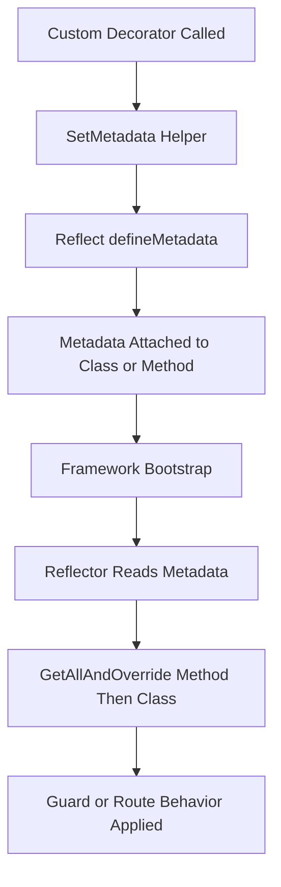

# Custom Decorators That Compose: Building Metadata Layers Without Duplication

## English

NestJS is driven by metadata. When you write `@Controller('users')` or `@Get(':id')`, the decorator does not do any work at that moment — it calls `Reflect.defineMetadata` to attach a key-value pair to the class or method, and later at bootstrap the framework walks the metadata and builds the routing table. Once you understand that, you can write your own decorators that attach your own metadata, and then read it back with `Reflector`. This is the mechanism behind `@Public()`, `@Roles()`, `@ApiOperation()`, and dozens of other patterns you have probably used without thinking about it.

A minimal example: you want to mark some routes as requiring an API key. You write `export const RequireApiKey = () => SetMetadata('requireApiKey', true)`. `SetMetadata` is a tiny helper exported by `@nestjs/common` that returns a decorator which calls `Reflect.defineMetadata` with the given key. Then in a guard you inject `Reflector` and call `this.reflector.getAllAndOverride<boolean>('requireApiKey', [context.getHandler(), context.getClass()])`. That call checks the method first, then the class, so a controller-level default can be overridden per-route. This two-level lookup is the standard pattern and it lets you write `@RequireApiKey()` once on the controller and opt out on specific routes with a different decorator.

The real power appears when you compose decorators. You can write a single decorator that applies several pieces of metadata at once — for example `@Authenticated({ roles: ['admin'], scopes: ['write'] })` which internally calls `applyDecorators(SetMetadata('roles', ...), SetMetadata('scopes', ...), ApiBearerAuth())`. `applyDecorators` from `@nestjs/common` takes multiple decorators and returns one that applies them all. Now your controllers read as a single line of intent instead of five stacked decorators, and the guard code reads the same metadata keys as before. This is how you build a shared vocabulary across a codebase: the decorators become the domain language, and the metadata keys become the contract between controllers and guards.

There is a subtlety with parameter decorators. `@Body()`, `@Param()`, `@Query()`, and `@Headers()` are parameter decorators that attach metadata to the method describing which argument index receives which piece of the request. You can write your own, for example `@CurrentUser()` that extracts `request.user` and injects it into a parameter. The implementation calls `createParamDecorator((data, ctx) => ctx.switchToHttp().getRequest().user)` and returns the resulting decorator. This is often cleaner than reading `req.user` in every handler, and it keeps the handler signature honest about what it depends on. The same pattern works for `@TenantId()`, `@RequestId()`, or any other value you attach to the request in middleware or a guard.

A word of caution about metadata inheritance. When a controller extends a base class, NestJS does inherit metadata through the prototype chain, and scope has nothing to do with it: a class-level `@UseGuards()` on the base class does fire for the subclass's own methods, and a method-level decorator on a base method still applies when the subclass inherits that method unchanged. The one case where metadata really is lost is when the subclass overrides the method — the override is a new function, and the parent's method-level metadata does not travel with it. That is why a base-class guard can appear to work for inherited routes and then silently stop firing once someone overrides one of them. The cleanest habit is to keep decorators on the concrete method rather than relying on inheritance, so that behaviour does not depend on whether a subclass later overrides it.

## 中文

NestJS 是由 metadata 驅動的。當你寫 `@Controller('users')` 或 `@Get(':id')` 時，decorator 在那一刻並沒有做任何工作 —— 它呼叫 `Reflect.defineMetadata` 把一組鍵值對附加到 class 或 method 上，之後在啟動時框架走訪 metadata 並建立路由表。一旦你明白這點，你就可以寫自己的 decorator 去附加自己的 metadata，然後用 `Reflector` 讀回來。這正是 `@Public()`、`@Roles()`、`@ApiOperation()` 以及你很可能用過但沒細想的幾十種模式背後的機制。

一個最小例子：你想把某些路由標記為需要 API key。你寫 `export const RequireApiKey = () => SetMetadata('requireApiKey', true)`。`SetMetadata` 是 `@nestjs/common` 匯出的小工具，回傳一個 decorator，該 decorator 會用給定的鍵呼叫 `Reflect.defineMetadata`。然後在 guard 裡注入 `Reflector` 並呼叫 `this.reflector.getAllAndOverride<boolean>('requireApiKey', [context.getHandler(), context.getClass()])`。這個呼叫先檢查 method，再檢查 class，所以 controller 層級的預設值可以被逐路由覆寫。這種兩層查找是標準模式，讓你可以在 controller 上寫一次 `@RequireApiKey()`，並在特定路由用另一個 decorator 選擇退出。

真正的威力在於組合 decorator。你可以寫一個 decorator 一次套用多個 metadata —— 例如 `@Authenticated({ roles: ['admin'], scopes: ['write'] })`，內部呼叫 `applyDecorators(SetMetadata('roles', ...), SetMetadata('scopes', ...), ApiBearerAuth())`。`@nestjs/common` 的 `applyDecorators` 接收多個 decorator 並回傳一個套用它們全部的 decorator。現在你的 controller 讀起來是一行意圖，而不是五個疊起來的 decorator，而 guard 程式碼讀取的 metadata 鍵跟以前一樣。這正是你在整個 codebase 建立共用詞彙的方式：decorator 成為領域語言，而 metadata 鍵成為 controller 與 guard 之間的契約。

參數 decorator 有一個微妙之處。`@Body()`、`@Param()`、`@Query()` 和 `@Headers()` 是參數 decorator，它們在 method 上附加 metadata，描述哪個參數索引接收請求的哪一部分。你可以寫自己的，例如 `@CurrentUser()` 提取 `request.user` 並注入到參數中。實作會呼叫 `createParamDecorator((data, ctx) => ctx.switchToHttp().getRequest().user)` 並回傳產生的 decorator。這通常比在每個 handler 裡讀 `req.user` 更乾淨，並讓 handler 的簽名誠實反映它依賴什麼。同樣的模式適用於 `@TenantId()`、`@RequestId()`，或任何你在 middleware 或 guard 中附加到請求上的值。

關於 metadata 繼承要小心。當 controller 繼承一個基底類別時，NestJS 其實會沿原型鏈繼承 metadata，而 scope 與這件事無關：基底類別上的類層級 `@UseGuards()` 對子類別自己的 method 同樣會觸發；method 層級的 decorator，在子類別原封不動繼承該 method 時也依然生效。真正會遺失 metadata 的唯一情況，是子類別覆寫了該 method —— 覆寫後是新函式，父類別的 method 層級 metadata 不會跟過去。這就是為何基底類別的 guard 對繼承而來的路由看似正常，卻在某天有人覆寫其中一個 method 後悄悄失效。最穩妥的習慣是把 decorator 放在具體 method 上，而不要依賴繼承，令行為不會因為子類別日後是否覆寫而改變。

## Key Takeaway

Custom decorators are just metadata writes — compose them with applyDecorators and read them with Reflector to turn repeated boilerplate into a shared domain vocabulary.

## Related Concepts
- SetMetadata and applyDecorators
- createParamDecorator and the ExecutionContext

## Diagram

