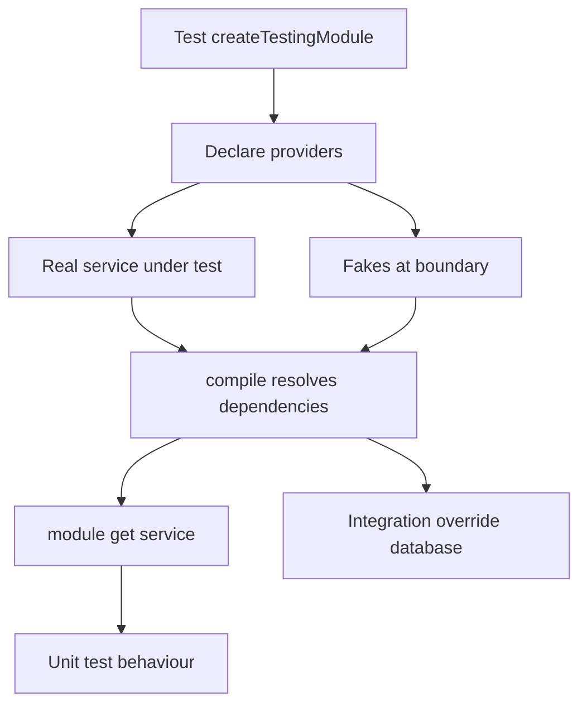

# Testing Strategy: Mocking the Container Without Mocking Yourself Into a Corner

## English

A NestJS unit test is not the same thing as a plain Jest test. The framework gives you `Test.createTestingModule()`, which builds a miniature dependency injection container for your test, and you decide which providers are real and which are replaced with fakes. The typical shape is `Test.createTestingModule({ providers: [UsersService, { provide: UsersRepository, useValue: mockRepo }] }).compile()`, then `module.get(UsersService)` to get the instance under test. The `compile()` step runs the same dependency resolution as production, which means if you forgot to provide something the service needs, the test fails at setup rather than with a confusing `undefined` later. That is a feature, not a nuisance.

The subtle trap is over-mocking. If you replace every dependency with a `useValue` object of hand-written stubs, your test is really testing your stubs, not your service. Every time the real repository changes its shape, the test still passes because the stub is frozen in time. A healthier pattern is to use real implementations for pure logic and mock only the boundary — the database, the HTTP client, the message queue. For a repository, that means an in-memory fake that implements the same interface but stores rows in a `Map`. For an HTTP client, that means injecting a `HttpService` and using something like `nock` or `msw` to intercept the actual network call. You get tests that fail when behaviour changes, which is the point.

Integration tests use the same `createTestingModule` but with fewer overrides. You import the real `AppModule` or a feature module and override only the database connection with a test container or an in-memory SQLite. `module.overrideProvider(DataSource).useValue(testDataSource)` is the pattern. This catches wiring mistakes that unit tests cannot: a missing `@Injectable()`, a provider that is not exported from its module, a circular dependency, a guard that is registered but never applied. These are the bugs that actually break production, and they are invisible to a test that mocks everything.

End-to-end tests go one step further: `createNestApplication()` on top of the testing module, then `app.init()`, then `supertest(app.getHttpServer()).get('/users').expect(200)`. This exercises the whole pipeline — middleware, guards, pipes, interceptors, exception filters, serialisation. It is slower, so you want a small number of them covering the critical paths, not one per handler. The pyramid still applies: many fast unit tests, fewer integration tests, a handful of end-to-end tests that assert the API contract your clients depend on.

One more thing worth knowing: `TestingModule` supports `overrideGuard`, `overrideInterceptor`, and `overridePipe` as well as `overrideProvider`. If your app has a global `AuthGuard` that reads a JWT, an end-to-end test can override it with a fake that always returns `true` and sets `request.user` to a fixture. This keeps the test focused on the endpoint's behaviour instead of the authentication machinery. The opposite is also useful: leave the guard real and use a signed test token to verify that the auth path actually works. Choose per test, and be explicit about which one you are testing.

## 中文

NestJS 的單元測試跟普通 Jest 測試不是同一回事。框架提供 `Test.createTestingModule()`，它為你的測試建立一個迷你依賴注入容器，由你決定哪些 provider 是真的、哪些換成假的。典型形狀是 `Test.createTestingModule({ providers: [UsersService, { provide: UsersRepository, useValue: mockRepo }] }).compile()`，然後 `module.get(UsersService)` 取得被測實例。`compile()` 步驟執行與生產環境相同的依賴解析，意思是如果你忘了提供 service 需要的東西，測試會在設定階段失敗，而不是之後出現令人困惑的 `undefined`。這是特性，不是麻煩。

微妙的陷阱是過度 mock。如果你把每個依賴都換成手寫 stub 的 `useValue` 物件，你的測試其實在測你的 stub，而不是你的 service。每次真實 repository 改變形狀，測試仍然通過，因為 stub 被凍結在時間裡。更健康的模式是對純邏輯使用真實實作，只 mock 邊界 —— 資料庫、HTTP 客戶端、訊息佇列。對 repository 而言，那意味著一個實作相同介面但把資料列存在 `Map` 裡的記憶體假物件。對 HTTP 客戶端而言，那意味著注入 `HttpService` 並用 `nock` 或 `msw` 之類攔截真正的網路呼叫。你會得到行為改變時會失敗的測試，這才是重點。

整合測試用同一個 `createTestingModule` 但更少覆寫。你匯入真正的 `AppModule` 或功能模組，只把資料庫連線覆寫成測試容器或記憶體 SQLite。`module.overrideProvider(DataSource).useValue(testDataSource)` 就是這個模式。這能抓到單元測試抓不到的接線錯誤：缺少 `@Injectable()`、provider 沒有從模組匯出、循環依賴、guard 註冊了卻從未套用。這些正是真正弄壞生產環境的 bug，而它們對 mock 一切的測試是隱形的。

端對端測試再進一步：在測試模組之上 `createNestApplication()`，然後 `app.init()`，然後 `supertest(app.getHttpServer()).get('/users').expect(200)`。這會演練整條管線 —— middleware、guard、pipe、interceptor、exception filter、序列化。它比較慢，所以你要少量覆蓋關鍵路徑，而不是每個 handler 一個。金字塔仍然適用：很多快速的單元測試、較少的整合測試、少數斷言客戶端依賴的 API 契約的端對端測試。

還有一點值得知道：`TestingModule` 除了 `overrideProvider` 之外，也支援 `overrideGuard`、`overrideInterceptor` 和 `overridePipe`。如果你的應用有讀取 JWT 的全域 `AuthGuard`，端對端測試可以用一個永遠回傳 `true` 並把 `request.user` 設為 fixture 的假 guard 覆寫它。這讓測試聚焦在端點行為而不是認證機制。反過來也有用：讓 guard 保持真實，用簽署過的測試 token 驗證認證路徑確實可行。逐測試選擇，並明確說出你在測哪一個。

## Key Takeaway

Use the testing module to build a real container with only boundary dependencies faked — over-mocking hides wiring bugs, while targeted overrides on guards, pipes and interceptors keep tests honest and fast.

## Related Concepts
- Test.createTestingModule and overrideProvider
- supertest and createNestApplication for e2e

## Diagram

