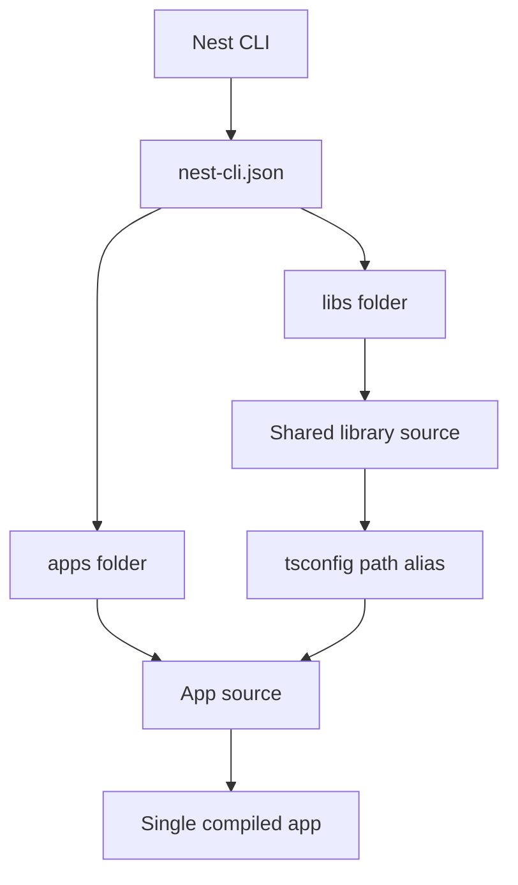

# Monorepos and Shared Libraries: One Repo, Many Apps

## English

A common point of confusion is that NestJS modules and NestJS libraries are not the same thing. Modules are runtime wiring inside one compiled application; libraries are workspace-level source organisation. The Nest CLI can generate a monorepo layout with `nest generate app` and `nest generate library`, producing a `nest-cli.json` file that describes several projects sharing one `node_modules` and one TypeScript configuration. In the default monorepo mode, projects live under `apps/` and `libs/`, and a library is consumed by importing it through a path alias declared in `tsconfig.json` (for example `@app/common`) rather than through a relative `../../` path. This matters because relative imports across project boundaries break the moment you move a folder, and they also make it impossible to tell at a glance whether a file belongs to the app or to shared code.

The key mental model is that a library is not a package published to npm; it is simply a folder of TypeScript source that gets compiled into whichever app imports it. There is no separate build step and no version negotiation. That makes refactoring cheap, but it also means a breaking change in a shared library immediately affects every app in the repo, so the discipline has to come from tests and review rather than from semver. A useful pattern is to keep libraries narrow and intention-revealing: a `logging` library, a `config` library, a `database` library, each exporting a module that apps import into their root module. If a library starts importing from an app, you have created an inverted dependency and should treat it as a design smell.

One subtlety is that a library that exports a NestJS module still needs its dependencies available at runtime in the consuming app. If the library's module injects a provider that is only registered in the app, the container will fail at bootstrap with an unresolved dependency error. The usual fix is to make the library module accept configuration through a static `forRoot`-style method, or to mark it `@Global()` if it is genuinely infrastructure that every app needs. Another subtlety is the difference between the monorepo's default mode and "standard mode": in standard mode each project has its own `package.json` and its own dependency tree, which is closer to a multi-package repository and is worth choosing deliberately if you expect projects to diverge in dependencies.

Build tooling also behaves differently. The CLI's default compiler can build a single project or all projects, and watch mode can be scoped to one app so that editing a shared library triggers a rebuild of only the apps that depend on it. If you find yourself adding a second app that duplicates 80% of the first, that is the signal to extract a library, not to copy the folder. Conversely, if two apps share almost nothing, forcing them into one repo buys you little and costs you coupling.

A practical rule of thumb: put code in a library the moment a second app needs it, and put it in the app the moment only one app needs it. Premature extraction creates libraries with a single consumer, which is just indirection with extra steps. The monorepo is a tool for managing change, not an architecture in itself.

## 中文

一個常見的混淆點是：NestJS 的 module 與 NestJS 的 library 並不是同一回事。Module 是單一已編譯應用程式內部的執行期接線；library 則是工作區層級的原始碼組織方式。Nest CLI 可以用 `nest generate app` 和 `nest generate library` 產生 monorepo 佈局，並生成一個 `nest-cli.json`，描述多個專案共用同一份 `node_modules` 與同一份 TypeScript 設定。在預設的 monorepo 模式下，專案放在 `apps/` 與 `libs/` 之下，而 library 是透過 `tsconfig.json` 宣告的路徑別名（例如 `@app/common`）來引用，而不是用 `../../` 這種相對路徑。這一點很重要，因為跨專案邊界的相對匯入在你搬動資料夾的那一刻就會斷掉，而且你也無法一眼看出某個檔案是屬於 app 還是共用程式碼。

關鍵的心智模型是：library 不是發佈到 npm 的套件，它只是一堆 TypeScript 原始碼的資料夾，會被編譯進任何匯入它的 app。沒有獨立的建置步驟，也沒有版本協商。這讓重構變得便宜，但也意味著共用 library 的一個破壞性變更會立刻影響 repo 裡的每一個 app，所以紀律必須來自測試與審查，而不是 semver。一個有用的模式是讓 library 保持狹窄且意圖明確：一個 `logging` library、一個 `config` library、一個 `database` library，每個都匯出一個 module 讓 app 匯入自己的根 module。如果某個 library 開始從 app 匯入東西，你就製造了反向依賴，應該把它當成設計上的壞味道。

有一個微妙之處：匯出 NestJS module 的 library，其依賴仍然必須在消費端的 app 執行期可用。如果 library 的 module 注入了一個只在 app 中註冊的 provider，容器會在啟動時因無法解析依賴而失敗。常見的解法是讓 library module 透過靜態的 `forRoot` 風格方法接受設定，或者若它確實是每個 app 都需要的基礎設施，就標記為 `@Global()`。另一個微妙之處是 monorepo 預設模式與「標準模式」的差別：在標準模式下，每個專案有自己的 `package.json` 與自己的依賴樹，這比較接近多套件 repo，若你預期各專案依賴會分歧，值得刻意選擇。

建置工具的行為也不同。CLI 的預設編譯器可以建置單一專案或所有專案，而 watch 模式可以限定在一個 app，讓編輯共用 library 時只觸發依賴它的 app 重新建置。如果你發現自己新增了第二個 app，卻複製了第一個 app 八成的內容，那就是抽出 library 的訊號，而不是複製資料夾。反過來說，如果兩個 app 幾乎不共用任何東西，硬把它們塞進同一個 repo 收益很小，卻要付出耦合的代價。

一個實用的經驗法則：當第二個 app 需要某段程式碼時，就把它放進 library；當只有一個 app 需要時，就留在 app 裡。過早抽出會產生只有單一消費者的 library，那只是多了幾層轉折的間接層。Monorepo 是管理變更的工具，本身不是架構。

## Key Takeaway

A NestJS library is shared source compiled into each app, not a published package, so extract code only when a second app actually needs it.

## Related Concepts
- TypeScript path aliases
- Nest CLI monorepo mode

## Diagram

