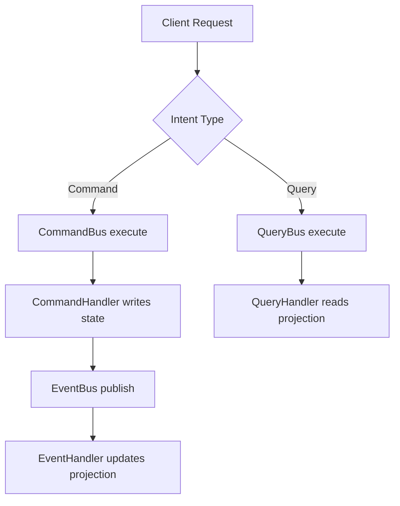

# CQRS and Event Sourcing: Separating Writes from Reads

## English

Most NestJS apps start with a service that both writes and reads the same entity, and for a long time that is fine. CQRS (Command Query Responsibility Segregation) is the idea that the model used to change state and the model used to read state do not have to be the same model. NestJS ships a `@nestjs/cqrs` package that gives you three building blocks: commands (intentions to change state), queries (requests for data), and events (facts that something happened). Each is a plain class, and each has a handler class decorated with `@CommandHandler`, `@QueryHandler` or `@EventHandler`. The `CommandBus`, `QueryBus` and `EventBus` are providers you inject, and calling `execute` or `publish` dispatches to the matching handler by class identity.

The reason to bother is not fashion; it is that write models and read models have different pressures. A write model wants invariants, transactions and validation. A read model wants denormalised, fast, shaped-for-the-screen data. When you force both through one service, every read optimisation risks breaking a write invariant, and every new write rule risks slowing a read. Splitting them lets you, for example, keep an `Order` aggregate strict about state transitions while serving a dashboard from a flat projection table that is rebuilt from events. The cost is more classes and more indirection, so the pattern earns its keep in domains with real complexity, not in a CRUD admin panel.

Event sourcing goes one step further: instead of storing current state, you store the ordered list of events that produced it, and current state is a fold over that list. This gives you a free audit log and the ability to rebuild any projection by replaying events. It also makes some things harder. You cannot simply `UPDATE` a row to fix a mistake; you must append a compensating event. Queries against the event store are awkward, which is why event sourcing almost always pairs with CQRS and separate read projections. Schema evolution is a real concern: an event written two years ago must still be readable, so events should be treated as immutable contracts and versioned carefully.

A pragmatic middle path is to use CQRS without event sourcing. Commands and queries are separated in code, events are published in-process through the `EventBus` for side effects like sending email or updating a search index, but the database still stores current state in ordinary tables. This gets you most of the decoupling benefit with far less operational risk. If you later need an audit trail, you can add an event log table alongside the state tables rather than replacing them.

One warning worth internalising: events published in-process are not durable. If the process crashes after the command commits but before the handler runs, the side effect is lost. For anything that must not be lost, you need an outbox table written in the same transaction as the state change, plus a relay that publishes from the outbox. That is the honest boundary between "nice decoupling" and "distributed systems", and it is worth crossing deliberately rather than by accident.

## 中文

大多數 NestJS 應用一開始都有一個 service，同時負責寫入與讀取同一個實體，很長一段時間這都沒問題。CQRS（Command Query Responsibility Segregation，命令與查詢職責分離）的核心想法是：用來改變狀態的模型，與用來讀取狀態的模型，不必是同一個模型。NestJS 提供了 `@nestjs/cqrs` 套件，給你三個積木：command（改變狀態的意圖）、query（索取資料的請求）、event（某件事已發生的事實）。每個都是普通的 class，每個都有一個用 `@CommandHandler`、`@QueryHandler` 或 `@EventHandler` 裝飾的 handler class。`CommandBus`、`QueryBus` 與 `EventBus` 是你注入的 provider，呼叫 `execute` 或 `publish` 時，會依 class 身分派發給對應的 handler。

值得這麼做的理由不是時髦，而是寫入模型與讀取模型承受的壓力不同。寫入模型要的是不變量、交易與驗證；讀取模型要的是反正規化、快速、為畫面量身打造的資料。當你硬把兩者塞進同一個 service，每一次讀取優化都可能破壞寫入不變量，每一條新的寫入規則都可能拖慢讀取。拆開之後，你可以讓 `Order` 聚合嚴格管控狀態轉移，同時用一張由事件重建的扁平投影表來服務儀表板。代價是更多 class 與更多間接層，所以這個模式在真正複雜的領域才划算，在 CRUD 後台管理面板則不然。

Event sourcing 再進一步：與其儲存當前狀態，你儲存產生當前狀態的有序事件清單，而當前狀態就是對這份清單做 fold（摺疊）。這免費給你一份稽核紀錄，也讓你能重播事件來重建任何投影。但它也讓某些事情變難。你不能單純 `UPDATE` 一列來修正錯誤，你必須附加一個補償事件。對事件儲存做查詢很彆扭，這就是為什麼 event sourcing 幾乎總是搭配 CQRS 與獨立的讀取投影。Schema 演進是真實的顧慮：兩年前寫下的事件今天仍必須可讀，所以事件應被視為不可變的契約並謹慎版本化。

一條務實的中間路線是只用 CQRS 而不用 event sourcing。Command 與 query 在程式碼中分離，事件透過 `EventBus` 在行程內發佈以處理副作用（例如寄信或更新搜尋索引），但資料庫仍用普通資料表儲存當前狀態。這能得到大部分解耦的好處，營運風險卻低得多。日後若需要稽核軌跡，你可以加一張事件紀錄表與狀態表並存，而不是取代它。

一個值得內化的警告：行程內發佈的事件並不持久。如果行程在 command 提交之後、handler 執行之前崩潰，副作用就丟了。對於任何絕不能遺失的東西，你需要一張與狀態變更寫在同一個交易裡的 outbox 表，再加上一個從 outbox 發佈的 relay。這就是「不錯的解耦」與「分散式系統」之間誠實的界線，值得刻意跨越，而不是不小心跨過去。

## Key Takeaway

CQRS separates write and read models so each can evolve independently, but in-process events are not durable, so use an outbox when side effects must not be lost.

## Related Concepts
- Event sourcing
- Transactional outbox pattern

## Diagram

