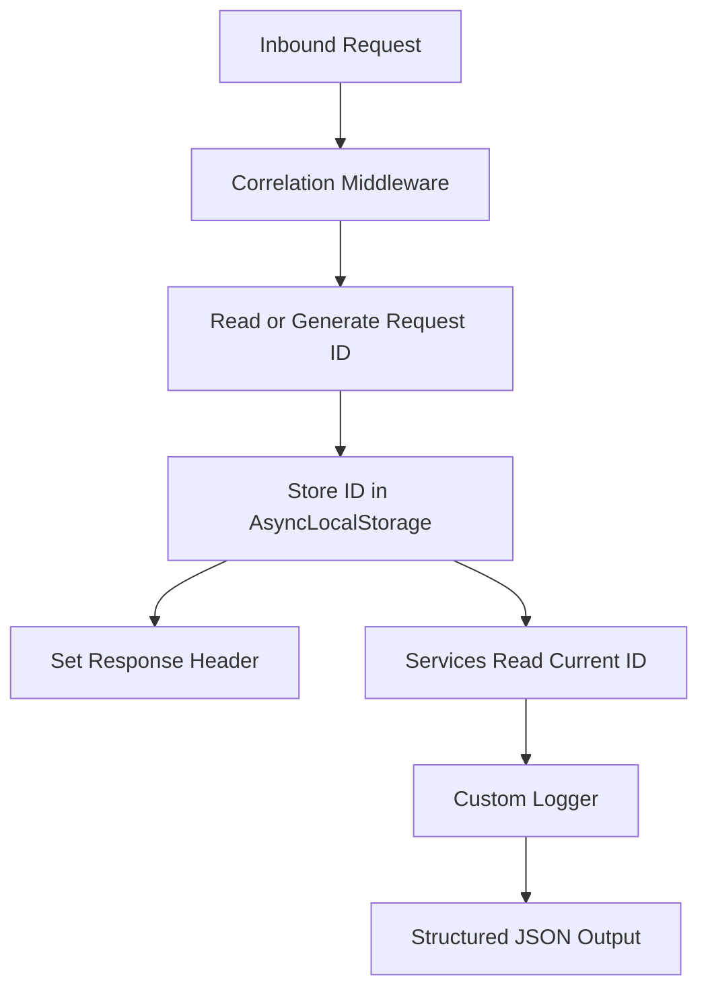

# Logging, Correlation IDs and Structured Output

## English

The built-in `Logger` in NestJS is more useful than it looks. It is a provider available by injection, it supports log levels, and it can be replaced globally at bootstrap by passing a custom logger instance to `NestFactory.create`. That last point is the hook most teams miss: instead of sprinkling `console.log` through services, you configure one logger and every `Logger` instance in the app routes through it. A typical production setup wraps a structured logger such as Pino or Winston, emits JSON lines rather than human prose, and lets your log aggregator index fields like `level`, `context` and `timestamp`.

The `context` argument is the second argument to `Logger` methods and is usually set to the class name, which is why you see `new Logger(OrdersService.name)` at the top of services. This gives you a cheap, consistent dimension to filter on. If you pass the class name rather than a hardcoded string, renaming the class updates the logs automatically, which matters more than it sounds when you are grepping through months of output at 2 a.m.

Correlation IDs are the piece that turns a pile of log lines into a story. The idea is that every inbound request gets a unique identifier, that identifier is attached to every log line emitted while handling it, and it is propagated to downstream calls in a header. NestJS does not do this for you, but the pieces are simple: a middleware that reads an incoming `x-request-id` header or generates one with `randomUUID`, stores it on the request object, and sets it on the response header. To make it available deep in the call stack without threading it through every function signature, use `AsyncLocalStorage` from Node's `async_hooks` module. The store follows the async context of the request, so any service can read the current ID without knowing about HTTP at all.

Structured logging has a cost that is easy to underestimate: volume. A single request can produce dozens of lines, and at scale that is real money in storage and real latency in queries. The discipline is to log at boundaries and at decisions, not at every function entry. Log the request coming in, the outcome going out, the external call and its duration, and anything that surprised you. Skip the line that says "entering method". Levels help here: `debug` for detail you would only enable while investigating, `log` or `info` for normal business events, `warn` for recoverable oddities, `error` for things that need a human.

Finally, remember that logs are not metrics and not traces. Logs answer "what happened in this one case"; metrics answer "how often does this happen overall"; traces answer "where did the time go across services". They complement each other, and a correlation ID is the thread that stitches a log line to a trace. Wiring all three early is far cheaper than retrofitting them after an incident.

## 中文

NestJS 內建的 `Logger` 比它看起來有用得多。它是一個可注入的 provider，支援 log level，而且可以在啟動時把自訂 logger 實例傳給 `NestFactory.create` 來全域替換。最後這一點是大多數團隊漏掉的鉤子：與其在各個 service 裡散落 `console.log`，你設定一個 logger，應用中每個 `Logger` 實例都經由它輸出。典型的正式環境設定會包裝 Pino 或 Winston 這類結構化 logger，輸出 JSON 行而不是人類散文，並讓你的日誌聚合器能索引 `level`、`context`、`timestamp` 等欄位。

`context` 參數是 `Logger` 方法的第二個參數，通常設為 class 名稱，這就是為什麼你會看到 service 開頭寫著 `new Logger(OrdersService.name)`。這給你一個便宜且一致、可用來過濾的維度。如果你傳的是 class 名稱而不是硬編碼字串，重新命名 class 時日誌會自動更新——當你凌晨兩點在數個月的輸出裡 grep 時，這比聽起來重要得多。

Correlation ID 是把一堆日誌行變成一個故事的那塊拼圖。想法是：每個進來的請求得到一個唯一識別碼，該識別碼附加到處理期間發出的每一行日誌，並透過標頭傳播到下游呼叫。NestJS 不會幫你做這件事，但零件很簡單：一個 middleware 讀取進來的 `x-request-id` 標頭，或用 `randomUUID` 生成一個，存到 request 物件上，並設到回應標頭。為了讓它能在呼叫堆疊深處使用，而不必穿過每個函式簽名，請用 Node `async_hooks` 模組的 `AsyncLocalStorage`。這個 store 會跟隨請求的非同步上下文，所以任何 service 都能讀到當前 ID，完全不必知道 HTTP 的存在。

結構化日誌有一個容易被低估的成本：量。一個請求可能產生數十行，規模一大就是實實在在的儲存費用與查詢延遲。紀律是在邊界與決策點記錄，而不是在每個函式入口記錄。記錄進來的請求、出去的結果、外部呼叫與其耗時，以及任何讓你意外的事。省掉那行「進入方法」。Level 在這裡有幫助：`debug` 用於只在調查時才開啟的細節，`log` 或 `info` 用於正常業務事件，`warn` 用於可復原的異常，`error` 用於需要人處理的事。

最後，記住日誌不是指標，也不是追蹤。日誌回答「這一個案例發生了什麼」；指標回答「整體上這件事多常發生」；追蹤回答「時間花在跨服務的哪裡」。它們互補，而 correlation ID 是把日誌行縫合到追蹤的那條線。及早把三者接好，遠比事故後補救便宜。

## Key Takeaway

Replace the default logger with a structured one at bootstrap and propagate a correlation ID via AsyncLocalStorage so every log line can be traced back to one request.

## Related Concepts
- AsyncLocalStorage
- Structured logging with Pino

## Diagram

