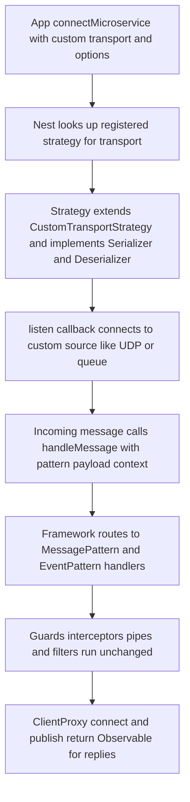

# Custom Transport Strategies: Teaching NestJS a New Way to Talk

## English

NestJS's microservice layer is built on a transport abstraction: the `Transport` enum names built-ins like TCP, Redis, NATS, MQTT, RabbitMQ and gRPC, and each of those is implemented by a strategy class that extends `Server` (for the receiving side) and `ClientProxy` (for the sending side). The key insight is that the framework never hard-codes a broker. When you call `app.connectMicroservice({ transport: Transport.REDIS, options: {...} })`, Nest looks up a registered strategy for that transport, instantiates it with your options, and hands it the message handlers discovered from your `@MessagePattern()` and `@EventPattern()` decorated methods. Everything above that seam — guards, interceptors, pipes, exception filters — behaves identically no matter what wire protocol is underneath, because the strategy converts incoming bytes into a `{ pattern, data, context }` shape the framework already understands.

That seam is public, which means you can write your own. You implement a class extending `CustomTransportStrategy` (usually also implementing `Deserializer` and `Serializer`), define a `listen(callback)` method that connects to whatever you like — a WebSocket feed, a message queue Nest doesn't ship support for, an in-process event emitter, a hardware bus — and inside it call `this.handleMessage(pattern, payload, context)` whenever a message arrives. `handleMessage` is inherited from the base server class and does the routing into your controllers. On the client side you extend `ClientProxy` and implement `connect()` plus `publish()` (or `dispatchEvent()` for events), returning an Observable so callers can still `await lastValueFrom(...)` or subscribe.

A concrete use case: a lecture-hall clicker system where hundreds of tiny UDP packets arrive per second. Instead of forcing them through HTTP, you write a `UdpStrategy` that opens a `dgram` socket in `listen()`, parses each packet into a pattern like `clicker:answer`, and calls `handleMessage`. Your controllers then look exactly like ordinary NestJS message handlers, and you can still apply a validation pipe or a logging interceptor to them. The transport is a detail; the application code is unchanged.

The trade-offs are real. Custom strategies are not covered by Nest's own integration tests, so you own the reconnect logic, the backpressure behaviour, and the error semantics when a message fails. `handleMessage` expects you to respect the framework's contract — if you swallow errors or forget to call the callback, `listen()` never resolves and the app hangs on startup. And because the strategy runs inside the same process as your handlers, a synchronous CPU-heavy parser will block the event loop for every other message; you need to keep parsing cheap or push heavy work onto a queue.

A good rule of thumb: reach for a custom transport only when the protocol genuinely has semantics the built-in transports can't express (fire-and-forget UDP, a proprietary bus, an in-process test harness). If you merely want a different serialisation of the same request/response shape, a custom `Serializer`/`Deserializer` on an existing transport is almost always less code and less risk. The abstraction exists so that the wire is swappable; use it for that, not as a general escape hatch.

## 中文

NestJS 的微服務層建立在一層「傳輸抽象」（transport abstraction）之上：`Transport` 這個 enum 列出 TCP、Redis、NATS、MQTT、RabbitMQ、gRPC 等內建選項，而每一個選項背後都由一個策略類別（strategy class）實作，接收端繼承 `Server`，發送端繼承 `ClientProxy`。關鍵洞見是：框架從來沒有把某個 broker 寫死。當你呼叫 `app.connectMicroservice({ transport: Transport.REDIS, options: {...} })`，Nest 會依這個 transport 找到已註冊的策略、用你給的 options 實例化它，然後把從 `@MessagePattern()` 與 `@EventPattern()` 裝飾方法掃描出來的消息處理器交給它。在這條接縫之上——守衛、攔截器、管道、例外過濾器——行為完全一致，不論底層是什麼線路協議，因為策略會把進來的位元組轉成框架早已理解的 `{ pattern, data, context }` 形狀。

這條接縫是公開的，意思是你可以自己寫一個。你實作一個繼承 `CustomTransportStrategy` 的類別（通常同時實作 `Deserializer` 與 `Serializer`），定義 `listen(callback)` 方法去連接任何你想要的東西——WebSocket 串流、Nest 未支援的訊息佇列、行程內的事件發射器、硬體匯流排——並在裡面於消息到達時呼叫 `this.handleMessage(pattern, payload, context)`。`handleMessage` 繼承自基礎 server 類別，負責把消息路由進你的 controller。客戶端則繼承 `ClientProxy`，實作 `connect()` 與 `publish()`（事件用 `dispatchEvent()`），回傳 Observable，讓呼叫方仍然可以 `await lastValueFrom(...)` 或訂閱。

一個具體場景：講堂按答器系統，每秒有數百個細小 UDP 封包湧入。與其硬把它們塞進 HTTP，你寫一個 `UdpStrategy`，在 `listen()` 裡開一個 `dgram` socket，把每個封包解析成 `clicker:answer` 這類 pattern，再呼叫 `handleMessage`。你的 controller 之後看起來就像普通的 NestJS 消息處理器，而且仍然可以套用驗證管道或日誌攔截器。傳輸只是細節，應用程式碼不變。

取捨是真實存在的。自訂策略不受 Nest 自家整合測試覆蓋，所以重連邏輯、背壓（backpressure）行為、消息失敗時的錯誤語意，全部由你負責。`handleMessage` 期望你遵守框架契約——若你吞掉錯誤或忘記呼叫 callback，`listen()` 永遠不會 resolve，應用程式會在啟動時卡住。而且策略與你的處理器跑在同一個行程裡，一個同步、CPU 密集的解析器會為其他所有消息阻塞事件迴圈；你要麼保持解析便宜，要麼把重活推到佇列上。

一個好用的判斷準則：只有當協議本身有內建傳輸無法表達的語意（fire-and-forget 的 UDP、專有匯流排、行程內測試替身），才值得自訂 transport。如果你只是想要同一種請求／回應形狀的不同序列化方式，在既有 transport 上換一個自訂 `Serializer`／`Deserializer` 幾乎總是更少程式碼、更低風險。這層抽象存在的目的是讓線路可替換；用它來做這件事，而不是當萬用逃生門。

## Key Takeaway

NestJS's transport abstraction lets you plug in an entirely new wire protocol by implementing a CustomTransportStrategy on the server side and a ClientProxy on the client side, while all guards, pipes and interceptors keep working unchanged.

## Related Concepts
- Transport strategies and message patterns
- ClientProxy and Observable-based messaging

## Diagram

