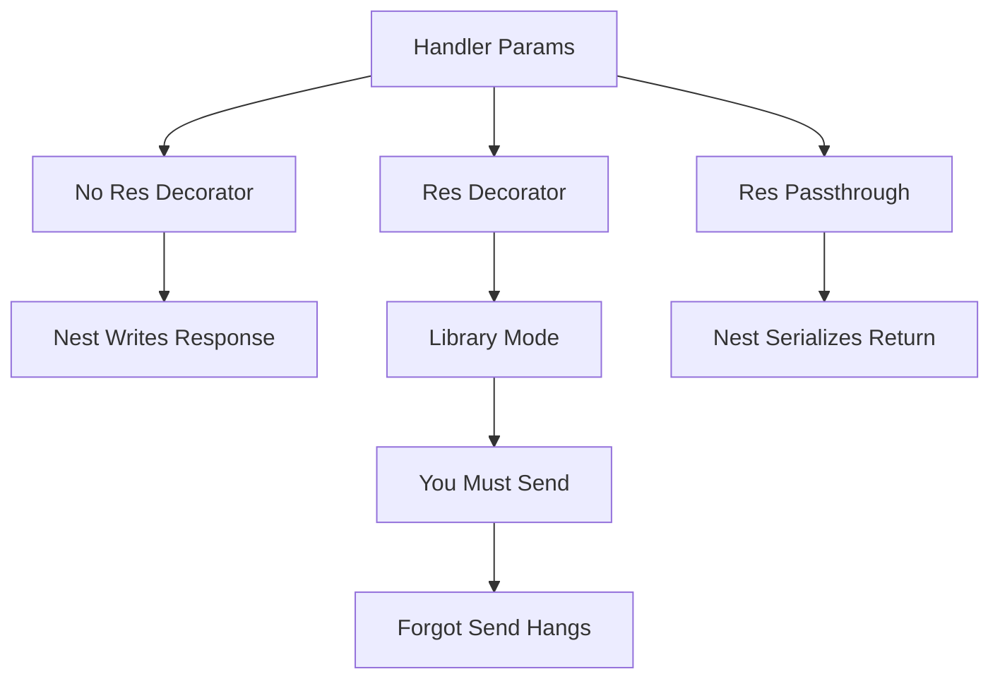

# Working With the Raw Request: @Req, @Res and When to Bypass the Framework

## English

NestJS gives you high-level decorators like `@Body()`, `@Query()` and `@Param()` that hide the underlying HTTP objects. But every so often you genuinely need the raw `Request` or `Response` — to set a custom header, stream a file, call `res.cookie()`, or hand off to a third-party middleware that expects Express signatures. Nest exposes these through `@Req()` and `@Res()` from `@nestjs/common`, which inject the platform-specific objects (Express's `req`/`res`, or Fastify's `request`/`reply`). The subtlety is that these are the adapter's objects, not Nest's: on Express you get `IncomingMessage`/`ServerResponse` extensions, on Fastify you get `FastifyRequest`/`FastifyReply`. Type them accordingly or you'll get confusing compile errors.

The critical rule is what happens when you inject `@Res()`. By default, Nest assumes it owns the response: it takes whatever your handler returns, runs it through interceptors and serialisation, and calls `res.json()` itself. The moment you add `@Res()` to a handler's parameters, Nest flips into "library mode" for that handler — it stops writing the response and expects you to do it. If you inject `@Res()` but forget to call `res.send()` or `res.json()`, the request hangs until it times out, which is one of the most common beginner bugs in NestJS. The escape hatch is `@Res({ passthrough: true })`: you get the raw object for headers or cookies, but Nest still handles the return value and serialisation. Prefer `passthrough` almost always.

A second layer of nuance is middleware and route ordering. Middleware registered via `configure(consumer)` in a module runs before guards, and it receives the raw `req`/`res` directly — this is where you'd attach something like `express-session` or a request-ID generator. But middleware is Express/Fastify-shaped, not Nest-shaped: it can't use dependency injection on the request object, and it doesn't know about your DTOs. If you find yourself wanting DI inside middleware, that's a signal you actually want a guard or interceptor instead. Interceptors can do most of what middleware does, with full DI and access to the execution context.

Streaming is the classic legitimate use of `@Res()`. If you want to pipe a file from disk, you inject `@Res()` and call `fs.createReadStream(path).pipe(res)`, or use `StreamableFile` from Nest, which lets you keep the framework's serialisation pipeline and still stream. The `StreamableFile` approach is preferable because it plays nicely with interceptors and error filters; raw `res.pipe()` bypasses them, so an error mid-stream won't produce a clean JSON error — the connection just dies. Similarly, Server-Sent Events (SSE) are typically done with `@Sse()` and an Observable, not by manually writing to `res`, because the framework handles the SSE headers and heartbeat.

A final caution: reaching for `@Req()`/`@Res()` is a coupling decision. Your handler now depends on Express or Fastify specifics, which breaks the platform-agnostic promise of NestJS and makes it harder to swap adapters or test with a mock. Before using them, ask whether the same outcome is achievable with a custom decorator (which can extract a value from the request without exposing the whole object), an interceptor (which can read and modify the request/response), or a `StreamableFile`. When you truly need the raw objects — for a legacy integration, a non-standard protocol handshake, or a library that insists on `res` — use them, but document why.

## 中文

NestJS 提供 `@Body()`、`@Query()`、`@Param()` 這類高階裝飾器，把底層 HTTP 物件隱藏起來。但偶爾你真的需要原始的 `Request` 或 `Response`——設定自訂標頭、串流檔案、呼叫 `res.cookie()`，或交給期待 Express 簽名的第三方中介軟體。Nest 透過 `@nestjs/common` 的 `@Req()` 與 `@Res()` 暴露這些，注入平臺特定的物件（Express 的 `req`／`res`，或 Fastify 的 `request`／`reply`）。微妙之處在於：這些是配接器的物件，不是 Nest 的物件——在 Express 上你拿到的是 `IncomingMessage`／`ServerResponse` 的擴充，在 Fastify 上則是 `FastifyRequest`／`FastifyReply`。型別要標對，否則會出現令人困惑的編譯錯誤。

關鍵規則是注入 `@Res()` 之後會發生什麼。預設情況下 Nest 假設它擁有回應：它拿你 handler 回傳的東西，經過攔截器與序列化，然後自己呼叫 `res.json()`。一旦你在 handler 引數加上 `@Res()`，Nest 對這個 handler 就切換成「函式庫模式」——它不再寫回應，並期待你自己寫。如果你注入了 `@Res()` 卻忘了呼叫 `res.send()` 或 `res.json()`，請求會一直掛著直到逾時，這是 NestJS 新手最常見的 bug 之一。逃生門是 `@Res({ passthrough: true })`：你拿到原始物件去設標頭或 cookie，但 Nest 仍然處理回傳值與序列化。幾乎所有情況都應該優先使用 `passthrough`。

第二層細節是中介軟體與路由順序。透過模組的 `configure(consumer)` 註冊的中介軟體在守衛之前執行，它直接收到原始 `req`／`res`——這是你掛 `express-session` 或請求 ID 產生器的地方。但中介軟體是 Express／Fastify 形狀，不是 Nest 形狀：它不能對請求物件做依賴注入，也不認識你的 DTO。如果你發現自己希望中介軟體裡有 DI，那其實是訊號：你真正想要的是守衛或攔截器。攔截器能做到中介軟體大部分的事，而且有完整 DI 與執行上下文存取權。

串流是 `@Res()` 經典的正當用途。想從磁碟 pipe 一個檔案，你注入 `@Res()` 然後 `fs.createReadStream(path).pipe(res)`，或者用 Nest 的 `StreamableFile`，後者讓你保留框架的序列化管線又能串流。`StreamableFile` 較可取，因為它與攔截器、錯誤過濾器配合良好；直接 `res.pipe()` 會繞過它們，串流中途出錯不會產生乾淨的 JSON 錯誤——連線就是斷掉。同樣地，Server-Sent Events（SSE）通常用 `@Sse()` 加 Observable，而不是手動寫 `res`，因為框架會處理 SSE 標頭與心跳。

最後一個警告：動用 `@Req()`／`@Res()` 是一個耦合決策。你的 handler 從此依賴 Express 或 Fastify 的細節，破壞了 NestJS 平臺無關的承諾，也讓替換配接器或用 mock 測試變難。使用前先問：同樣的結果能不能用自訂裝飾器（只從請求取出某個值而不暴露整個物件）、攔截器（可讀寫請求／回應），或 `StreamableFile` 達成？當你真的需要原始物件——為了舊系統整合、非標準協議握手，或某個堅持要 `res` 的函式庫——就用吧，但把原因寫下來。

## Key Takeaway

Injecting @Res() hands response ownership to your handler (unless you use passthrough: true), so reach for raw request/response objects only when a decorator, interceptor or StreamableFile genuinely cannot do the job.

## Related Concepts
- StreamableFile and response streaming
- Custom parameter decorators

## Diagram

