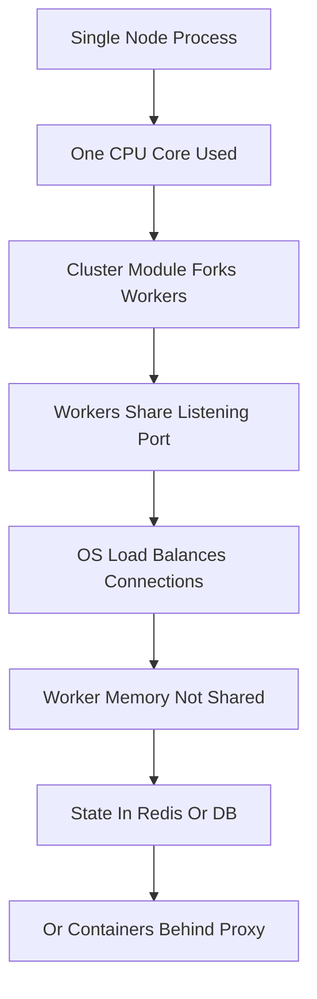

# Scaling Out: Clustering, Workers and the Multi-Core Reality of Node

## English

Node.js runs your JavaScript on a single thread. NestJS inherits that constraint: no matter how many modules, guards or providers you write, one process uses one CPU core for application code. On a modern server with 8, 16 or 32 cores, a single NestJS process leaves most of the machine idle. The standard fix is the `cluster` module, which forks N worker processes that all share the same listening port; the operating system load-balances incoming connections across them. NestJS does not ship a clustering helper of its own — there is no `ClusterModule` in `@nestjs/core` — so you wire the Node.js `cluster` module in yourself: check `cluster.isPrimary` in the bootstrap file, fork one worker per CPU core, and call `NestFactory.create()` inside each worker. A common pattern is to have worker 0 run background jobs while all workers serve HTTP, or to have every worker bootstrap the full app. In production most teams skip hand-rolled forking and let a process manager such as PM2 handle the cluster mode instead.

There are real caveats. Cluster workers do not share memory: each one has its own module instances, its own in-memory caches, its own singleton providers. If you cache a user object in a provider's field, worker 3 won't see what worker 1 cached. That's why anything stateful — sessions, rate-limit counters, job queues, WebSocket rooms — must live outside the process, in Redis, a database, or a dedicated service. Sticky sessions matter for WebSockets and long-polling: without them, a client that connects to worker 2 and then reconnects may land on worker 5, losing its socket state unless you back it with a shared pub/sub layer. The `@nestjs/websockets` adapter does not solve this for you; you either use sticky routing at the load balancer or a Redis adapter.

An alternative to `cluster` is running multiple independent containers behind a reverse proxy like Nginx or a cloud load balancer. This is often preferable in containerised environments because the orchestrator (Kubernetes, ECS) already handles health checks, restarts and rolling deploys, and each container is a clean unit. The trade-off is that you lose the shared-port convenience of `cluster` and gain a dependency on the proxy. For a small deployment, `cluster` inside one container is simpler; for anything serious, separate processes behind a load balancer is the norm.

A second scaling axis is moving work off the request path entirely. If a route takes 300ms because it does image resizing or PDF generation, clustering multiplies the CPU but doesn't make the route faster — it just lets more requests hit the same slow code. The better move is to enqueue the work (BullMQ, RabbitMQ, SQS) and let a pool of worker processes consume it, while the HTTP handler returns a job ID immediately. NestJS supports this cleanly with `@nestjs/bullmq` and a separate `WorkerHost` class, or with a standalone application (`NestFactory.createApplicationContext`) that has no HTTP server at all and just consumes jobs. That standalone pattern is the cleanest way to scale background processing independently of web traffic.

A final practical point: measure before you scale. A NestJS app that is slow because of an N+1 database query will not get faster with 16 workers — it will just hammer the database 16 times harder. Use the Node `--prof` flag or a profiler to find the actual bottleneck; if the CPU is idle and latency is high, the problem is I/O, not cores. If the CPU is pegged, clustering helps, but moving work off-process helps more. The general principle is: scale horizontally only after you've established that the process is the constraint.

## 中文

Node.js 把你的 JavaScript 跑在單一執行緒上。NestJS 繼承這個限制：無論你寫了多少模組、守衛或 provider，一個行程的應用程式碼只用一顆 CPU 核心。在 8、16、32 核心的現代伺服器上，單一 NestJS 行程讓機器大部分閒著。標準解法是 `cluster` 模組，它 fork 出 N 個 worker 行程共用同一個監聽埠；作業系統把進來的連線負載平衡到它們之間。NestJS 本身並無提供 clustering 輔助工具——`@nestjs/core` 裡沒有 `ClusterModule`——所以你要自己接上 Node.js 的 `cluster` 模組：在 bootstrap 檔檢查 `cluster.isPrimary`，依 CPU 核心數 fork 出 worker，並在每個 worker 內呼叫 `NestFactory.create()`。常見模式是 worker 0 跑背景任務、其他 worker 服務 HTTP，或每個 worker 都啟動完整應用程式。在正式環境裡，多數團隊會跳過手動 fork，改由像 PM2 這類行程管理器處理 cluster 模式。

有真實的注意事項。Cluster worker 不共享記憶體：每個都有自己的模組例項、自己的記憶體快取、自己的單例 provider。如果你把使用者物件快取在 provider 的欄位裡，worker 3 看不到 worker 1 快取的東西。這就是為什麼任何有狀態的東西——session、限流計數器、任務佇列、WebSocket 房間——都必須活在行程之外，放在 Redis、資料庫或專屬服務。Sticky session 對 WebSocket 與長輪詢很重要：沒有它，連到 worker 2 的客戶端重連後可能落到 worker 5，丟掉 socket 狀態，除非你用共享的 pub/sub 層支撐。`@nestjs/websockets` 配接器不會幫你解決這件事；你要麼在負載平衡器做 sticky routing，要麼用 Redis 配接器。

`cluster` 的替代方案是在 Nginx 或雲端負載平衡器後面跑多個獨立容器。在容器化環境這通常更可取，因為編排器（Kubernetes、ECS）已經處理健康檢查、重啟與滾動部署，而每個容器是乾淨的單位。取捨是你失去 `cluster` 共用埠的便利，換來對代理的依賴。小型部署在單一容器內用 `cluster` 較簡單；任何認真的場景，負載平衡器後面跑獨立行程才是常態。

第二條擴充套件軸是把工作整個移出請求路徑。如果某個路由因為做圖片縮放或 PDF 產生要 300ms，clustering 只是把 CPU 乘上去，不會讓路由變快——只是讓更多請求撞上同一段慢程式碼。更好的做法是把工作丟進佇列（BullMQ、RabbitMQ、SQS），讓一群 worker 行程去消費，而 HTTP handler 立刻回傳 job ID。NestJS 用 `@nestjs/bullmq` 加一個獨立的 `WorkerHost` 類別，或用完全沒有 HTTP server 的獨立應用程式（`NestFactory.createApplicationContext`）只消費任務，支援得很乾淨。那種獨立模式是讓背景處理獨立於網頁流量擴充套件的最乾淨方式。

最後一個實務重點：擴充套件之前先量測。一個因為 N+1 資料庫查詢而慢的 NestJS 應用，不會因為 16 個 worker 變快——只會用 16 倍力度打資料庫。用 Node 的 `--prof` 旗標或 profiler 找出真正瓶頸；如果 CPU 閒著而延遲高，問題是 I/O，不是核心數。如果 CPU 被吃滿，clustering 有幫助，但把工作移出行程幫助更大。通則：先確定行程是瓶頸，再水平擴充套件。

## Key Takeaway

Node's single-threaded model means a NestJS process uses one core, so scaling requires either the cluster module or multiple containers behind a load balancer — and any shared state must live outside the process.

## Related Concepts
- Node.js cluster module and worker processes
- Standalone applications for background workers

## Diagram

