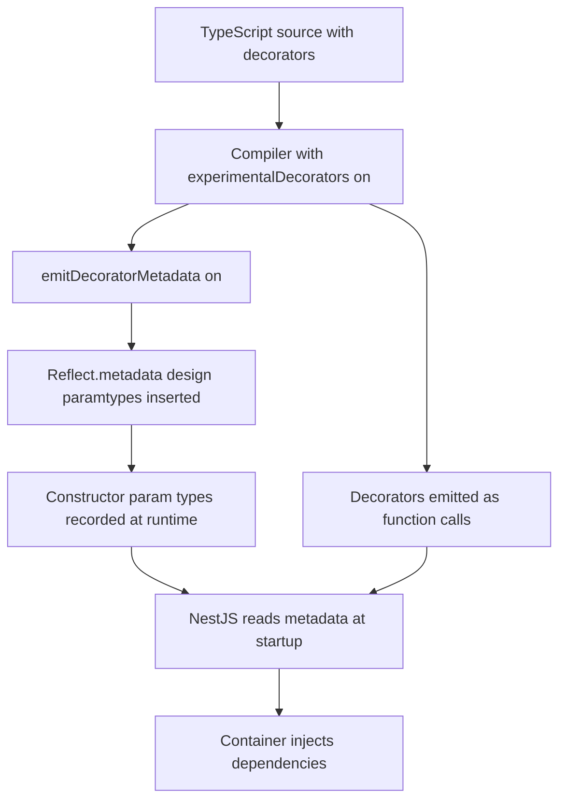

# Compiling Decorators: What TypeScript Actually Emits

## English

When you write `@Injectable()` above a class, you are not writing a language feature that survives to runtime by itself — decorators are erased and then re-emitted as ordinary function calls by the TypeScript compiler. The key detail is the `experimentalDecorators` and `emitDecoratorMetadata` flags in `tsconfig.json`. The first enables the legacy decorator proposal that NestJS was built on; the second is the quiet workhorse that makes dependency injection possible at all. With `emitDecoratorMetadata` on, the compiler inserts calls to `Reflect.metadata("design:paramtypes", [...])` next to each decorated class, recording the runtime constructor types of every parameter. That is why `constructor(private readonly users: UsersService)` works without you naming the type anywhere else — the compiler wrote it into the class's metadata, and NestJS reads it back at startup.

The catch is that this metadata only exists for types that survive compilation. An interface is a compile-time fiction; it vanishes, so `design:paramtypes` records `Object` and the container has no idea what to inject. That is the real reason the NestJS style guide pushes you toward classes as tokens. A string token or a symbol token works too, but then you must inject explicitly with `@Inject('TOKEN')`, because there is nothing for the compiler to record. This is also why `forwardRef` exists for circular dependencies — the metadata points at a class that may not be fully defined yet at module evaluation time.

A second subtlety is ordering. Decorators evaluate bottom-up and compose, so `@Injectable()` and a custom `@SetMetadata()` stack in a defined way. NestJS's `Reflector` reads keys like `design:paramtypes` and your own custom keys off the same metadata object attached to the class or method. Understanding that there is one shared metadata store — not a special NestJS registry — demystifies a lot: `Reflect.getMetadata('roles', handler)` is literally all a roles guard is doing.

Finally, note the modern alternative. The TC39 standard decorators (TypeScript 5.x, `experimentalDecorators: false`) do not emit `design:paramtypes` at all, which is why NestJS historically required the legacy flag. If you ever see `Cannot resolve dependencies` errors after changing compiler settings, the metadata emission is the first thing to check. Reading the compiled `dist/` output of a small NestJS app is one of the most clarifying exercises you can do — you will see your elegant class reduced to a function with a `__decorate([...])` wrapper, and the magic becomes mechanical.

Practically: keep `emitDecoratorMetadata: true`, prefer class tokens over interfaces for injected dependencies, use `@Inject()` for non-class tokens, and treat the compiled JavaScript as the source of truth when something fails to resolve.

## 中文

當你在類別上方寫 `@Injectable()` 時，你寫的並不是一個能自行存活到執行期的語言特性——裝飾器會被抹除，再由 TypeScript 編譯器重新輸出成普通函式呼叫。關鍵細節在 `tsconfig.json` 裡的 `experimentalDecorators` 與 `emitDecoratorMetadata` 兩個旗標。第一個啟用 NestJS 所建基的舊版裝飾器提案；第二個則是讓依賴注入得以成立的沉默功臣。開啟 `emitDecoratorMetadata` 後，編譯器會在每個被裝飾的類別旁插入 `Reflect.metadata("design:paramtypes", [...])` 呼叫，記錄每個參數的執行期建構子型別。這就是為何 `constructor(private readonly users: UsersService)` 不需要你在別處再指名型別就能運作——編譯器已把它寫進類別的中繼資料，NestJS 在啟動時讀回來。

陷阱在於：這份中繼資料只對能存活過編譯的型別存在。介面是編譯期的虛構物，會消失，所以 `design:paramtypes` 只記到 `Object`，容器根本不知道要注入什麼。這才是 NestJS 風格指南推動你用類別當 token 的真正原因。字串或 symbol token 也行，但你必須用 `@Inject('TOKEN')` 明確注入，因為編譯器沒有東西可記錄。這也是迴圈依賴需要 `forwardRef` 的原因——中繼資料指向的類別在模組求值時可能尚未完整定義。

第二個微妙之處是順序。裝飾器由下往上求值並可組合，所以 `@Injectable()` 與自訂的 `@SetMetadata()` 有明確的堆疊方式。NestJS 的 `Reflector` 讀取 `design:paramtypes` 與你自訂的鍵，全都來自掛在類別或方法上的同一個中繼資料物件。理解到這裡只有一個共用的中繼資料儲存區——而非 NestJS 專屬註冊表——就能解開許多疑惑：一個角色守衛所做的，字面上就是 `Reflect.getMetadata('roles', handler)`。

最後，留意現代替代方案。TC39 標準裝飾器（TypeScript 5.x，`experimentalDecorators: false`）完全不輸出 `design:paramtypes`，這就是 NestJS 歷來要求舊版旗標的原因。若你在改動編譯器設定後看到 `Cannot resolve dependencies` 錯誤，第一個要查的就是中繼資料輸出。把一個小型 NestJS 應用的 `dist/` 編譯產物讀一遍，是最能澄清觀念的練習之一——你會看到優雅的類別被縮減成一個函式加上 `__decorate([...])` 包裝，魔法頓時變成機械。

實務上：保持 `emitDecoratorMetadata: true`、注入依賴時優先使用類別 token 而非介面、非類別 token 用 `@Inject()`、並在解析失敗時把編譯後的 JavaScript 當作真相來源。

## Key Takeaway

Decorators are compile-time syntax that the TypeScript compiler rewrites into function calls plus metadata, and `emitDecoratorMetadata` is what lets NestJS know your constructor parameter types at runtime.

## Related Concepts
- TypeScript decorators
- Reflect metadata API

## Diagram

