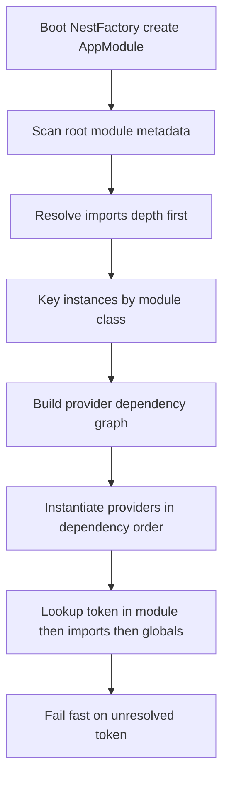

# Module Resolution Order: How NestJS Builds the Graph Before It Serves a Request

## English

Most explanations of NestJS modules describe what they contain, but the more useful mental model is the order in which the framework walks them at boot. When `NestFactory.create(AppModule)` runs, the container does not lazily resolve providers on first use — it performs a full scan, building a dependency graph and instantiating singletons eagerly. Understanding this order explains a whole class of confusing errors: a provider that seems unreachable, a configuration value that is `undefined` inside a factory, or a guard that fires before you expected.

The scan starts at the root module. For each module, NestJS reads its metadata: `imports`, `providers`, `controllers`, `exports`. Imports are resolved depth-first, which is why a module imported twice is still instantiated once — the container keys instances by module class, not by import path. This is the mechanism behind the common surprise that a `@Global()` module's providers are visible everywhere without importing, while a non-global module's providers are strictly private unless listed in `exports`. Encapsulation is real: a provider in `UsersModule` that is not exported simply does not exist as far as `OrdersModule` is concerned, even though both are loaded into the same process.

Within a module, providers are instantiated in dependency order, not declaration order. If `A` depends on `B`, `B` is constructed first. The container resolves each constructor's `design:paramtypes`, looks up the token in the module's own providers, then in imported modules' exports, then in global modules. If it finds nothing, it throws at startup — not at request time. That fail-fast behavior is a feature: a misconfigured graph crashes the process immediately rather than producing a 500 on the third request of the day.

Dynamic modules complicate this pleasantly. `forRootAsync` returns a `DynamicModule` whose providers may themselves be factories that depend on `ConfigService`. NestJS resolves these in two passes: first the async factory that produces the module's options, then the providers that consume those options. This is why `useFactory` can safely inject `ConfigService` even though the module is still being defined — the config module was resolved earlier in the depth-first walk.

A practical consequence: circular imports between modules break the depth-first walk, which is why `forwardRef` exists and why the framework sometimes reports `undefined` for a provider that is technically defined. The fix is almost never to add `forwardRef` everywhere; it is to extract the shared piece into a third module both can import. Drawing the import graph on paper before adding a module is worth more than an hour of debugging at runtime.

## 中文

多數對 NestJS 模組的解說只談它們裝了什麼，但更有用的心智模型，是框架在開機時走訪它們的順序。當 `NestFactory.create(AppModule)` 執行時，容器不會等到第一次使用才惰性解析 provider——它會做一次完整掃描，建立依賴圖並急切地把單例實例化。理解這個順序，能解釋一整類令人困惑的錯誤：看似搆不到的 provider、在 factory 裡變成 `undefined` 的設定值，或比你預期更早觸發的守衛。

掃描從根模組開始。對每個模組，NestJS 讀取它的中繼資料：`imports`、`providers`、`controllers`、`exports`。Imports 以深度優先解析，這就是為何一個模組被匯入兩次仍只實例化一次——容器以模組類別為鍵，而非以匯入路徑。這正是常見驚訝背後的機制：`@Global()` 模組的 provider 不用匯入就處處可見，而非全域模組的 provider 除非列在 `exports` 中，否則嚴格私有。封裝是真的：`UsersModule` 裡沒被匯出的 provider，對 `OrdersModule` 而言根本不存在，即使兩者都載入同一行程。

在模組內，provider 依依賴順序而非宣告順序被實例化。若 `A` 依賴 `B`，就先建構 `B`。容器解析每個建構子的 `design:paramtypes`，先在模組自身的 providers 找 token，再找已匯入模組的 exports，再找全域模組。若什麼都找不到，就在啟動時拋錯——不是等到請求時。這種快速失敗是特性：設定錯誤的依賴圖會立刻讓行程崩潰，而不是在當天第三個請求時產生 500。

動態模組會愉快地讓這件事變複雜。`forRootAsync` 回傳一個 `DynamicModule`，其 providers 本身可能是依賴 `ConfigService` 的 factory。NestJS 分兩趟解析：先解析產生模組選項的非同步 factory，再解析消費這些選項的 providers。這就是為何 `useFactory` 能安全注入 `ConfigService`，即使模組尚在定義中——設定模組在深度優先走訪中較早被解析。

實務後果：模組間的迴圈匯入會打斷深度優先走訪，這就是 `forwardRef` 存在的原因，也是框架有時對技術上已定義的 provider 回報 `undefined` 的原因。解法幾乎從來不是到處加 `forwardRef`，而是把共用部分抽到第三個模組讓雙方匯入。在新增模組前先把匯入圖畫在紙上，比在執行期除錯一小時更有價值。

## Key Takeaway

NestJS eagerly builds the whole module and provider graph depth-first at startup, so encapsulation and import order determine what can be injected long before any request arrives.

## Related Concepts
- Module encapsulation
- Dynamic modules

## Diagram

