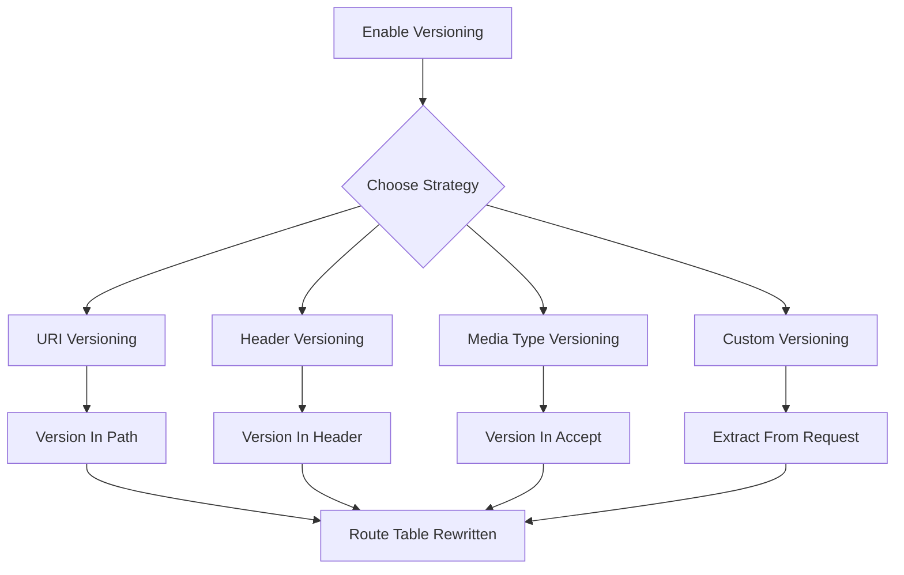

# Versioning Strategies: URI, Header and Media Type — and What Each Costs

## English

NestJS ships a versioning layer that sits above routing, and choosing a strategy is a genuine API design decision rather than a configuration detail. Enable it with `app.enableVersioning({ type: VersioningType.URI })` and mark controllers or individual routes with `@Version('2')`. The framework then rewrites the route table so that the same handler can exist at multiple versions without duplicating code. The interesting part is the three strategies and their trade-offs.

URI versioning puts the version in the path: `/v1/users`, `/v2/users`. It is the easiest to debug — you can paste a URL into a browser or `curl` and see exactly which version you hit, and it plays nicely with CDNs and caches because the URL is the cache key. Its cost is that the version is part of the resource identity, which purists argue is not what URIs are for, and that a major version bump changes every URL in your docs. Header versioning uses a custom header such as `Accept-Version: 2`; the URL stays stable, which is elegant, but now caching proxies must be told to vary on that header or they will serve the wrong version, and casual testing becomes harder because the version is invisible in the address bar.

Media type versioning uses content negotiation — `Accept: application/vnd.myapp.v2+json` — which is the most theoretically correct approach and the most awkward in practice. It leans on HTTP semantics properly, but tooling support is uneven and every client must set the header correctly. NestJS supports all three plus a custom `VersioningType.CUSTOM` where you supply a function that extracts the version from the request, which is useful when you have an existing scheme you cannot change.

A detail that trips people up: versioning is applied per route, and routes without an explicit `@Version()` default to `VERSION_NEUTRAL`, meaning they answer on every version. That is convenient for health checks and login endpoints that genuinely do not change, but it also means a new endpoint silently becomes available on `v1` even though you intended it only for `v2`. Being explicit about `@Version(['1', '2'])` versus neutral is worth the keystrokes. You can also set a default version at the app level so unmarked routes inherit it.

Finally, versioning is not a substitute for backwards compatibility discipline. The honest use of versioning is to introduce a new shape while keeping the old one alive for a deprecation window — which means running both handlers, possibly both DTOs, and eventually deleting one. NestJS makes the routing cheap; the hard part remains the product decision of when to retire `v1` and how to tell the clients who still call it.

## 中文

NestJS 內建一層版本控制，位於路由之上，而選擇策略是真正的 API 設計決策，而非設定細節。用 `app.enableVersioning({ type: VersioningType.URI })` 啟用，並以 `@Version('2')` 標記控制器或個別路由。框架隨後改寫路由表，讓同一個處理常式能存在於多個版本而不必重複程式碼。有趣的是三種策略及其取捨。

URI 版本控制把版本放進路徑：`/v1/users`、`/v2/users`。它最容易除錯——把 URL 貼進瀏覽器或用 `curl` 就能看到命中哪個版本，且與 CDN 和快取配合良好，因為 URL 就是快取鍵。代價是版本成了資源身分的一部分，純粹主義者認為這不是 URI 的用途，且一次主版本升級會改變檔案裡的每個 URL。標頭版本控制使用自訂標頭如 `Accept-Version: 2`；URL 保持穩定，很優雅，但現在必須告訴快取代理要依該標頭變異，否則會送出錯誤版本，隨手測試也變難，因為版本在網址列裡看不見。

媒體型別版本控制使用內容協商——`Accept: application/vnd.myapp.v2+json`——理論上最正確，實務上最彆扭。它正確地倚賴 HTTP 語意，但工具支援參差不齊，每個客戶端都必須正確設定標頭。NestJS 三種都支援，另加自訂的 `VersioningType.CUSTOM`，由你提供從請求擷取版本的函式，當你已有無法更改的既有方案時很有用。

一個常讓人踩坑的細節：版本控制是逐路由套用的，沒有明確 `@Version()` 的路由預設為 `VERSION_NEUTRAL`，也就是對所有版本都應答。對健康檢查和確實不會變的登入端點很方便，但也意味著新端點會悄悄地在 `v1` 上可用，即使你只想給 `v2`。明確區分 `@Version(['1', '2'])` 與中性，值得多打幾個字。你也可以在應用層級設定預設版本，讓未標記的路由繼承。

最後，版本控制不能取代向後相容的紀律。誠實的用法是引入新形狀、同時讓舊形狀在棄用視窗記憶體活——這意味著同時執行兩個處理常式、可能兩套 DTO，最終刪掉一個。NestJS 讓路由變便宜；難的仍是產品決策：何時退役 `v1`，以及如何通知仍在呼叫它的客戶端。

## Key Takeaway

NestJS versioning is a routing layer above your handlers, and the URI versus header versus media-type choice is really a trade-off between debuggability, cache correctness, and HTTP purity.

## Related Concepts
- API versioning
- HTTP content negotiation

## Diagram

