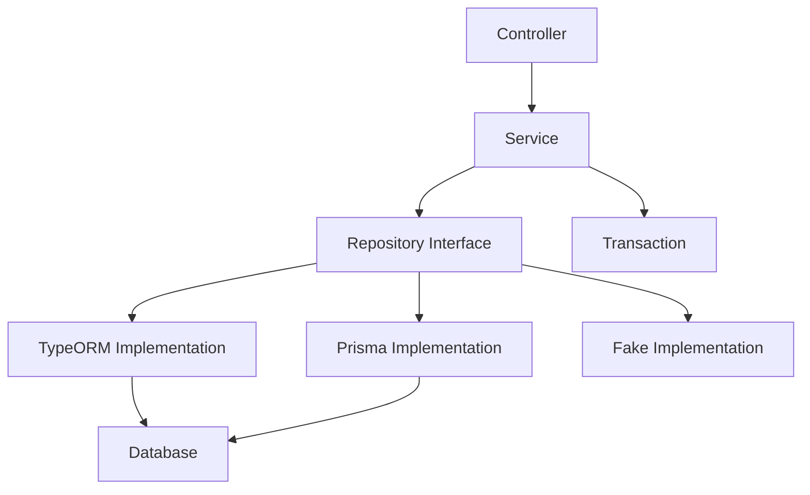

# NestJS and the Database Layer: TypeORM, Prisma and the Repository Pattern

## English

NestJS deliberately does not ship a database layer. Instead it treats persistence as just another set of providers you inject, which means the framework's real gift here is a consistent shape: a repository or service that hides the ORM behind a small interface, so controllers never touch SQL and the rest of your code never imports the ORM directly. The two dominant integrations are TypeORM (the classic NestJS pairing, where `@nestjs/typeorm` gives you `TypeOrmModule.forRoot()` for the connection and `forFeature([Entity])` to register repositories per module) and Prisma (where you write a `PrismaService` that extends `PrismaClient` and implements `OnModuleInit` so it calls `$connect()` when the app boots). Both approaches end up in the same place: an injectable class that the DI container hands to your services.

The repository pattern is the reason this works so cleanly. A repository is an object whose job is to look like an in-memory collection of domain objects — you call `findById`, `save`, `findByEmail` — while hiding whether the data lives in Postgres, a cache, or a test double. In NestJS you get this almost for free: define an abstract class or an injection token describing the interface, provide a concrete implementation in the module, and your business logic depends only on the abstract type. Swapping TypeORM for Prisma, or swapping a real database for an in-memory fake in a unit test, becomes a one-line change in the module's `providers` array rather than a rewrite of every service.

Transactions are where the abstraction gets leaky and you have to think. A single `save()` is atomic, but a business operation that touches three tables usually is not. TypeORM exposes this through `QueryRunner` or `DataSource.transaction()`, and Prisma through `$transaction()`. The NestJS-idiomatic answer is often to keep transaction boundaries inside the repository or a dedicated domain service, not scattered across controllers, because once a transaction handle has to be passed down through five method calls your clean interface has stopped being clean. A common pragmatic compromise is a unit-of-work style service that opens the transaction, calls several repository methods that accept an optional transaction context, and commits at the end.

Migrations deserve their own discipline. Both TypeORM and Prisma generate migration files from a schema diff, and both expect you to run them as a separate step (a CLI command in CI, or a migration job before the new app version rolls out) rather than on application startup. Running migrations automatically when the app boots feels convenient in development and becomes a race condition in production the moment you run more than one replica — two instances trying to alter the same table at once. NestJS's lifecycle hooks make it tempting to do it in `onModuleInit`, but the safer pattern is a standalone script or a dedicated deployment step.

Finally, think about connection pooling and health. Every ORM sits on top of a pool of TCP connections to the database, and that pool has a maximum size. If you scale to twenty NestJS pods and each pool allows ten connections, you have asked the database for two hundred connections whether it can handle them or not. This is why connection limits are usually configured per-instance and why a health check that merely returns 200 without touching the database can lie to your orchestrator. A `TypeOrmHealthIndicator` or a simple `SELECT 1` in your readiness probe tells the truth about whether this instance can actually serve traffic.

## 中文

NestJS 刻意不內建資料庫層。它把持久化（persistence）視為另一組可注入的 provider，所以框架真正的價值在於提供一致的形狀：用一個 repository 或 service 把 ORM 藏在小介面後面，controller 永遠不碰 SQL，其餘程式碼也不會直接 import ORM。兩大主流整合是 TypeORM（NestJS 的經典搭配，`@nestjs/typeorm` 提供 `TypeOrmModule.forRoot()` 建立連線，`forFeature([Entity])` 則按模組註冊 repository）與 Prisma（你寫一個 `PrismaService` 繼承 `PrismaClient` 並實作 `OnModuleInit`，在應用啟動時呼叫 `$connect()`）。兩條路最後都殊途同歸：一個可注入的類別，由 DI 容器交給你的 service。

Repository 模式正是這一切能乾淨運作的原因。Repository 是一個物件，職責是讓自己看起來像記憶體中的領域物件集合——你呼叫 `findById`、`save`、`findByEmail`——同時隱藏資料究竟在 Postgres、快取還是測試替身裡。在 NestJS 裡這幾乎免費：定義一個抽象類別或 injection token 描述介面，在模組裡提供具體實作，商業邏輯就只依賴抽象型別。要把 TypeORM 換成 Prisma，或在單元測試中把真資料庫換成記憶體假物件，只需改模組 `providers` 陣列的一行，而不是重寫每個 service。

交易（transaction）是抽象開始漏水、你必須動腦的地方。單次 `save()` 是原子的，但一個橫跨三張表的商業操作通常不是。TypeORM 透過 `QueryRunner` 或 `DataSource.transaction()` 暴露這件事，Prisma 則用 `$transaction()`。NestJS 的道地做法，往往是把交易邊界留在 repository 或專門的領域 service 裡，而不是散落在 controller 之間——因為一旦交易把手要一路傳過五層方法呼叫，你乾淨的介面就不再乾淨了。常見的務實折衷是一個 unit-of-work 風格的 service：它開啟交易、呼叫數個接受可選交易上下文的 repository 方法、最後 commit。

Migration（資料庫遷移）值得獨立的自律。TypeORM 與 Prisma 都從 schema 差異產生遷移檔，兩者都預期你把遷移當成獨立步驟執行（CI 裡的 CLI 指令，或新版本上線前的遷移 job），而不是在應用啟動時跑。啟動時自動遷移在開發階段很舒服，但一旦生產環境跑多個副本，它就變成競態條件（race condition）——兩個例項同時嘗試修改同一張表。NestJS 的生命週期鉤子讓你在 `onModuleInit` 裡做這件事很誘人，但更安全的模式是獨立指令碼或專門的部署步驟。

最後，想想連線池與健康檢查。每個 ORM 底下都是一池通往資料庫的 TCP 連線，而池有上限。如果你擴充套件到二十個 NestJS pod，每個池允許十條連線，你就向資料庫要求了兩百條連線，不管它吃不吃得消。這就是為什麼連線上限通常按例項設定，也是為什麼只回 200、沒碰資料庫的健康檢查會對編排器（orchestrator）說謊。`TypeOrmHealthIndicator` 或就緒探測（readiness probe）裡一句 `SELECT 1`，才能誠實回答這個例項究竟能不能服務流量。

## Key Takeaway

NestJS keeps persistence honest by treating the ORM as an injectable behind a repository interface, so database choices, transactions and migrations stay at the edges instead of leaking into your business logic.

## Related Concepts
- Repository pattern
- Database migrations

## Diagram

