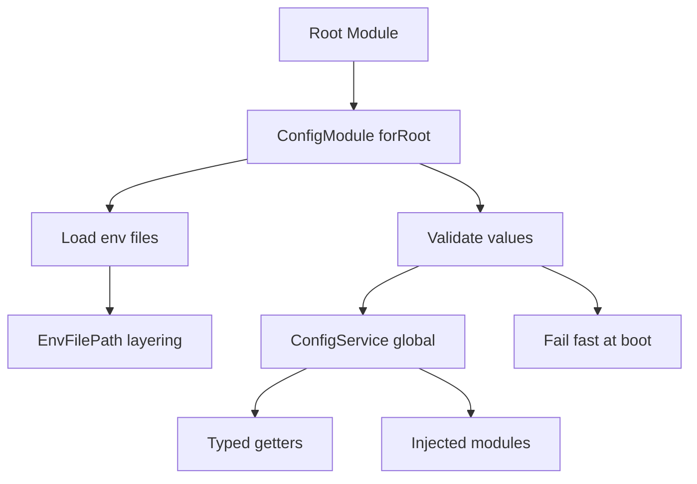

# Environment-Aware Configuration and the Twelve-Factor Boundary

## English

A NestJS app usually runs in at least three places — a developer's laptop, a CI runner, and production — and the same code must behave correctly in all of them without being edited. The framework's answer is the `@nestjs/config` package, which wraps the popular `dotenv` library and exposes a `ConfigService` you inject anywhere. The important idea is not the library but the boundary: configuration is anything that varies between deployments (database URLs, API keys, feature flags, log levels), and it should enter the application through exactly one door rather than being read from `process.env` in forty different files. When every module reads the environment directly, you cannot tell from the module's constructor what it actually needs, and you cannot test it without mutating global state.

`ConfigModule.forRoot()` is typically called once, in the root module, and marked `isGlobal: true` so `ConfigService` is available everywhere without re-importing. It loads `.env` files, optionally with an `envFilePath` array so you can layer `.env.local` over `.env`, and it can validate the loaded values at startup. Validation is the part people skip and later regret: a missing `DATABASE_URL` should crash the process at boot with a clear message, not surface as a cryptic connection error three minutes into serving traffic. The common approach is a Joi schema passed as `validationSchema`, or a custom `validate` function that receives the raw object and returns a typed, cleaned version — throwing on anything missing or malformed.

Beyond validation, there is the question of typing. `ConfigService.get('PORT')` returns `string | undefined` by default, which means every caller has to handle the undefined case even though startup validation already guaranteed it exists. Two patterns help. One is a `getOrThrow` style accessor that throws if the key is absent, making the contract explicit. The other, more scalable, is to group related settings into namespaced configuration objects using `registerAs('database', () => ({...}))`, then inject them with `@Inject(databaseConfig.KEY)`. The namespace gives you a real TypeScript type, so `config.host` is a `string`, not `string | undefined`, and the settings for one concern live together instead of being scattered across a dozen `get()` calls.

Secrets are a separate concern from configuration even though they travel the same pipe. A `.env` file is fine for local development and should never be committed; in production the values typically come from the platform — environment variables injected by the orchestrator, a secrets manager, or a mounted file. NestJS does not care where they originate as long as they arrive as environment variables or as an explicitly loaded source, which is exactly the twelve-factor principle: store config in the environment, not in code. The practical rule is that your repository contains a `.env.example` documenting every key with a dummy value, and nothing else.

One subtle trap is when configuration is read. If a module reads `process.env` at import time — at the top level of a file, outside any function — it captures whatever was set when the module was first loaded, which may be before `ConfigModule` has run. Reading inside a factory, a constructor, or `onModuleInit` always sees the final values. Similarly, `forRootAsync` with a `useFactory` that injects `ConfigService` is the correct way to configure a database connection from environment values, because it defers reading until the container is ready. Getting this ordering right is the difference between configuration that works and configuration that works only on your machine.

## 中文

一個 NestJS 應用通常至少在三個地方執行——開發者的筆記型電腦、CI runner、以及生產環境——同一份程式碼必須在全部環境中正確運作，且不需被修改。框架的答案是 `@nestjs/config` 套件，它包裝了流行的 `dotenv` 函式庫，並提供可注入到任何地方的 `ConfigService`。重點不在函式庫本身，而在邊界：設定是任何會因部署而異的東西（資料庫 URL、API 金鑰、功能旗標、日誌等級），它應該只透過一道門進入應用，而不是在四十個不同檔案裡讀 `process.env`。當每個模組都直接讀環境變數，你從模組建構子看不出它真正需要什麼，也無法在不改動全域狀態的情況下測試它。

`ConfigModule.forRoot()` 通常只在根模組呼叫一次，並標記 `isGlobal: true`，讓 `ConfigService` 處處可用而不必重複 import。它會載入 `.env` 檔，可選地用 `envFilePath` 陣列把 `.env.local` 疊在 `.env` 之上，並能在啟動時驗證載入的值。驗證正是大家常跳過、事後才後悔的部分：缺少 `DATABASE_URL` 應該在開機時就以清楚的訊息讓行程崩潰，而不是在服務流量三分鐘後冒出一個晦澀的連線錯誤。常見做法是傳入 Joi schema 作為 `validationSchema`，或是一個自訂 `validate` 函式，接收原始物件並回傳已定型、清理過的版本——缺少或格式錯誤就拋錯。

除了驗證，還有型別問題。`ConfigService.get('PORT')` 預設回傳 `string | undefined`，意味著即使啟動驗證已保證它存在，每個呼叫端還是得處理 undefined。兩種模式有幫助。一是 `getOrThrow` 風格的存取器，鍵不存在就拋錯，讓契約明確。另一種更具擴充套件性：用 `registerAs('database', () => ({...}))` 把相關設定群組成名稱空間物件，然後用 `@Inject(databaseConfig.KEY)` 注入。名稱空間給你真正的 TypeScript 型別，`config.host` 是 `string` 而非 `string | undefined`，而且某個關注點的設定會聚在一起，而不是散落在十幾個 `get()` 呼叫中。

秘密（secrets）與設定是兩件事，即使它們走同一條管線。`.env` 檔適合本機開發，且絕不該提交；生產環境的值通常來自平臺——編排器注入的環境變數、秘密管理器，或掛載的檔案。NestJS 不在乎它們從哪來，只要以環境變數或明確載入的來源抵達即可，這正是十二因子（twelve-factor）原則：把設定存在環境裡，而不是程式碼裡。實務守則是：你的 repo 只放一個 `.env.example`，用假值記錄每個鍵，其他什麼都不放。

一個微妙的陷阱是設定被讀取的時機。如果某模組在 import 時讀 `process.env`——在檔案頂層、任何函式之外——它捕捉的是模組首次載入時的值，可能早於 `ConfigModule` 執行。在 factory、建構子或 `onModuleInit` 裡讀，才會看到最終值。同樣地，用 `forRootAsync` 搭配注入 `ConfigService` 的 `useFactory`，才是從環境值設定資料庫連線的正確方式，因為它延後讀取直到容器就緒。把這個順序搞對，就是「設定能用」與「設定只在你機器上能用」的差別。

## Key Takeaway

Configuration should enter a NestJS app through one validated, typed door at startup, so missing values fail loudly at boot and no module ever reads process.env at import time.

## Related Concepts
- Twelve-factor app
- ConfigModule namespaces

## Diagram

