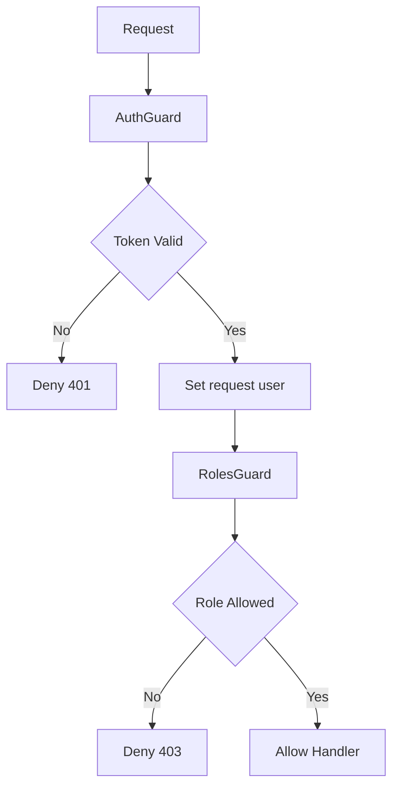

# Access Control in NestJS: Authentication, Authorization and the Role of Passport

## English

Guards are the mechanism NestJS uses to decide whether a request may proceed, but a guard is only as good as the strategy behind it. Most NestJS applications bolt on `@nestjs/passport` and `passport-jwt`: Passport is a long-standing Node authentication library that organises credential checking into pluggable 'strategies', and the NestJS wrapper turns each strategy into a provider you can reference in a guard. A JWT strategy, for example, extracts the token from the `Authorization` header, verifies its signature against a secret or public key, and returns a user object that NestJS attaches to `request.user`. The guard then simply allows or denies based on whether that object exists.

It is worth being precise about what authentication and authorization mean, because conflating them produces security holes. Authentication answers 'who is this?' — verifying a token, a session cookie, an API key. Authorization answers 'may this identity do this?' — checking a role, a permission, or ownership of a resource. NestJS keeps them separate on purpose: authentication belongs in a guard or middleware that populates `request.user`, while authorization belongs in a second guard, a policy check in the service, or a decorator-driven roles guard. A common pattern is a `@Roles('admin')` decorator that writes metadata onto the handler, plus a `RolesGuard` that reads that metadata with the `Reflector` and compares it against `request.user.roles`. The decorator declares intent; the guard enforces it.

Ownership checks are the case that trips people up, because they cannot be expressed as a static role. 'Only the author may edit this post' depends on the specific row being edited, which the guard often cannot see without loading it. Two answers exist. One is to push the check into the service, where the entity is already loaded, and throw a `ForbiddenException` if the current user is not the owner — simple and reliable, at the cost of doing the database work before rejecting. The other is a resource-scoped guard or a policy library (CASL is a popular fit with NestJS) that expresses rules like 'can update Post' as data, evaluated against both the user and the loaded resource. CASL's advantage is that the same rule set can be reused on the client to hide buttons, keeping the two sides honest.

Token handling itself has choices worth understanding. A stateless JWT is easy to scale — any instance can verify it without shared state — but it cannot be revoked before expiry, which is why short lifetimes plus a refresh token are standard. Refresh tokens are stored server-side (database or Redis) so they can be invalidated on logout or compromise, and the rotation pattern — issue a new refresh token each time one is used, and revoke the old one — limits the damage of a stolen token. Session cookies, by contrast, are stateful but come with mature protections like `HttpOnly`, `Secure` and `SameSite` flags, and are simpler to revoke. Neither is universally right; the choice depends on whether your clients are browsers or native apps and how much revocation you need.

Finally, remember that guards run before pipes and the handler, so they see the raw request but not the validated DTO. If your authorization logic depends on a validated body field, the guard is the wrong layer — do the check in the service after validation. And always apply authentication globally where possible (`APP_GUARD` with a `@Public()` decorator to opt out) rather than per-controller, because the failure mode of forgetting a decorator is an open endpoint, whereas the failure mode of forgetting `@Public()` is a loud 401 that you notice immediately.

## 中文

Guard 是 NestJS 用來決定請求能否繼續的機制，但 guard 的好壞取決於它背後的策略。多數 NestJS 應用會掛上 `@nestjs/passport` 與 `passport-jwt`：Passport 是歷史悠久的 Node 認證函式庫，把憑證檢查組織成可插拔的「策略」（strategy），而 NestJS 的包裝把每個策略變成可在 guard 中引用的 provider。以 JWT 策略為例，它從 `Authorization` 標頭取出 token、用密鑰或公鑰驗證簽章、回傳一個使用者物件，NestJS 再把它掛到 `request.user`。guard 接著只根據該物件是否存在來放行或拒絕。

值得精確區分認證（authentication）與授權（authorization），因為混淆兩者會產生安全漏洞。認證回答「這是誰？」——驗證 token、session cookie、API 金鑰。授權回答「這個身分可以做這件事嗎？」——檢查角色、權限，或對資源的擁有權。NestJS 刻意把它們分開：認證屬於負責填充 `request.user` 的 guard 或 middleware，授權則屬於第二個 guard、service 中的策略檢查，或由裝飾器驅動的角色 guard。常見模式是 `@Roles('admin')` 裝飾器把 metadata 寫到處理器上，再由 `RolesGuard` 用 `Reflector` 讀取該 metadata 並與 `request.user.roles` 比對。裝飾器宣告意圖；guard 負責執行。

擁有權檢查是最容易絆倒人的情況，因為它無法用靜態角色表達。「只有作者能編輯這篇文章」取決於正在被編輯的那一列資料，guard 往往不載入它就看得到。有兩種答案。一是把檢查推進 service，那裡實體已載入，若當前使用者不是擁有者就拋 `ForbiddenException`——簡單可靠，代價是先做資料庫工作才拒絕。另一種是資源範圍的 guard 或策略函式庫（CASL 與 NestJS 搭配很流行），把「可更新 Post」這類規則表達成資料，同時對使用者與已載入的資源求值。CASL 的優勢是同一套規則可在客戶端重用來隱藏按鈕，讓兩邊保持一致。

Token 處理本身也有值得理解的選擇。無狀態 JWT 容易擴展——任何實例都能不靠共享狀態驗證它——但到期前無法撤銷，這就是為什麼「短壽命加 refresh token」是標準做法。Refresh token 存在伺服器端（資料庫或 Redis），以便登出或外洩時失效；輪替模式——每次使用就發新的 refresh token 並撤銷舊的——能限制被竊 token 的損害。相對地，session cookie 是有狀態的，但附帶成熟的保護如 `HttpOnly`、`Secure`、`SameSite` 旗標，且更容易撤銷。兩者沒有絕對正確；選擇取決於你的客戶端是瀏覽器還是原生應用，以及你需要多少撤銷能力。

最後，記得 guard 在 pipe 與處理器之前執行，所以它看到原始請求，但看不到驗證後的 DTO。若你的授權邏輯依賴驗證過的 body 欄位，guard 就是錯的層——應在驗證後於 service 中檢查。而且盡可能在全域套用認證（用 `APP_GUARD` 搭配 `@Public()` 裝飾器來豁免），而不是逐 controller 設定，因為忘記加裝飾器的後果是端點門戶大開，而忘記 `@Public()` 的後果是一個你立刻會注意到的響亮 401。

## Key Takeaway

Keep authentication (who you are) and authorization (what you may do) in separate layers, apply authentication globally by default, and push ownership checks to where the resource is actually loaded.

## Related Concepts
- Passport strategies
- Role-based access control

## Diagram

