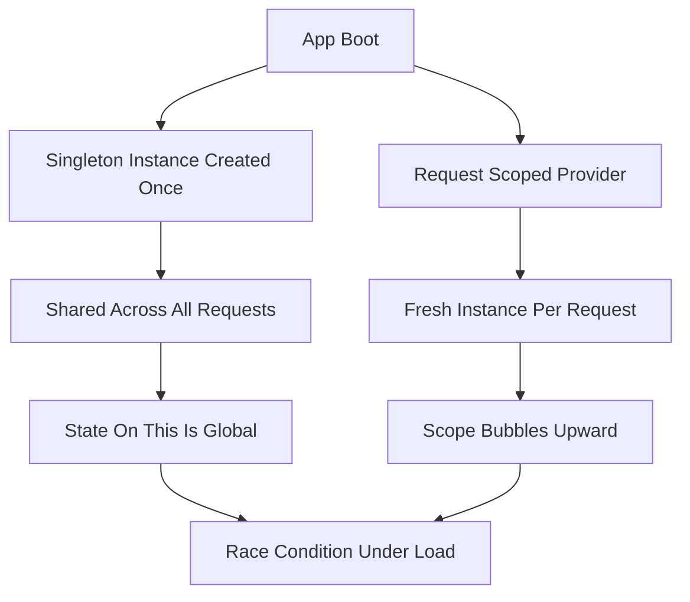

# Scopes and Lifetime: Why Singleton Is the Default and What Changes When It Isn't

## English

Every provider in NestJS has a scope, and the default is singleton: one instance is created when the application boots and shared by every request that ever touches it. This is the cheapest possible arrangement, because construction happens once and the instance lives in memory for the life of the process. It also means any state you store on `this` inside a singleton service is shared across all concurrent requests — which is fine for a stateless repository wrapper and catastrophic for anything holding per-user data. The instant you write `this.currentUser = user` in a singleton, you have created a race condition that will only show up under load.

The alternative is request scope, declared with `@Injectable({ scope: Scope.REQUEST })`. NestJS then creates a fresh instance for every incoming request and disposes of it afterwards. Under the hood this works through a scope hierarchy: a request-scoped provider causes everything that injects it to become request-scoped too, and that effect bubbles upward through the dependency graph. If a controller injects a request-scoped service, the controller itself becomes request-scoped, and so does the module's resolution for that chain. This is called scope bubbling, and it is the reason a single innocent `Scope.REQUEST` deep in your service layer can quietly turn half your application into per-request instantiation.

The cost is real. Instead of one object graph built at startup, NestJS builds a sub-tree per request and garbage-collects it afterwards. Benchmarks and framework documentation both note this is measurably slower, and the memory churn can matter under high throughput. There is also a subtler trap: request-scoped providers cannot be injected into singleton providers, because a singleton is created once at boot when no request exists. NestJS will either throw or silently promote the singleton to request scope, depending on the situation, and either outcome surprises people.

There is a middle option: transient scope, `Scope.TRANSIENT`. A transient provider gets a new instance for every consumer that injects it, but the consumers themselves keep their own scope. Two singletons that both inject a transient service get two separate instances; the transient service is not shared between them. This is useful for things like per-consumer loggers or per-consumer strategy objects where you want isolation between injection sites but not per-request churn.

A practical rule: keep everything singleton by default, and reach for request scope only when you genuinely need per-request identity — for example, a service that reads the current user from the request context. Even then, consider whether `AsyncLocalStorage` or passing the value as a method argument would be cheaper, because request scope is a structural decision that propagates. Choose it deliberately, not as a reflex.

## 中文

NestJS 裡面每一個 provider 都有 scope（作用域），預設係 singleton：應用程式啟動嗰陣建立一個例項，之後所有 request 共用同一個。呢個係最便宜嘅安排，因為只係建構一次，例項就喺 process 嘅生命週期內一直留喺記憶體。但同時代表你喺 singleton service 嘅 `this` 上面儲存嘅任何狀態，都會被所有並發 request 共享——對於無狀態嘅 repository 包裝冇問題，但對於任何裝住單一使用者資料嘅嘢就係災難。你一喺 singleton 入面寫 `this.currentUser = user`，就已經製造咗一個 race condition，而且只會喺高負載先浮現。

另一個選擇係 request scope，用 `@Injectable({ scope: Scope.REQUEST })` 宣告。NestJS 會為每個進入嘅 request 建立一個全新例項，處理完就丟棄。底層係透過 scope 階層運作：一個 request-scoped provider 會令所有注入佢嘅嘢都變成 request-scoped，而呢個效應會沿住依賴圖向上蔓延。如果一個 controller 注入咗 request-scoped service，controller 本身都會變成 request-scoped，佢所屬 module 嘅解析鏈都一樣。呢個叫 scope bubbling（作用域冒泡），亦係點解一個喺 service 層深處看似無害嘅 `Scope.REQUEST`，可以靜靜雞令你半個應用程式變成逐個 request 重新建立。

代價係真實嘅。唔再係啟動時建構一次物件圖，NestJS 要為每個 request 建構一個子樹，之後再等垃圾回收。框架檔案同 benchmark 都指出呢個明顯較慢，而且喺高吞吐量之下記憶體 churn 都會有影響。仲有個更陰險嘅陷阱：request-scoped provider 唔可以注入去 singleton provider，因為 singleton 喺啟動時建立，嗰陣根本冇 request 存在。NestJS 一係拋錯，一係靜靜雞將 singleton 升級做 request scope，視情況而定，而兩種結果都會令人意外。

仲有個中間選擇：transient scope，即 `Scope.TRANSIENT`。transient provider 會為每一個注入佢嘅消費者建立新例項，但消費者本身保持自己嘅 scope。兩個都注入同一個 transient service 嘅 singleton，會各自得到一個獨立例項；transient service 唔會喺佢哋之間共享。呢個適合好似每個消費者一個 logger、或者每個消費者一個策略物件嘅情況——你想注入點之間有隔離，但唔想逐個 request 都翻新。

實用守則：預設全部用 singleton，只有真正需要逐個 request 身分（例如要由 request context 讀取當前使用者）先至用 request scope。即使係咁，都要諗嚇用 `AsyncLocalStorage` 或者直接將值當引數傳入會唔會更便宜，因為 request scope 係一個會傳播嘅結構性決定。要有意識咁揀，唔好當反射動作。

## Key Takeaway

Singleton is the default and the cheapest scope; request scope bubbles upward through the dependency graph and should be chosen deliberately, not casually.

## Related Concepts
- Scope bubbling
- AsyncLocalStorage

## Diagram

