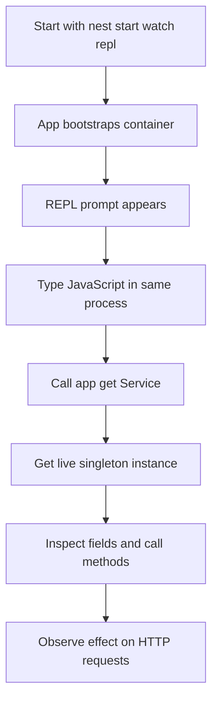

# The NestJS REPL and Interactive Debugging of a Live Container

## English

Most of the time you interact with a NestJS application through HTTP: you send a request, something happens, you get a response. But the framework also ships a REPL mode that boots your application and then hands you a Node.js prompt with the entire IoC container live and inspectable. You start it with `nest start --watch --repl` or by passing `repl: true` in the `NestFactory.create` options, and when the app finishes bootstrapping you get a `>` prompt where you can type JavaScript that runs inside the same process, with the same container, the same database connections, and the same in-memory state as the running server.

What makes this powerful is the `NestFactory.createApplicationContext` and `app.get()` combination. From the REPL you can call `app.get(UsersService)` and get the actual singleton instance the HTTP layer is using — not a mock, not a fresh copy, the very object. You can then call its methods directly, inspect its internal fields, mutate its caches, and watch the effect on subsequent HTTP requests in another terminal. This is a fundamentally different debugging posture from adding `console.log` and restarting: you are probing a live system rather than re-running a script.

The REPL is especially useful for three situations. First, investigating a provider that seems to hold stale state — you can grab the instance and print its fields to see what it actually contains right now. Second, exercising a service method with crafted inputs that would be awkward to send over HTTP, like calling `ordersService.refund(orderId, amount)` directly without building a controller route for it. Third, exploring the container itself: `app.get(ModuleRef)` gives you the module reference, from which you can walk the graph and confirm which providers exist and how they were resolved.

There are caveats worth knowing. The REPL runs in the same event loop as your HTTP server, so a long synchronous operation you type will block request handling — keep experiments fast. Top-level `await` works in modern Node REPL, so you can await promises, but be careful with anything that mutates production-like state, because there is no undo. And the REPL is a development tool: it is not something you enable in production, both because it exposes an arbitrary code execution surface and because it holds the process open waiting for stdin.

A useful habit is to treat the REPL as a scratchpad for understanding your own application. When you are unsure whether a service is a singleton or request-scoped, or whether a module actually exported the provider you think it did, the REPL answers the question in seconds with ground truth rather than inference from reading code. It turns the container from an abstract idea into something you can poke at.

## 中文

大部分時間你透過 HTTP 同 NestJS 應用程式互動：送個 request，發生啲嘢，收到 response。但框架仲有 REPL 模式，會啟動你嘅應用程式，然後畀你一個 Node.js prompt，而整個 IoC 容器係活生生、可以檢查嘅。你可以用 `nest start --watch --repl` 啟動，或者喺 `NestFactory.create` 嘅選項傳 `repl: true`，當應用程式 bootstrap 完成之後你會見到 `>` prompt，可以喺入面打 JavaScript，喺同一個 process、同一個容器、同一條資料庫連線、同一份記憶體狀態之下執行，同正在執行嘅伺服器完全一致。

威力嚟自 `NestFactory.createApplicationContext` 同 `app.get()` 嘅組合。喺 REPL 入面你可以叫 `app.get(UsersService)`，攞到 HTTP 層真正用緊嘅 singleton 例項——唔係 mock，唔係新副本，係同一個物件。你可以直接呼叫佢嘅方法、檢查內部欄位、改動快取，然後喺另一個終端機觀察之後嘅 HTTP request 有咩變化。呢個係同「加 `console.log` 再重啟」完全唔同嘅除錯姿態：你係喺探測一個活系統，而唔係重跑一個 script。

REPL 喺三種情況特別有用。第一，調查一個似乎持有過時狀態嘅 provider——你可以攞到例項，印出佢嘅欄位，睇嚇佢而家真正裝住啲乜。第二，用精心設計嘅輸入去試 service 方法，而呢啲輸入透過 HTTP 送會好麻煩，例如直接呼叫 `ordersService.refund(orderId, amount)`，唔需要為佢開一條 controller 路由。第三，探索容器本身：`app.get(ModuleRef)` 會畀你 module reference，你可以沿住個圖行，確認邊啲 provider 存在、佢哋係點樣解析出嚟。

有幾個要注意嘅地方。REPL 同你嘅 HTTP 伺服器跑喺同一個 event loop，所以你打嘅任何長時間同步操作都會阻塞 request 處理——實驗要快。現代 Node REPL 支援 top-level `await`，所以你可以 await promise，但任何會改動類似生產狀態嘅嘢都要小心，因為冇得 undo。而且 REPL 係開發工具：唔應該喺生產環境啟用，一來佢暴露任意程式碼執行嘅介面，二來佢會 hold 住個 process 等 stdin。

一個好習慣係將 REPL 當成理解自己應用程式嘅草稿紙。當你唔肯定某個 service 係 singleton 定 request-scoped，或者某個 module 究竟有冇 export 你以為有嘅 provider，REPL 幾秒內就畀到你地面真相，而唔係靠讀程式碼推斷。佢將容器由抽象概念變成你可以戳嚇嘅實物。

## Key Takeaway

The REPL boots your real container and hands you a prompt, letting you inspect and call live singleton instances instead of guessing from source code.

## Related Concepts
- ModuleRef
- NestFactory.createApplicationContext

## Diagram

