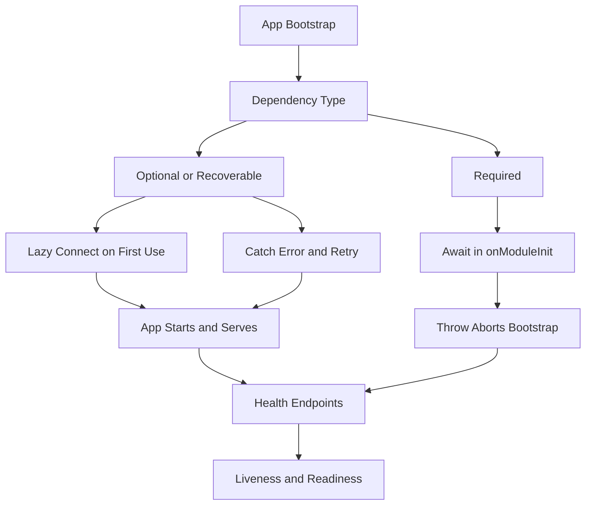

# Graceful Degradation: Handling Dependency Outages Without Crashing the Whole App

## English

A NestJS application typically depends on things outside its own process: a database, a cache, a message broker, an upstream HTTP API. The framework's default posture is optimistic — modules bootstrap, providers connect, and if a connection fails during startup the application throws and refuses to start. That is the right behaviour in many cases, because starting a server that cannot serve anything is worse than not starting at all. But there are dependencies that are optional or recoverable, and treating them the same as the database is a common source of self-inflicted outages.

Consider a cache like Redis. If Redis is down at boot, do you want the whole application to fail? Probably not: you would rather start, serve requests from the database, and reconnect to Redis when it comes back. The same applies to a metrics exporter, a non-critical upstream service, or a feature-flag provider. The pattern for this is to make the connection lazy or resilient: instead of connecting in the constructor and throwing on failure, connect on first use and catch the error, or use a client library that retries in the background. The provider exists immediately; only its readiness varies.

For dependencies that are genuinely required, the opposite pattern applies, and NestJS gives you tools for it. A provider's `onModuleInit` lifecycle hook can await a connection and throw if it fails, which aborts bootstrap and lets your orchestrator (Kubernetes, systemd, a process manager) decide whether to retry. The distinction between liveness (is the process alive?) and readiness (can it serve traffic?) matters here: a process that is alive but not ready should be restarted or removed from the load balancer, not killed outright. Exposing both as separate health endpoints lets your infrastructure make that call correctly.

There is also the runtime case: a dependency that was healthy at boot and fails later. A naive implementation lets every subsequent request throw a 500 from deep inside a service, which is noisy and unhelpful. A better approach is a circuit breaker — after N consecutive failures, stop calling the dependency for a cooldown period and fail fast with a clear error, then probe again. This prevents a slow dependency from tying up your event loop and exhausting connection pools, and it gives the downstream service room to recover. Libraries like `opossum` implement this pattern; the integration with NestJS is typically an interceptor or a wrapper service.

The underlying principle is to classify your dependencies by criticality and handle each class differently. Required-and-blocking dependencies should fail startup loudly. Optional-and-recoverable dependencies should degrade gracefully and reconnect. Slow-and-flaky dependencies should be wrapped in timeouts and circuit breakers. Getting this classification right is more important than any specific library, because it determines what your application does when the world is not cooperating — which is exactly when you need it most.

## 中文

一個 NestJS 應用程式通常依賴自己 process 以外嘅嘢：資料庫、快取、訊息中介軟體、上游 HTTP API。框架預設係樂觀嘅——module bootstrap、provider 連線，如果啟動期間連線失敗，應用程式就會拋錯並拒絕啟動。好多情況下呢個係正確行為，因為啟動一個乜都服務唔到嘅伺服器，比唔啟動更差。但有啲依賴係可選或者可恢復嘅，將佢哋同資料庫同等看待，係一個常見嘅自招故障來源。

諗嚇 Redis 呢類快取。如果啟動時 Redis 死咗，你想唔想成個應用程式都啟動失敗？大概唔想：你寧願照樣啟動、由資料庫服務 request、等 Redis 返嚟先再連。同樣道理適用於 metrics exporter、非關鍵上游服務、或者 feature flag provider。呢個模式係將連線做到 lazy 或者有韌性：唔好喺 constructor 連線並喺失敗時拋錯，而係第一次用到先連、捕捉錯誤，或者用一個會喺背景重試嘅 client library。provider 即刻存在；只係佢嘅就緒程度有變。

對於真正必需嘅依賴，相反嘅模式就適用，而 NestJS 有工具幫你。provider 嘅 `onModuleInit` 生命週期 hook 可以 await 連線，失敗就拋錯，從而中止 bootstrap，交由你嘅編排器（Kubernetes、systemd、process manager）決定要唔要重試。呢度 liveness（process 仲生存嗎？）同 readiness（佢可以服務流量嗎？）嘅分別好重要：一個生存但未就緒嘅 process 應該被重啟或者由負載平衡器移除，而唔係直接殺死。將兩者暴露成獨立嘅健康檢查端點，可以令你嘅基礎設施正確咁做決定。

仲有執行期嘅情況：一個依賴啟動時健康，之後先死。天真嘅實作會令之後每個 request 都由 service 深處拋個 500 出嚟，又吵又冇用。更好嘅做法係斷路器（circuit breaker）——連續失敗 N 次之後，喺冷卻期內停止呼叫嗰個依賴，快速失敗並回傳清晰錯誤，然後再試探。呢個防止一個慢吞吞嘅依賴拖住你嘅 event loop、耗盡連線池，亦畀下游服務有空間恢復。`opossum` 呢類 library 實作咗呢個模式；同 NestJS 嘅整合通常係一個 interceptor 或者一層包裝 service。

背後原則係按關鍵程度將依賴分類，每一類唔同處理。必需且阻塞嘅依賴應該大聲咁令啟動失敗。可選且可恢復嘅依賴應該優雅降級並重連。慢而且不穩定嘅依賴應該包上 timeout 同斷路器。搞好呢個分類，比揀邊個 library 更重要，因為佢決定咗當世界唔合作嗰陣你嘅應用程式會點做——而嗰陣正正就係你最需要佢嘅時候。

## Key Takeaway

Classify dependencies by criticality: fail startup loudly for required ones, degrade and reconnect for optional ones, and wrap flaky ones in timeouts and circuit breakers.

## Related Concepts
- Circuit breaker
- Liveness vs readiness

## Diagram

