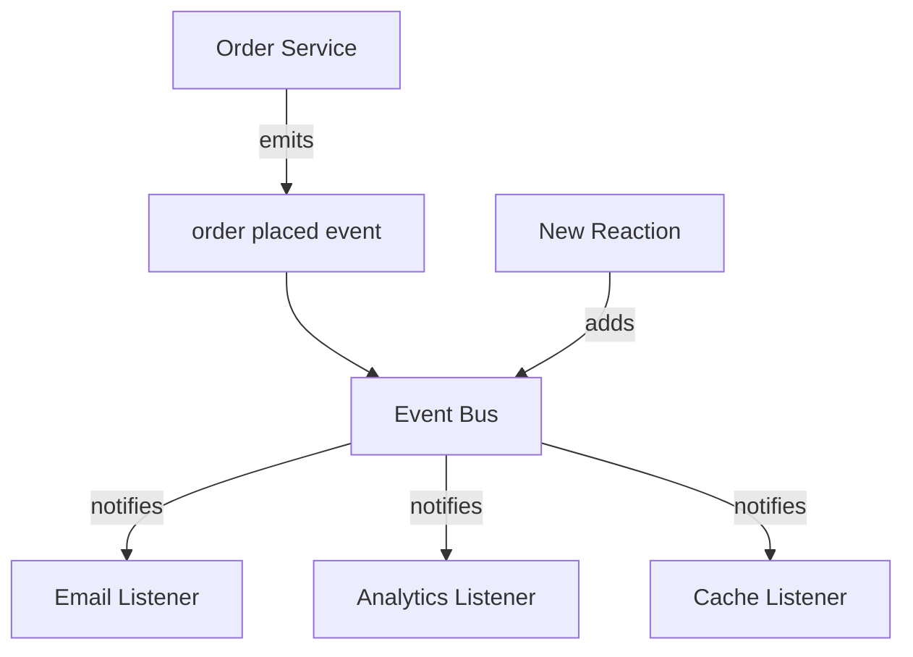

# Event Emitters and the In-Process Event Bus

## English

Sometimes a service needs to tell other parts of the application that something happened, without knowing or caring who is listening. NestJS ships a small module for exactly this: `@nestjs/event-emitter`, which wraps Node's built-in `EventEmitter` and wires it into the dependency injection system. You call `EventEmitterModule.forRoot()` once in your root module, then inject an `EventEmitter2` instance (the underlying library it uses) wherever you want to publish events. Any provider can subscribe by decorating a method with `@OnEvent('user.created')`. The publisher never imports the listener's module, so the two stay decoupled — a classic publish/subscribe pattern inside a single process.

The real value shows up when one action must trigger several unrelated side effects. Imagine an order is placed: you want to send a confirmation email, update an analytics counter, and invalidate a cache. Doing all three inline makes the order service a dumping ground for concerns it should not own. Emitting an `order.placed` event instead lets an email listener, an analytics listener, and a cache listener each react independently. Adding a fourth reaction later means adding a listener, not editing the order code. That is the Open/Closed principle in practice: open for extension, closed for modification.

There are sharp edges worth knowing. By default, `EventEmitter2` emits synchronously — listeners run before the emitting call returns, so a slow listener blocks the publisher. You can pass `{ async: true }` when registering the module to have listeners invoked asynchronously, or mark a listener `@OnEvent('x', { async: true })`. Ordering is also subtle: listeners fire in the order they were registered, and there is no built-in retry or persistence. If a listener throws, the error does not automatically propagate back to the emitter in the async case, so you need your own error handling and logging.

Crucially, an in-process event bus is not a message queue. Events vanish if the process crashes mid-flight, and they never leave the machine, so they cannot reach another instance of your app behind a load balancer. If you need durability, retries, or cross-service delivery, you want a real broker (RabbitMQ, Kafka, Redis Streams) — often via `@nestjs/microservices` or BullMQ. The event emitter is best understood as an internal notification mechanism: cheap, fast, and perfect for decoupling modules inside one process, terrible for anything that must survive a restart.

A good mental model is a school PA system versus the postal service. The PA system (event emitter) is instant and reaches everyone in the building, but nobody hears the announcement if they were not in the building at that moment. The postal service (a message broker) delivers reliably even if the recipient is away, at the cost of latency and infrastructure. Use the PA system for in-process reactions, and reach for the post office when the message must not be lost.

## 中文

有時候一個 service 需要通知應用程式的其他部分「某件事發生了」，但不想知道、也不在乎誰在聽。NestJS 就為此提供了一個小模組：`@nestjs/event-emitter`，它包裝了 Node 內建的 `EventEmitter`，並把它接上依賴注入系統。你在根模組呼叫一次 `EventEmitterModule.forRoot()`，之後在任何想釋出事件的地方注入一個 `EventEmitter2` 例項（它底層所用的函式庫）。任何 provider 都可以用 `@OnEvent('user.created')` 裝飾一個方法來訂閱。釋出者從不 import 訂閱者的模組，兩者因此保持解耦——這就是單一 process 內的經典釋出／訂閱模式。

真正的價值在於一個動作要觸發好幾個互不相關的副作用時。想像一筆訂單成立：你想寄確認電郵、更新分析計數器、以及讓快取失效。把這三件事全部寫在同一段 inline 程式碼，會讓訂單 service 變成什麼雜事都往裡塞的垃圾桶。改為發出一個 `order.placed` 事件，就讓電郵 listener、分析 listener、快取 listener 各自獨立反應。日後要加第四種反應，只需新增一個 listener，而不用改動訂單程式碼。這就是實務上的開放／封閉原則：對擴充開放，對修改封閉。

有幾個尖角值得注意。預設情況下 `EventEmitter2` 是同步發射——listener 會在發射呼叫返回之前執行，所以一個慢的 listener 會阻塞釋出者。你可以在註冊模組時傳 `{ async: true }`，讓 listener 以非同步方式被呼叫，或在 listener 上標記 `@OnEvent('x', { async: true })`。順序也很微妙：listener 按註冊次序觸發，而且沒有內建重試或持久化。若 listener 丟擲錯誤，在非同步情況下錯誤不會自動傳回發射者，所以你必須自己處理錯誤與記錄。

關鍵是：in-process 事件匯流排並不是訊息佇列。如果 process 在事件飛在半路時崩潰，事件就消失了；它們也永遠不離開這臺機器，所以無法到達負載平衡器背後你應用程式的另一個例項。如果你需要永續性、重試、或跨服務傳遞，你要的是真正的 broker（RabbitMQ、Kafka、Redis Streams）——通常經由 `@nestjs/microservices` 或 BullMQ。事件發射器最好理解為內部通知機制：便宜、快速，非常適合在單一 process 內解耦模組，但對任何必須熬過重啟的事情則很糟糕。

一個好的心智模型是校園廣播系統對比郵政服務。廣播系統（事件發射器）即時、能傳遍整棟大樓，但如果當時不在大樓裡的人就聽不到。郵政服務（訊息 broker）即使收件人不在也能可靠送達，代價是延遲與基礎設施。單一 process 內的反應用廣播，訊息絕不能遺失時就找郵局。

## Key Takeaway

The in-process event emitter decouples modules cheaply but is not durable and never leaves the process, so reserve real brokers for anything that must survive a crash or cross a network boundary.

## Related Concepts
- Publish/Subscribe Pattern
- Message Queues and Brokers

## Diagram

