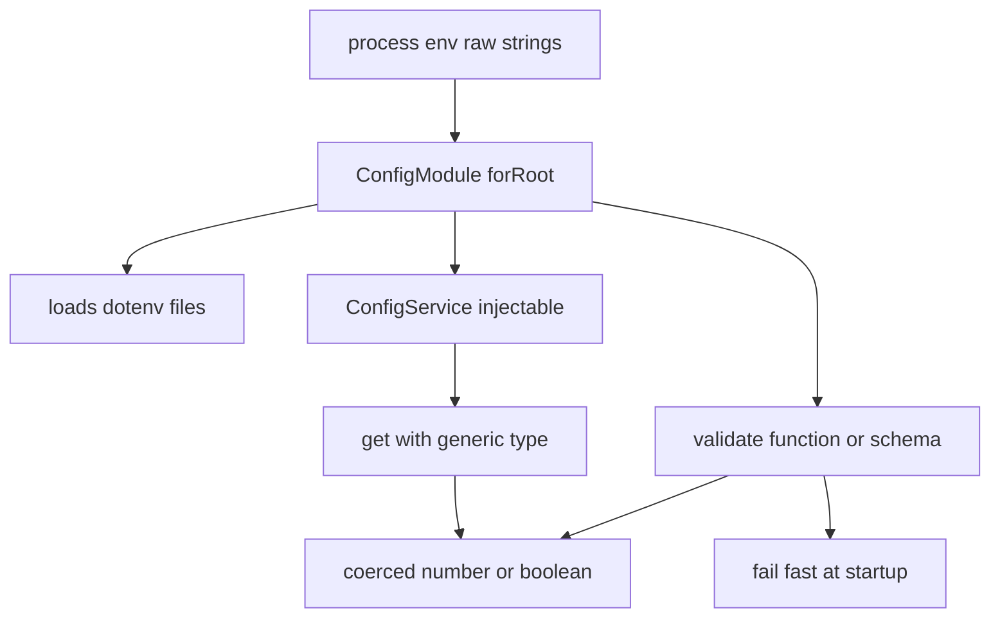

# The NestJS Config Service as a Typed Contract

## English

Reading environment variables directly with `process.env.SOMETHING` is deceptively simple and quietly dangerous. `process.env` values are always strings (or undefined), so a port like `3000` arrives as `"3000"` and a boolean `true` arrives as the string `"true"`, which is truthy in JavaScript — meaning `if (process.env.DEBUG)` is true even when someone sets it to `"false"`. NestJS's `@nestjs/config` module exists to smooth over exactly these traps. `ConfigModule.forRoot()` loads `.env` files into `process.env` and registers a `ConfigService` you can inject, giving you a single, typed, testable place to read configuration.

The first layer of help is type coercion through `get`. Instead of touching `process.env` directly, you call `configService.get<number>('PORT')` or `configService.get('PORT', { infer: true })`. The generic parameter tells TypeScript what type you expect, and the service can convert string values into numbers or booleans. This does not magically validate that the value makes sense — a `PORT` of `"banana"` still comes back as `NaN` — but it does mean you stop sprinkling `parseInt` and `=== 'true'` comparisons throughout the codebase. Configuration reads become greppable and consistent.

The second, more important layer is validation at startup. You can pass a `validate` function to `ConfigModule.forRoot()`, or use a schema library such as Joi or a class-validator-based `validate` function. The idea is to fail fast: if `DATABASE_URL` is missing or `PORT` is not a number, the application should refuse to boot with a clear message, rather than crashing mysteriously on the first request that happens to need that value. This is the difference between discovering a misconfiguration at deploy time (loud, obvious) and discovering it at 3 a.m. in production (silent, painful). A validated config is a contract: the rest of your code can assume the values exist and have the right shape.

The third layer is namespacing. `ConfigModule.forRoot({ load: [databaseConfig] })` lets you group related settings under a named object, and `ConfigModule.forFeature(...)` registers feature-specific configuration in a module. You then read it with `configService.get('database.host')`. This keeps a large app from turning into a flat soup of environment variable names, and it lets each module own the config it cares about. Combined with `cache: true`, the config service can memoize lookups so repeated reads are cheap.

A subtle but valuable consequence is testability. Because `ConfigService` is an injectable provider, a unit test can supply a fake with known values instead of mutating the global `process.env`, which leaks between tests. The overall lesson: treat configuration as an explicit, validated, typed interface at the edge of your application, not as a loose bag of strings that any file can reach into at any time.

## 中文

直接用 `process.env.SOMETHING` 讀環境變數看似簡單，其實暗藏危機。`process.env` 的值永遠是字串（或 undefined），所以像 `3000` 這樣的 port 會以 `"3000"` 抵達，而布林值 `true` 會以字串 `"true"` 抵達——它在 JavaScript 中是真值，意思是即使有人把它設成 `"false"`，`if (process.env.DEBUG)` 依然為真。NestJS 的 `@nestjs/config` 模組正是為了抹平這些陷阱而存在。`ConfigModule.forRoot()` 把 `.env` 檔載入 `process.env`，並註冊一個可注入的 `ConfigService`，給你一個單一、有型別、可測試的地方去讀設定。

第一層幫助是透過 `get` 做型別轉換。不要直接碰 `process.env`，而是呼叫 `configService.get<number>('PORT')` 或 `configService.get('PORT', { infer: true })`。泛型引數告訴 TypeScript 你期望的型別，而 service 可以把字串值轉成數字或布林。這不會神奇地驗證值是否合理——`PORT` 為 `"banana"` 仍會回傳 `NaN`——但它確實讓你不用在整個 codebase 散佈 `parseInt` 與 `=== 'true'` 比較。設定讀取變得可 grep、且一致。

第二層、也是更重要的一層，是啟動時的驗證。你可以傳一個 `validate` 函式給 `ConfigModule.forRoot()`，或使用 Joi、或基於 class-validator 的 `validate` 函式這類 schema 函式庫。重點是快速失敗：若 `DATABASE_URL` 缺失、或 `PORT` 不是數字，應用程式應該拒絕啟動並給出清楚訊息，而不是在第一個剛好需要該值的請求上神秘崩潰。這就是「部署時發現設定錯誤」（響亮、明顯）與「凌晨三點在正式環境發現」（無聲、痛苦）的分別。驗證過的設定是一份契約：其餘程式碼可以假設這些值存在、且形狀正確。

第三層是名稱空間。`ConfigModule.forRoot({ load: [databaseConfig] })` 讓你把相關設定歸入一個具名物件，而 `ConfigModule.forFeature(...)` 在模組內註冊功能專屬設定。之後你用 `configService.get('database.host')` 讀取。這能避免大型應用變成一個扁平的環境變數名稱大雜燴，也讓每個模組擁有它關心的設定。配合 `cache: true`，config service 可以記憶化查詢，讓重複讀取變得便宜。

一個微妙但寶貴的後果是可測試性。因為 `ConfigService` 是可注入的 provider，單元測試可以供給一個帶已知值的假物件，而不用改動全域 `process.env`（那會在測試之間洩漏）。整體的教訓是：把設定視為應用程式邊緣一個明確、經驗證、有型別的介面，而不是任何人任何時候都能伸手進去的一袋鬆散字串。

## Key Takeaway

Inject ConfigService instead of reading process.env directly, and validate the whole configuration at startup so misconfiguration fails loudly at boot rather than silently in production.

## Related Concepts
- Twelve-Factor App Configuration
- Schema Validation

## Diagram

