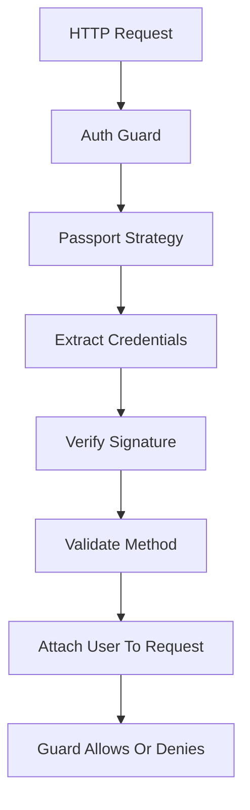

# Passport Strategies and the Auth Guard Contract

## English

Authentication is the question "who are you?", and NestJS answers it with a thin, opinionated layer over Passport, the long-standing Node authentication library. The pattern has three moving parts. First, a strategy — a class extending `PassportStrategy(Strategy)` that implements a `validate` method. Second, an `AuthGuard` created with `AuthGuard('jwt')` (or whatever strategy name you registered) that protects routes. Third, the request object, onto which the strategy attaches the authenticated user. Understanding how these three fit together is more useful than memorizing any single recipe.

A strategy is essentially a plugin that knows how to extract credentials and verify them. The `passport-jwt` strategy, for example, reads a bearer token from the `Authorization` header, verifies its signature against a secret, and decodes the payload. Then it calls your `validate(payload)` method. Whatever `validate` returns becomes `request.user`. That is the entire contract: return a user object (or throw / return null to reject). The guard then simply checks whether `request.user` was set and allows or denies the request. This separation is why the same guard works for any strategy — JWT, local username/password, OAuth, API key — as long as the strategy follows the contract.

A frequent source of confusion is the difference between authentication and authorization. Passport answers "who are you?" and stops there. Whether a given user may access a given route is a separate concern, usually handled by a second guard or a roles decorator. Mixing the two into one strategy makes it hard to reason about, and it also means your JWT strategy has to know about every role in the system. Keeping them separate lets you change the authorization rules without touching the token-verification code.

The strategy classes are ordinary NestJS providers, which means they participate in dependency injection. You can inject a `UsersService` into a JWT strategy to look up the full user record from the token's subject claim, or inject a `ConfigService` to read the secret. This is a major advantage over bare Passport, where you would wire these by hand. It also means strategies must be registered as providers in a module, and the module must import whatever the strategy depends on. A classic bug is forgetting to make the strategy a provider — then the guard silently fails because no strategy with that name was ever registered.

Finally, remember that a JWT is a claim, not a session. The token is self-contained and stateless, so revoking access before expiry requires extra machinery (a token blocklist, short expiry plus refresh tokens, or checking a session store). Passport and NestJS give you the plumbing to verify tokens and attach users, but the security model — how long tokens live, how they are refreshed, how logout actually works — is a design decision you must make deliberately. The framework makes the mechanics easy; the policy is still yours.

## 中文

認證是「你是誰？」這個問題，而 NestJS 用一層薄薄的、有主見的封裝，蓋在護照（Passport）這個歷史悠久的 Node 認證函式庫之上來回答。這個模式有三個活動零件。第一，一個 strategy——繼承 `PassportStrategy(Strategy)` 並實作 `validate` 方法的類別。第二，一個用 `AuthGuard('jwt')`（或你註冊的任何 strategy 名稱）建立的 `AuthGuard`，用來保護路由。第三，request 物件，strategy 會把已認證的使用者掛上去。理解這三者如何拼在一起，比背下任何單一食譜更有用。

Strategy 本質上是一個外掛，知道如何抽取憑證並驗證它們。例如 `passport-jwt` strategy 會從 `Authorization` 標頭讀取 bearer token、用密鑰驗證簽章、解碼 payload，然後呼叫你的 `validate(payload)` 方法。`validate` 回傳什麼，就成為 `request.user`。這就是整個契約：回傳一個使用者物件（或拋出錯誤／回傳 null 以拒絕）。接著 guard 只檢查 `request.user` 有沒有被設定，來放行或拒絕請求。這種分離正是為什麼同一個 guard 對任何 strategy 都適用——JWT、本地用戶名密碼、OAuth、API key——只要 strategy 遵守契約。

常見的混淆來源是認證（authentication）與授權（authorization）的分別。護照回答「你是誰？」就停在那裡。某個使用者可否存取某條路由是另一回事，通常由第二個 guard 或角色裝飾器處理。把兩者混進同一個 strategy 會難以推理，也意味著你的 JWT strategy 必須知道系統中的每一個角色。把它們分開，就能在不碰 token 驗證程式碼的情況下改變授權規則。

Strategy 類別是普通的 NestJS provider，意思是它們參與依賴注入。你可以把 `UsersService` 注入 JWT strategy，從 token 的 subject claim 查出完整使用者紀錄，或注入 `ConfigService` 讀取密鑰。這是相對裸用護照的一大優勢，因為後者你得手動接線。這也意味著 strategy 必須在模組中註冊為 provider，而該模組必須 import strategy 所依賴的一切。經典的 bug 是忘記把 strategy 註冊為 provider——然後 guard 會無聲失敗，因為根本沒有以該名稱註冊的 strategy。

最後，記住 JWT 是一個聲明（claim），不是一個 session。token 是自包含且無狀態的，所以在到期前撤銷存取需要額外機制（token 黑名單、短到期加 refresh token、或檢查 session 儲存）。護照與 NestJS 給你驗證 token 與掛上使用者的管線，但安全模型——token 活多久、如何更新、登出實際上如何運作——是你必須刻意做出的設計決定。框架讓機制變簡單；策略仍然是你的事。

## Key Takeaway

Passport strategies verify credentials and attach request.user, while guards decide access; keeping authentication and authorization separate is what makes the whole pipeline composable and safe.

## Related Concepts
- JSON Web Tokens
- OAuth 2.0 Flows

## Diagram

