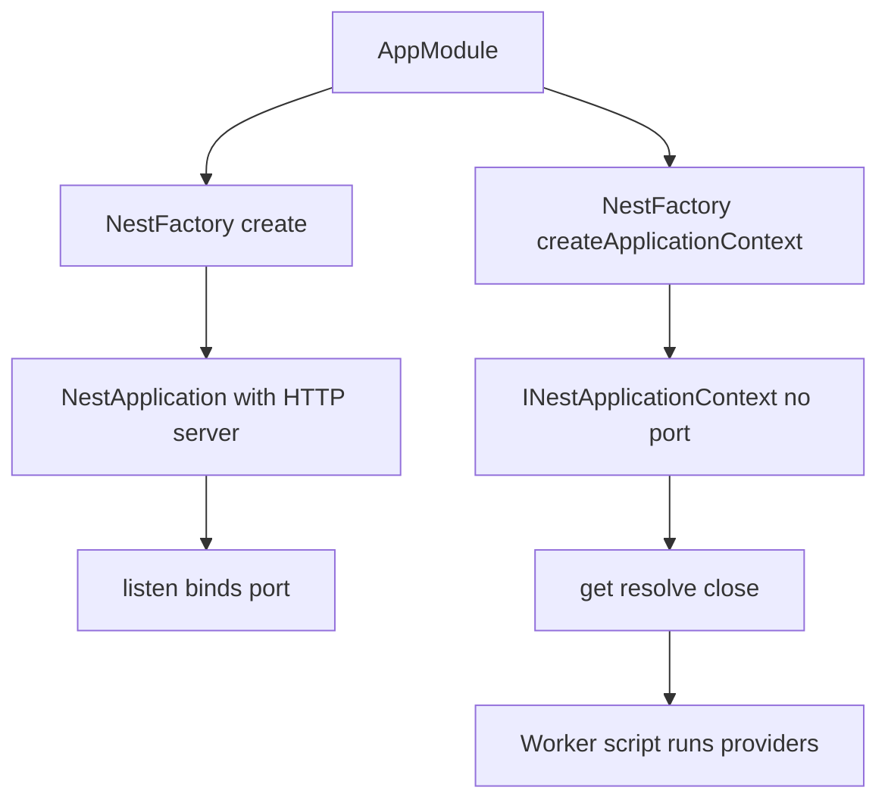

# The NestApplicationContext: Booting the Container Without Listening on a Port

## English

Most people meet NestJS through `NestFactory.create(AppModule)`, which builds the dependency graph and then starts an HTTP server. But there is a second, quieter entry point: `NestFactory.createApplicationContext(AppModule)`, which builds the exact same container — modules resolved, providers instantiated, lifecycle hooks fired — and then simply stops. No port is bound, no routes are mounted, no adapter is loaded for serving traffic. What you get back is an `INestApplicationContext`, an object that exposes `get()` for pulling providers out by token, `resolve()` for request-scoped providers, and `close()` for triggering `onModuleDestroy` and `onApplicationShutdown`.

Why does this matter? Because a huge amount of useful code in a NestJS codebase has nothing to do with HTTP. A command-line migration runner, a one-off data backfill script, a cron worker in a separate process, an AWS Lambda handler, a Kafka consumer — all of these want the same services, repositories, and configuration that your web app uses, but they do not want a web server. With `createApplicationContext` you can write a small `main-worker.ts` that boots the container, calls `app.get(BackfillService).run()`, then `await app.close()`. The service gets its dependencies injected exactly as it would in production, so you are testing real wiring instead of hand-constructing objects.

The subtlety is that the context is not a full `INestApplication`. Methods like `useGlobalGuards`, `enableCors`, `listen`, and `setGlobalPrefix` live on the application, not the context. If you need them, boot with `create()` and just never call `listen()`. That pattern — full application, no server — is what you want when you need the HTTP adapter configured (for example, to reuse middleware) but are running in a test harness or a serverless wrapper where the platform supplies the listener.

A second subtlety: lifecycle hooks fire in the same order in a context as in a full app. `onModuleInit` runs for every provider, then `onApplicationBootstrap`. If a provider opens a database connection in `onModuleInit`, it will be open in your worker script too. This is usually what you want, but it means a worker that only reads from a cache still pays the cost of connecting to Postgres if some unrelated module does so eagerly. The fix is to split the graph: put database-touching providers in a module the worker does not import, or use lazy loading via `LazyModuleLoader` so the connection is only established when first requested.

Finally, remember that `createApplicationContext` is the right tool for integration tests that exercise services rather than controllers. Instead of spinning up Supertest and hitting routes, you boot a context, grab the service, and assert on its return value. You get real DI, real configuration, real lifecycle — without the HTTP layer getting in the way of what you are actually testing.

## 中文

大部分人認識 NestJS 都是透過 `NestFactory.create(AppModule)`：它會建立依賴圖，然後啟動一個 HTTP 伺服器。但其實還有第二個較低調的入口：`NestFactory.createApplicationContext(AppModule)`。它會建立完全相同的容器——模組被解析、provider 被例項化、生命週期鉤子被觸發——然後就停在那裡。它不會繫結任何埠、不會掛載任何路由、也不會載入用於處理流量的 adapter。你拿回的是一個 `INestApplicationContext`，它提供 `get()` 讓你按 token 取出 provider、`resolve()` 用於 request-scoped provider、以及 `close()` 用來觸發 `onModuleDestroy` 與 `onApplicationShutdown`。

為什麼這很重要？因為 NestJS 程式碼庫中大量有用的程式碼與 HTTP 毫無關係。命令列遷移工具、一次性的資料回填指令碼、獨立程序中的 cron worker、AWS Lambda handler、Kafka 消費者——這些全都想要與你的 Web 應用相同的 service、repository 和設定，但不需要 Web 伺服器。用 `createApplicationContext`，你可以寫一個小小的 `main-worker.ts`：啟動容器、呼叫 `app.get(BackfillService).run()`，然後 `await app.close()`。Service 會像在生產環境一樣被注入依賴，所以你測試的是真實的接線，而不是手動建構物件。

微妙之處在於，context 並不是完整的 `INestApplication`。`useGlobalGuards`、`enableCors`、`listen`、`setGlobalPrefix` 等方法存在於 application 上，而非 context 上。如果你需要它們，就用 `create()` 啟動，只是永遠不要呼叫 `listen()`。這種模式——完整 application 但不開伺服器——正是當你需要設定好 HTTP adapter（例如為了重用 middleware），但身處測試框架或由平臺提供 listener 的 serverless 包裝層時所需要的。

第二個微妙之處：生命週期鉤子在 context 中觸發的順序與完整 app 相同。`onModuleInit` 會對每個 provider 執行，然後是 `onApplicationBootstrap`。如果某個 provider 在 `onModuleInit` 中開啟資料庫連線，那麼在你的 worker 指令碼中它也會被開啟。這通常是你想要的，但也意味著一個只讀快取的 worker 仍要付出連線 Postgres 的代價——只要某個無關模組急切地這麼做。解法是把依賴圖切開：把碰資料庫的 provider 放進 worker 不匯入的模組，或使用 `LazyModuleLoader` 做延遲載入，讓連線只在首次被請求時才建立。

最後，`createApplicationContext` 是撰寫「測試 service 而非 controller」的整合測試時的正確工具。與其啟動 Supertest 並打路由，不如啟動 context、取出 service、對其回傳值斷言。你得到真實的 DI、真實的設定、真實的生命週期——而 HTTP 層不會擋在你真正要測的東西前面。

## Key Takeaway

Use `createApplicationContext` when you need the DI container and lifecycle but not an HTTP server — for workers, CLIs, serverless handlers, and service-level integration tests.

## Related Concepts
- Standalone Applications
- Lifecycle Hooks and Graceful Shutdown

## Diagram

