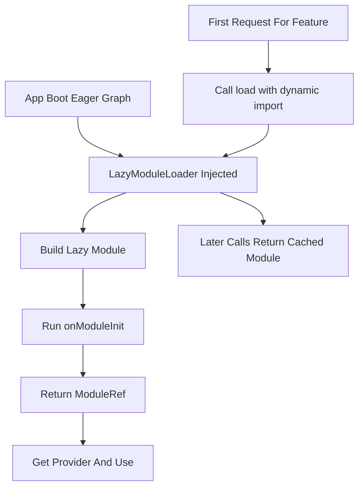

# Lazy Loading Modules: Deferring Part of the Graph Until First Use

## English

NestJS normally builds its entire dependency graph eagerly at boot. Every module listed in `imports`, every provider reachable from those modules, every controller, every factory — all instantiated before the first request arrives. This is great for predictability: if something is misconfigured, you find out at startup, not at 3 a.m. under load. But it becomes a problem when part of your graph is expensive (a connection pool, a heavy SDK client, a large in-memory cache) or only needed for a fraction of traffic (an admin panel, a rarely-used report generator, a plugin system).

`LazyModuleLoader` is NestJS's escape hatch. You inject it like any other provider, then call `await lazyModuleLoader.load(() => import('./reports/reports.module').then(m => m.ReportsModule))`. The first call actually builds the module — resolving its providers, running its `onModuleInit` — and returns a `ModuleRef` you can use to `get()` providers out of it. Subsequent calls with the same module return the cached instance without re-instantiating anything. The `import()` is important: it tells your bundler to code-split that module into a separate chunk, so the JavaScript for the reports feature is not even downloaded until someone asks for it.

This is not free. Lazy-loaded modules cannot be part of the eager graph's dependency resolution — you cannot inject a provider from a lazy module into a provider from an eager module, because at boot time the lazy module does not exist yet. The dependency arrow points the other way: lazy modules can import eager modules freely, but eager modules must reach lazy ones through `LazyModuleLoader` and `ModuleRef.get()`. This inverts the usual mental model and is the single biggest source of confusion when people first try it.

A practical use case is a plugin or extension system. Your core application boots with a small set of providers. A configuration file or database table lists enabled plugins. On first request to a plugin's route, you lazily load its module, register it, and route traffic to it. If the plugin is disabled, its code is never loaded, its dependencies are never constructed, and its migrations never run. The core app stays lean regardless of how many plugins exist. The same pattern works for feature flags: gate a module behind a flag and only load it when the flag is on for the current tenant.

One caveat: because lazy modules participate in the same container, their lifecycle hooks still fire — `onModuleInit` when loaded, `onModuleDestroy` when the application shuts down. If a lazy module opens a connection, that connection is closed properly on `app.close()`. What you lose is the guarantee that misconfiguration surfaces at boot. A typo in a lazy module's provider will only explode the first time someone triggers the load, potentially in front of a user. Treat lazy modules as a deliberate optimization with an operational cost, not a default.

## 中文

NestJS 通常在啟動時就急切地建立整個依賴圖。`imports` 中列出的每個模組、從這些模組可達的每個 provider、每個 controller、每個 factory——全部都會在第一個請求抵達前被例項化。這對可預測性很好：如果哪裡設定錯了，你在啟動時就會發現，而不是凌晨三點在高負載下才發現。但當依賴圖中某部分很昂貴（連線池、重量級 SDK client、大型記憶體快取），或只服務一小部分流量（管理後臺、很少用的報表產生器、外掛系統），這就變成問題。

`LazyModuleLoader` 是 NestJS 的逃生艙。你像注入其他 provider 一樣注入它，然後呼叫 `await lazyModuleLoader.load(() => import('./reports/reports.module').then(m => m.ReportsModule))`。第一次呼叫才真正建立模組——解析其 provider、執行其 `onModuleInit`——並回傳一個 `ModuleRef`，讓你從中 `get()` provider。之後對同一模組的呼叫會回傳快取例項，不會重新例項化任何東西。`import()` 很重要：它告訴 bundler 把該模組切成獨立 chunk，所以報表功能的 JavaScript 根本不會被下載，直到有人需要它。

這不是免費的。延遲載入的模組不能參與急切依賴圖的解析——你不能把 lazy 模組的 provider 注入到 eager 模組的 provider 裡，因為啟動時 lazy 模組還不存在。依賴箭頭指向另一邊：lazy 模組可以自由 import eager 模組，但 eager 模組必須透過 `LazyModuleLoader` 與 `ModuleRef.get()` 才能碰到 lazy 模組。這顛倒了平常的心智模型，也是人們第一次嘗試時最大的困惑來源。

一個實用的場景是外掛或擴充系統。你的核心應用只啟動一小組 provider。某個設定檔或資料庫表列出已啟用的外掛。第一次請求某外掛的路由時，你延遲載入它的模組、註冊它、把流量導過去。若外掛停用，它的程式碼永遠不會被載入、依賴永遠不會被建構、遷移永遠不會執行。核心應用保持精簡，不管有多少外掛存在。同樣的模式也適用於功能旗標：把模組藏在旗標後面，只有目前租戶的旗標開啟時才載入。

一個注意事項：因為 lazy 模組參與同一個容器，它們的生命週期鉤子仍會觸發——載入時 `onModuleInit`、應用關閉時 `onModuleDestroy`。如果 lazy 模組開啟連線，該連線會在 `app.close()` 時正確關閉。你失去的是「設定錯誤會在啟動時浮現」的保證。lazy 模組 provider 裡的一個錯字，只會在有人第一次觸發載入時爆炸，而且可能是在使用者面前。把 lazy 模組視為有營運成本的刻意最佳化，而不是預設做法。

## Key Takeaway

`LazyModuleLoader` lets you defer expensive or rarely-used modules until first use, at the cost of losing boot-time validation and inverting the dependency arrow.

## Related Concepts
- Dynamic Modules
- Module Resolution Order

## Diagram

