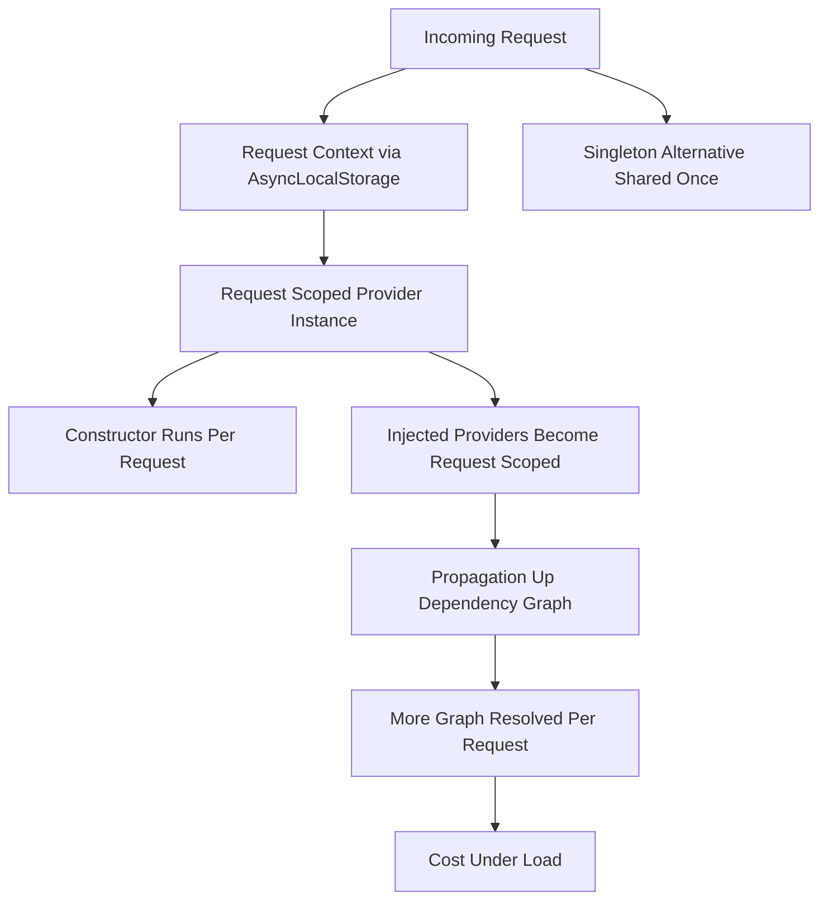

# Request-Scoped Providers Under Load: The Cost Model You Should Know

## English

NestJS defaults every provider to singleton scope: one instance per application, shared across all requests. Request scope changes that — a new instance per incoming request — and it is tempting because it makes per-request state (the current user, a correlation ID, a tenant context) feel natural. But request scope has a cost model that is easy to underestimate, and understanding it is what separates a working app from one that mysteriously slows down under load.

The first cost is instantiation. A singleton is constructed once; a request-scoped provider is constructed on every request that touches it. If the constructor is trivial, this is fine. If it does real work — parsing config, opening a client, building a cache — you are paying that cost on every request. The second cost is propagation: any provider that injects a request-scoped provider becomes request-scoped itself, and so does anything that injects *that*, all the way up. A single request-scoped leaf can silently make half your graph per-request. NestJS will actually refuse to boot if a singleton tries to inject a request-scoped provider without going through `ModuleRef.resolve()`, because the singleton would otherwise capture one request's instance forever — a subtle bug the framework catches for you.

The third cost is the machinery itself. Request-scoped providers are resolved through a per-request context that NestJS tracks using `AsyncLocalStorage` (a Node API that propagates state across async boundaries without threading it through every function call). That tracking is not free: each request allocates a context object, and each `resolve()` walks the graph. For a handful of request-scoped providers this is negligible. For dozens, it shows up in profiles.

The alternative, and usually the better one, is to keep providers singleton and pass request context explicitly. Instead of injecting `CurrentUser` into a service, have the controller extract the user and pass it as an argument. Instead of a request-scoped logger, use a singleton logger that reads the correlation ID from `AsyncLocalStorage` at call time — the same mechanism NestJS uses internally, but without making your providers request-scoped. This gives you per-request behavior with singleton performance.

When is request scope genuinely the right call? When the provider wraps a resource that must not be shared across requests — a database transaction, a per-request SDK client with request-specific auth, a mutable accumulator. In those cases the isolation is the point, and the cost is the price of correctness. The rule of thumb: reach for request scope when sharing would be a bug, not when passing an argument would be mildly inconvenient.

## 中文

NestJS 預設每個 provider 都是 singleton scope：整個應用一個實例，所有請求共用。Request scope 改變了這點——每個進來的請求都拿到新實例——而且很誘人，因為它讓「每個請求的狀態」（目前使用者、correlation ID、租戶 context）感覺很自然。但 request scope 有一套很容易被低估的成本模型，理解它正是「能跑的應用」與「在高負載下莫名變慢的應用」之間的分水嶺。

第一個成本是實例化。Singleton 只被建構一次；request-scoped provider 在每個碰到它的請求上都會被建構。如果建構子很簡單，這沒問題。如果它做真正的工作——解析設定、開啟 client、建立快取——你就是在每個請求上付這筆成本。第二個成本是傳播：任何注入 request-scoped provider 的 provider 自己也會變成 request-scoped，任何注入「那個」的也一樣，一路往上。一個 request-scoped 的葉節點可能默默讓半個依賴圖變成 per-request。NestJS 其實會拒絕啟動——如果 singleton 試圖不透過 `ModuleRef.resolve()` 就注入 request-scoped provider，因為 singleton 否則會永遠抓住某個請求的實例——這是框架幫你抓到的細微 bug。

第三個成本是機制本身。Request-scoped provider 透過 NestJS 用 `AsyncLocalStorage`（一個 Node API，能在非同步邊界之間傳遞狀態，而不必把它串進每個函式呼叫）追蹤的 per-request context 來解析。這個追蹤不是免費的：每個請求配置一個 context 物件，每次 `resolve()` 走一遍依賴圖。對少數幾個 request-scoped provider 來說微不足道；對數十個來說，它會出現在 profile 裡。

替代方案——通常也是更好的方案——是讓 provider 保持 singleton，並明確傳遞請求 context。與其把 `CurrentUser` 注入 service，不如讓 controller 取出使用者並當作參數傳進去。與其用 request-scoped logger，不如用 singleton logger，在呼叫時從 `AsyncLocalStorage` 讀取 correlation ID——這是 NestJS 內部用的同一套機制，但不會讓你的 provider 變成 request-scoped。這讓你用 singleton 的效能得到 per-request 的行為。

什麼時候 request scope 才真正正確？當 provider 包裝的資源絕不能在請求之間共用時——資料庫交易、帶有請求專屬認證的 per-request SDK client、可變的累加器。在那些情況下，隔離本身就是目的，成本是正確性的代價。經驗法則：當「共用」會是 bug 時才用 request scope，而不是當「傳參數」只是有點麻煩時。

## Key Takeaway

Request scope is contagious and costs instantiation plus context tracking per request — use it only when sharing state across requests would be a correctness bug, not merely inconvenient.

## Related Concepts
- Request-Scoped Providers and the AsyncLocalStorage Trick
- Scopes and Lifetime

## Diagram

