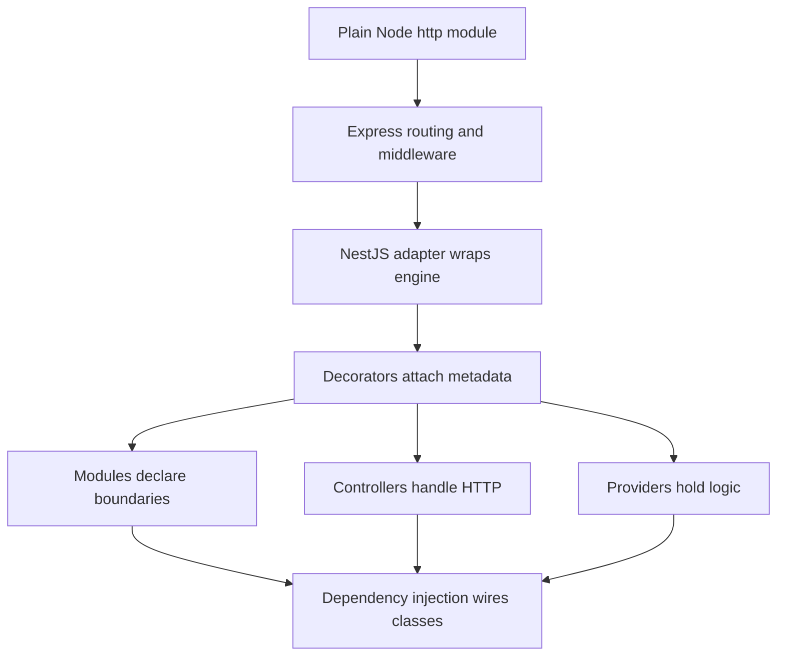

# NestJS as a Meta-Framework: What It Adds on Top of Node

## English

It helps to think of NestJS not as a web framework but as a meta-framework — a framework that sits on top of other frameworks and imposes structure on them. Plain Node ships with http, a low-level module that hands you raw request and response streams and leaves routing, parsing, and error handling to you. Express adds a routing layer and middleware chain. NestJS adds a third layer: a declarative, class-based application model built from decorators, modules, and dependency injection. The key insight is that NestJS does not replace Express or Fastify — it wraps them through an adapter, which is why you can swap the underlying HTTP engine without rewriting your controllers.

The value comes from conventions that scale with team size. In a bare Express app, nothing stops one developer from putting database queries in a route handler and another from putting them in a service — the framework has no opinion. NestJS has strong opinions: controllers handle HTTP, providers hold logic, modules define boundaries. These opinions are enforced loosely by the compiler and strongly by culture, and they pay off when a codebase grows past a few thousand lines and new contributors need to find things without asking.

The declarative style is the other big shift. Instead of writing `app.get('/users', handler)`, you write a class with a `@Get()` method and let the framework discover it. This is inversion of control at the application level: you describe what should exist, and NestJS figures out when to create it and how to wire it. That description lives in metadata attached to your classes by TypeScript decorators, which NestJS reads at startup through reflection.

One consequence worth internalising: because the framework does so much at startup, the startup phase is where most of your bugs live. A missing provider, a circular import, or a misconfigured module shows up as a runtime error when the container boots, not as a compile error. Learning to read those boot-time errors is a skill in itself. Once the app is running, the request path is fast and predictable because all the wiring happened up front.

Finally, NestJS is deliberately opinionated but not rigid. You can drop to the raw request object, register plain Express middleware, or skip the HTTP layer entirely with a standalone application context. The framework's philosophy is that structure should be the default, not a cage — you get the safety of conventions and the escape hatch of the underlying platform when you need it.

## 中文

與其把 NestJS 看成一個網頁框架，不如把它想成一個「元框架」（meta-framework）——即是站在其他框架之上、為它們加上結構的框架。原生 Node 附帶的 http 模組是低階工具，它把原始的請求與回應串流交給你，路由、解析、錯誤處理全部要自己搞。Express 在中間加了一層路由與中介軟體鏈。NestJS 就加上第三層：一個由裝飾器、模組與依賴注入組成的宣告式、以類別為本的應用模型。關鍵洞見是：NestJS 並不取代 Express 或 Fastify，而是透過介面卡把它們包起來，所以你可以換掉底層的 HTTP 引擎而毋須重寫控制器。

它的價值來自能夠隨團隊規模擴充套件的慣例。在一個赤裸的 Express 應用裡，沒有東西阻止一個開發者把資料庫查詢塞進路由處理函式，另一個開發者就把它放在服務層——框架本身沒有立場。NestJS 就很有立場：控制器處理 HTTP，提供者承載邏輯，模組界定邊界。這些立場由編譯器寬鬆地、由文化強烈地執行，當程式碼庫長到幾千行、新同事要不用問人就能找到東西時，這些立場就回本了。

宣告式風格是另一個大轉變。與其寫 `app.get('/users', handler)`，你寫一個類別，裡面有個 `@Get()` 方法，然後讓框架去發現它。這是應用層次的反轉控制：你描述「應該有甚麼」，NestJS 就負責決定何時建立、如何接線。這個描述就住在 TypeScript 裝飾器貼在你類別上的元資料裡，NestJS 在啟動時透過反射讀取。

有一個後果值得記住：因為框架在啟動時做了這麼多事，啟動階段就是你大部分 bug 的藏身之處。缺少的提供者、迴圈匯入、配置錯誤的模組，都會在容器啟動時以執行期錯誤的形式出現，而不是編譯錯誤。讀懂這些啟動期錯誤本身就是一門技能。一旦應用跑起來，請求路徑就快而可預測，因為所有接線都已經預先完成。

最後，NestJS 刻意有主見，但並不僵化。你可以降到原始的請求物件、註冊普通的 Express 中介軟體，甚至完全跳過 HTTP 層，用獨立的應用上下文。框架的哲學是：結構應該是預設，而不是牢籠——你得到慣例的安全感，需要時又有底層平臺的逃生門。

## Key Takeaway

NestJS is a meta-framework that layers declarative structure on top of Express or Fastify, trading boot-time complexity for runtime predictability.

## Related Concepts
- Inversion of Control
- Adapter Pattern

## Diagram

