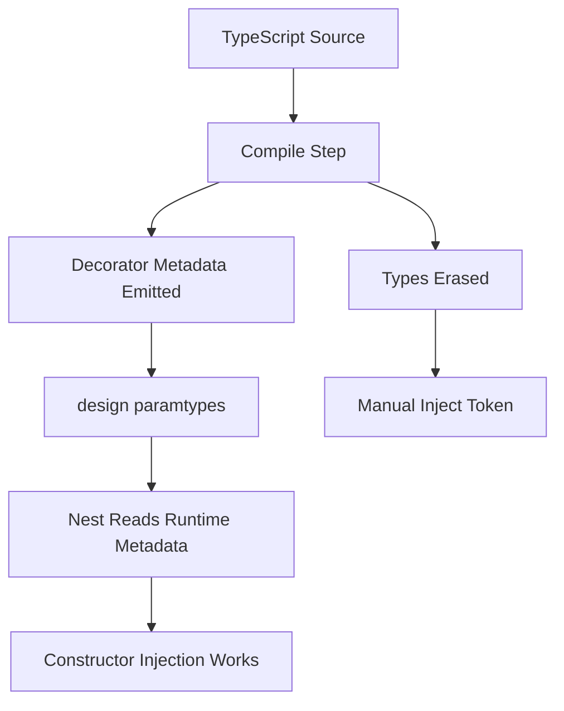

# The Two Languages of a NestJS App: TypeScript at Build Time, Metadata at Runtime

## English

A NestJS application is written in TypeScript but runs as JavaScript, and the gap between those two worlds explains a lot of confusing behaviour. TypeScript types are erased at compile time — they exist to catch mistakes in your editor and then vanish. What survives compilation is the JavaScript code plus any decorator metadata that TypeScript chooses to emit. NestJS depends entirely on that surviving metadata, which is why a decorator like `@Injectable()` on a class is not decoration but a runtime instruction.

When you write a constructor with typed parameters, TypeScript can emit a `design:paramtypes` metadata entry listing the classes of those parameters — but only if you enable `emitDecoratorMetadata` in your tsconfig. This is the mechanism behind the magic where NestJS seems to know what to inject just by looking at your constructor. Without that flag, the types disappear and NestJS has nothing to work with, so you must inject manually with `@Inject(SomeToken)`. Understanding this single flag explains a whole class of "Nest can't resolve dependencies" errors.

Interfaces are a special trap. An interface is a pure type-level construct — it compiles to nothing at all, so there is no runtime value for NestJS to reference. You cannot inject an interface directly. Instead you use a token: a string, a symbol, or a class used as a stand-in. This is why custom providers pair a token with a factory or class. The token is the runtime identity; the interface is only the compile-time shape. Confusing the two is one of the most common early mistakes.

Decorators themselves are just functions that receive the class or method they decorate and can attach metadata to it. `@Injectable()` does not create a service; it calls `Reflect.defineMetadata` to record that this class is available for injection. NestJS later walks the class graph, reads those metadata entries, and builds the dependency tree. The framework is essentially a metadata-driven runtime — the decorators are the source code of that runtime, and your classes are the data.

This split has practical consequences. It means you can inspect and even manipulate the container's decisions through the `Reflector` API. It means tests can override metadata rather than rewrite code. And it means that if you ever ship code through a build step that strips metadata — a minifier, a bundler with the wrong settings, a transpiler that ignores decorators — NestJS will break in ways that look like magic failing. The mental model to keep is: TypeScript describes, decorators record, NestJS reads.

## 中文

一個 NestJS 應用用 TypeScript 寫，但以 JavaScript 執行，而這兩個世界之間的落差解釋了很多令人困惑的行為。TypeScript 型別在編譯時會被抹除——它們的存在是為了在編輯器裡捉錯，然後就消失。編譯後殘留的是 JavaScript 程式碼，加上 TypeScript 選擇發出的裝飾器元資料。NestJS 完全依賴這些殘留的元資料，所以像 `@Injectable()` 這類貼在類別上的裝飾器並非裝飾，而是執行期指令。

當你寫一個帶有型別參數的建構函式，TypeScript 可以發出一個 `design:paramtypes` 元資料條目，列出那些參數的類別——但前提是你在 tsconfig 裡啟用了 `emitDecoratorMetadata`。這就是「NestJS 好像單憑看你的建構函式就知道要注入甚麼」這個魔法背後的機制。沒有這個旗標，型別就消失，NestJS 無從入手，你就必須用 `@Inject(SomeToken)` 手動注入。理解這一個旗標，就解釋了一整類「Nest 無法解析依賴」的錯誤。

介面是一個特別的陷阱。介面是純型別層面的構造——它編譯成虛無，所以沒有執行期值讓 NestJS 引用。你不能直接注入一個介面。取而代之，你用一個權杖（token）：字串、symbol，或者用一個類別作替身。這就是為何自訂提供者要把權杖與工廠或類別配對。權杖是執行期身分；介面只是編譯期的形狀。把兩者混淆是最常見的早期錯誤之一。

裝飾器本身只是函式，它們接收所裝飾的類別或方法，並可以貼上元資料。`@Injectable()` 不會建立服務；它呼叫 `Reflect.defineMetadata` 去記錄這個類別可供注入。NestJS 之後會走訪類別圖、讀取那些元資料條目、建立依賴樹。這個框架本質上是一個元資料驅動的執行期——裝飾器是那個執行期的原始碼，而你的類別是資料。

這個分割有實際後果。它意味著你可以透過 `Reflector` API 檢視甚至操縱容器的決定。它意味著測試可以覆寫元資料而不是改寫程式碼。它也意味著，如果你曾經用一個會剝離元資料的建置步驟出貨——壓縮器、設定錯誤的打包器、忽略裝飾器的轉譯器——NestJS 就會以「魔法失效」的方式壞掉。要記住的心智模型是：TypeScript 描述，裝飾器記錄，NestJS 讀取。

## Key Takeaway

NestJS runs on decorator metadata emitted at compile time, so flags like emitDecoratorMetadata and the difference between interfaces and tokens explain most injection mysteries.

## Related Concepts
- emitDecoratorMetadata
- Injection Tokens

## Diagram

