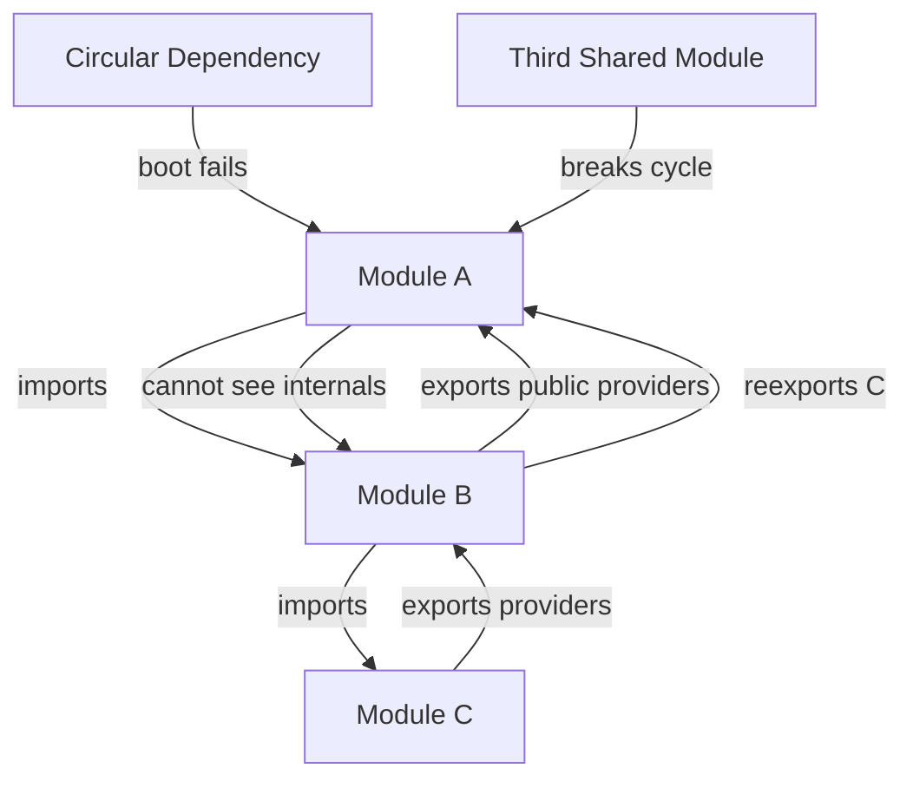

# The Module Graph Is a Contract: Boundaries, Exports, and the Cost of Leaky Design

## English

In NestJS, modules are not just folders — they are the unit of visibility. A provider declared inside a module is private to that module by default. Other modules cannot inject it unless the owning module explicitly lists it in its `exports` array. This is a deliberate design choice borrowed from encapsulation in object-oriented programming: the framework gives you a way to say "this is my public API" and "this is an implementation detail," and it enforces that distinction at container startup rather than at code review.

The `imports` array on a module is the other half of the contract. When module A imports module B, A gains access to whatever B exports — nothing more. It does not gain access to B's internal providers, and it does not gain access to whatever B itself imported unless B re-exports those. This last point trips people up: if B imports C and wants A to be able to use C's providers, B must re-export C. Re-exporting is a legitimate technique for building facade modules that hide a set of related dependencies behind one import.

Why does this matter beyond tidiness? Because leaky module boundaries are the leading cause of the dreaded circular dependency. If module A imports B and B imports A, the container cannot decide which to instantiate first and throws at boot. The fix is almost never `forwardRef` — it is usually a sign that a piece of logic belongs in a third module that both A and B can import. Circular dependencies are a design smell, and NestJS surfaces them early precisely because the module graph is explicit.

There is also a performance and testability dimension. Because the graph is built once at startup, NestJS knows the full dependency tree before the first request arrives. That means it can fail fast on misconfiguration, and it means tests can construct a minimal module containing only the providers under test plus their declared dependencies. If your modules are coarse-grained — one giant AppModule with everything in it — you lose both benefits: every test drags in the whole world, and every change risks touching unrelated code.

The practical discipline is to design modules around capabilities, not file types. A "users" module owns user creation, lookup, and whatever providers those need; it exports only the service that other modules should call. A "billing" module imports users, uses the exported service, and never reaches into users' internals. When you find yourself wanting to export a repository or a raw database handle, that is a signal the boundary is wrong — either the consumer should call the service, or the shared piece deserves its own module.

## 中文

在 NestJS 裡，模組不只是資料夾——它們是可見性的單位。一個在模組內宣告的提供者預設對該模組私有。其他模組不能注入它，除非擁有它的模組在 `exports` 陣列裡明確列出它。這是一個刻意從物件導向封裝借來的設計選擇：框架給你一個方法去講「這是我的公開 API」和「這是實作細節」，並且在容器啟動時而非程式碼審查時執行這個區分。

模組上的 `imports` 陣列是契約的另一半。當模組 A 匯入模組 B，A 就得到 B 所匯出的一切——僅此而已。它不會得到 B 的內部提供者，也不會得到 B 自己所匯入的東西，除非 B 再匯出那些東西。最後這一點最容易令人中招：如果 B 匯入 C，而想讓 A 能用 C 的提供者，B 就必須再匯出 C。再匯出是一個正當技術，用來建立門面模組，把一組相關依賴藏在一個匯入後面。

為何這除了整齊之外還重要？因為漏水的模組邊界是可怕的迴圈依賴的主要成因。如果模組 A 匯入 B，B 又匯入 A，容器就無法決定先例項化哪一個，並在啟動時拋錯。修法幾乎永遠不是 `forwardRef`——通常是一個訊號，顯示某段邏輯應該屬於一個 A 和 B 都能匯入的第三個模組。迴圈依賴是設計異味，而 NestJS 之所以能及早揭露它們，正是因為模組圖是明確的。

還有效能與可測試性的層面。因為圖在啟動時只建立一次，NestJS 在首個請求抵達之前就知道完整的依賴樹。這意味著它可以在配置錯誤時快速失敗，也意味著測試可以建構一個只含受測提供者及其宣告依賴的最小模組。如果你的模組太粗——一個巨型 AppModule 包辦一切——你就同時失去兩個好處：每個測試都拖進整個世界，每次改動都冒著碰到無關程式碼的風險。

實際的紀律是圍繞能力而非檔案型別來設計模組。一個「users」模組擁有使用者建立、查詢，以及那些所需的提供者；它只匯出其他模組應該呼叫的服務。一個「billing」模組匯入 users，使用匯出的服務，永不伸手進 users 的內部。當你發現自己想匯出一個 repository 或原始資料庫控制代碼，那就是邊界錯了——要麼消費者應該呼叫服務，要麼那塊共用的東西值得擁有自己的模組。

## Key Takeaway

A NestJS module is a visibility boundary: providers are private unless exported, and leaky boundaries are the usual root cause of circular dependencies.

## Related Concepts
- Encapsulation
- Circular Dependencies

## Diagram

