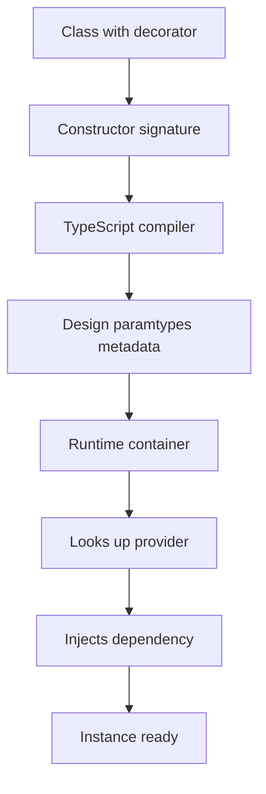

# Why NestJS Feels Like Angular for the Server

## English

If you have ever touched Angular, NestJS will feel eerily familiar. Both frameworks are built around the same three ideas: a class marked with a decorator declares what it is, a constructor signature declares what it needs, and a runtime container figures out how to connect the two. In Angular, `@Component` marks a UI class and `@Injectable()` marks a service that can be injected; in NestJS, `@Controller('cats')` marks an HTTP-facing class and `@Injectable()` marks a provider. The decorators are different words, but the grammar is the same. This is not a coincidence: NestJS was explicitly inspired by Angular's architecture, and the author has said as much publicly.

The mechanism behind both is TypeScript's decorator metadata. When you write `constructor(private readonly catsService: CatsService)`, the TypeScript compiler emits a small runtime array of design-time types (via `emitDecoratorMetadata`). NestJS reads that metadata with `Reflect.getMetadata('design:paramtypes', ...)` and uses it to look up the right provider in the container. That is why you never write `new CatsService()` yourself — the framework already knows from the constructor signature what to pass in. It is the same trick Angular uses to decide which service instance a component receives.

The similarity extends to the module system. Angular has `@NgModule` with `declarations`, `imports`, `providers`, and `exports`; NestJS has `@Module` with `controllers`, `imports`, `providers`, and `exports`. Both are about declaring a boundary: what lives inside this slice of the app, what it borrows from elsewhere, and what it offers to the outside. The mental model — "a module is a contract, not a folder" — transfers directly.

Where the analogy breaks down is the runtime environment. Angular runs in a browser (or on the server via Angular Universal) and cares about the DOM, change detection, and templates. NestJS runs on Node.js and cares about HTTP requests, sockets, message queues, and streams. Angular has templates and components; NestJS has controllers and route handlers. Angular's dependency injection is per-component-tree; NestJS's is per-module-graph. So the shapes rhyme, but the vocabulary and the concerns are different.

For a student, the practical payoff is that learning one framework teaches you something about the other. If you understand why `@Injectable()` exists in NestJS — to tell the container "this class is safe to construct for me" — you also understand why Angular's services are decorated. And if you understand why NestJS separates `controllers` from `providers` in a module, you understand why Angular separates `declarations` from `providers`. The decorator-driven, container-wired style is a family of frameworks, not a single product.

## 中文

如果你之前接觸過 Angular，NestJS 會讓你有一種似曾相識的感覺。兩個框架都圍繞著同一個核心想法：用裝飾器標記的類別宣告「我是什麼」，用建構子簽名宣告「我需要什麼」，再由執行時期的容器負責把兩者接駁起來。在 Angular 裡，`@Component` 標記 UI 類別，`@Injectable()` 標記可被注入的服務；在 NestJS 裡，`@Controller('cats')` 標記處理 HTTP 的類別，`@Injectable()` 標記 provider。裝飾器的字眼不同，但語法結構如出一轍。這並非巧合：NestJS 的架構明確受到 Angular 啟發，作者亦曾公開這樣說過。

背後的機制是 TypeScript 的裝飾器中繼資料（decorator metadata）。當你寫 `constructor(private readonly catsService: CatsService)`，TypeScript 編譯器會產生一小段執行時期的設計型別陣列（透過 `emitDecoratorMetadata`）。NestJS 用 `Reflect.getMetadata('design:paramtypes', ...)` 讀取這段中繼資料，再據此在容器裡尋找對應的 provider。這就是為什麼你永遠不需要自己寫 `new CatsService()`——框架從建構子簽名已經知道要傳入什麼。Angular 決定元件收到哪個服務實例，用的正是同一招。

相似的感覺延伸到模組系統。Angular 有 `@NgModule`，內含 `declarations`、`imports`、`providers`、`exports`；NestJS 有 `@Module`，內含 `controllers`、`imports`、`providers`、`exports`。兩者都在宣告一條邊界：這塊應用裡面有什麼、從外面借了什麼、對外提供什麼。那個心法——「模組是一份契約，不是一個資料夾」——可以直接搬過來用。

類比在執行環境這一層就斷了。Angular 跑在瀏覽器（或透過 Angular Universal 跑在伺服器端），關心的是 DOM、變更偵測與樣板；NestJS 跑在 Node.js 上，關心的是 HTTP 請求、socket、訊息佇列與串流。Angular 有樣板與元件，NestJS 有控制器與路由處理器。Angular 的依賴注入是按元件樹劃分，NestJS 的則按模組圖劃分。形狀相似，但詞彙與關注點不同。

對學生來說，實際的好處是：學一個框架會讓你更懂另一個。如果你明白 NestJS 為何要有 `@Injectable()`——告訴容器「這個類別可以放心幫我建構」——你也就明白 Angular 的服務為何要加裝飾器。如果你明白 NestJS 為何在模組裡把 `controllers` 與 `providers` 分開，你也就明白 Angular 為何把 `declarations` 與 `providers` 分開。這種裝飾器驅動、容器接駁的風格，是一整個家族，而不是單一產品。

## Key Takeaway

NestJS borrows Angular's decorator-plus-container grammar, so the same mental model transfers between the two frameworks even though they run in very different environments.

## Related Concepts
- Decorator metadata and design:paramtypes
- Angular NgModule vs NestJS @Module

## Diagram

