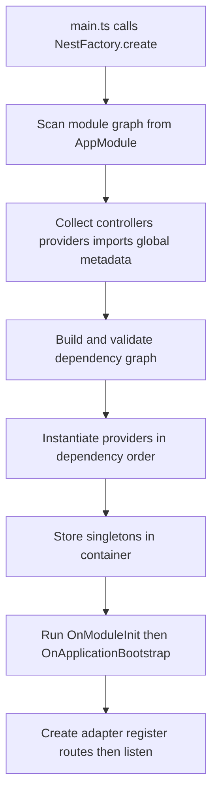

# The NestJS Boot Sequence: What Happens Between main.ts and the First Request

## English

Most tutorials show `NestFactory.create(AppModule)` and then `app.listen(3000)`, and that is it. But a surprising amount happens in that one line, and understanding it turns debugging from guesswork into reasoning. When you call `NestFactory.create`, NestJS does not just `require()` your module and start a server. It builds a dependency graph, validates it, instantiates providers in the right order, and only then hands control back to you.

The first phase is scanning. NestJS walks the module graph starting from `AppModule`, following every `imports` edge, and collects metadata from every class it finds: which classes are controllers, which are providers, which are imported modules, which are global. This is why a typo in a module's `imports` array can silently produce a "Nest can't resolve dependencies" error at boot rather than at request time — the graph is built eagerly, before any traffic exists.

The second phase is instantiation. NestJS resolves providers in dependency order: if `CatsService` needs `DatabaseService`, `DatabaseService` is constructed first. Singletons are created once and stored in the container. Request-scoped providers are not instantiated here — they are deferred until a request actually arrives, because there is no request to bind them to yet. This is why a request-scoped provider that does heavy work in its constructor will not slow down boot, but will slow down every single request.

The third phase is initialization. Every provider that implements `OnModuleInit` gets its `onModuleInit()` called; then `OnApplicationBootstrap` hooks fire; then the HTTP adapter is created and routes are registered. Only after that does `app.listen()` actually open a socket. If you have ever wondered why a NestJS app can take a second or two to start on a cold boot, this is where the time goes — not in Node itself, but in graph construction and hook execution.

The practical upshot: when something fails at boot, the error message usually tells you which module could not resolve which dependency, and the fix is almost always in an `imports` array or an `exports` array, not in your business logic. When something fails on the first request but not on subsequent ones, suspect a request-scoped provider doing lazy work. And when you want to run code that must complete before the server accepts traffic — warming a cache, opening a connection pool — the right place is `onApplicationBootstrap`, not the top of `main.ts`.

## 中文

大部分教學只示範 `NestFactory.create(AppModule)` 然後 `app.listen(3000)`，就這樣。但單單這一行背後發生的事情多得驚人，理解它有助你把除錯由靠猜變成靠推理。當你呼叫 `NestFactory.create`，NestJS 並不是單純 `require()` 你的模組然後開一個伺服器。它會建構依賴圖、驗證它、按正確次序實例化 provider，然後才把控制權交還給你。

第一階段是掃描。NestJS 由 `AppModule` 開始走訪模組圖，沿著每一條 `imports` 邊走，收集每個類別的中繼資料：哪些是 controller、哪些是 provider、哪些是被匯入的模組、哪些是全域的。這就是為什麼模組 `imports` 陣列裡打錯一個字，會在啟動時而不是請求時悄悄產生「Nest can't resolve dependencies」錯誤——圖是在任何流量出現之前就急切建構好的。

第二階段是實例化。NestJS 按依賴次序解析 provider：如果 `CatsService` 需要 `DatabaseService`，就先建構 `DatabaseService`。單例只建立一次並存放在容器裡。Request-scoped provider 不會在這裡實例化——它們會延後到真的有請求進來時才建立，因為此刻根本沒有請求可以綁定。這解釋了為什麼在建構子裡做重活的 request-scoped provider 不會拖慢啟動，但會拖慢每一個請求。

第三階段是初始化。每個實作了 `OnModuleInit` 的 provider 會收到 `onModuleInit()` 呼叫；然後 `OnApplicationBootstrap` 掛鈎觸發；然後 HTTP adapter 被建立、路由被註冊。要到這之後，`app.listen()` 才真正打開 socket。如果你曾疑惑為何 NestJS 應用在冷啟動時要一兩秒才起來，時間就花在這裡——不是 Node 本身，而是圖的建構與掛鈎的執行。

實際的啟示：啟動時出錯，錯誤訊息通常會告訴你哪個模組解析不到哪個依賴，而修正幾乎總是在 `imports` 或 `exports` 陣列，而不是你的業務邏輯。若第一個請求失敗但之後的請求正常，就懷疑是某個 request-scoped provider 在做延遲工作。若你想執行一些必須在伺服器接受流量之前完成的程式碼——預熱快取、開啟連線池——正確的位置是 `onApplicationBootstrap`，而不是 `main.ts` 的頂部。

## Key Takeaway

NestFactory.create eagerly builds and validates the whole dependency graph before a single request arrives, so boot-time errors are almost always graph errors, not logic errors.

## Related Concepts
- OnModuleInit and OnApplicationBootstrap
- NestFactory.create internals

## Diagram

