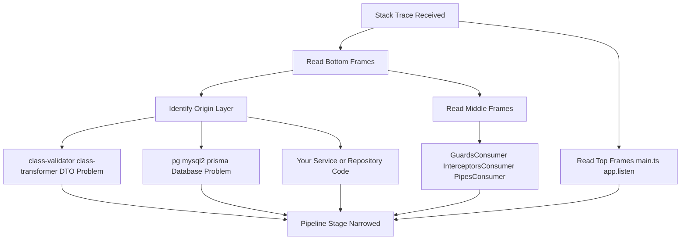

# Reading a NestJS Stack Trace: Mapping Errors Back to the Framework

## English

When something breaks in a NestJS app, the stack trace is your best friend — but only if you know how to read it. NestJS adds several layers between your code and the raw Node.js runtime: the HTTP adapter (Express or Fastify), the routing layer, the request pipeline (middleware, guards, interceptors, pipes), and your controller. A stack trace that looks like a wall of `node_modules` frames is actually telling you exactly which layer threw.

Start from the bottom. The last few frames are usually the origin of the error — your service method, your repository call, or a validation failure inside a pipe. If the bottom frames are in `class-validator` or `class-transformer`, you have a DTO validation problem, and the fix is in your DTO or your `ValidationPipe` configuration, not in your controller. If the bottom frames are in `pg` or `mysql2` or `prisma`, you have a database problem, and the fix is in your query or your schema. The bottom is where the truth is.

Now look at the middle. Frames from `@nestjs/core` and `@nestjs/common` tell you which pipeline stage the error passed through. If you see `GuardsConsumer`, the error happened inside a guard — likely an auth check that threw instead of returning `false`. If you see `InterceptorsConsumer`, an interceptor threw before or after calling `next.handle()`. If you see `PipesConsumer`, a pipe threw during transformation or validation. These names are stable across NestJS versions and are worth memorising, because they instantly narrow the search space.

The top frames are usually your entry point: `main.ts`, `app.listen`, or the HTTP adapter's request handler. They are the least informative part of the trace for debugging, but they confirm the request actually reached the framework and did not die at the socket level. If the top frames are in `express` or `fastify` and the bottom frames are also in those libraries, the error may be happening outside NestJS entirely — for example, a body parser rejecting a malformed payload before any of your code runs.

A few habits pay off. First, run with source maps enabled (`node --enable-source-maps dist/main.js` or the equivalent in your start script) so traces point at your TypeScript, not compiled JavaScript. Second, use `@nestjs/common`'s built-in `Logger` rather than `console.log`, so log lines carry context like `[CatsService]` and correlate with the trace. Third, when an error is swallowed by an exception filter, check whether the filter is logging the original error before transforming it — otherwise you lose the bottom of the trace entirely. Reading traces is a skill, and NestJS's layered architecture makes it a very learnable one.

## 中文

NestJS 應用出錯時，stack trace 是你最好的朋友——但前提是你懂得怎樣讀。NestJS 在你的程式碼與原生 Node.js 執行環境之間加了好幾層：HTTP adapter（Express 或 Fastify）、路由層、請求管道（middleware、guard、interceptor、pipe），然後才是你的 controller。一段看起來滿是 `node_modules` frame 的 stack trace，其實正正告訴你哪一層拋出了錯誤。

由底部開始看。最底的幾個 frame 通常就是錯誤的源頭——你的 service 方法、你的 repository 呼叫，或者 pipe 內部的驗證失敗。如果底部 frame 落在 `class-validator` 或 `class-transformer`，那就是 DTO 驗證問題，修正應在 DTO 或 `ValidationPipe` 設定，而不是 controller。如果底部 frame 落在 `pg`、`mysql2` 或 `prisma`，那就是資料庫問題，修正應在查詢或 schema。真相在底部。

然後看中間。來自 `@nestjs/core` 與 `@nestjs/common` 的 frame 告訴你錯誤經過哪個管道階段。若見到 `GuardsConsumer`，錯誤發生在 guard 之內——很可能是某個認證檢查拋出錯誤而非回傳 `false`。若見到 `InterceptorsConsumer`，就是某個 interceptor 在呼叫 `next.handle()` 前後拋錯。若見到 `PipesConsumer`，就是某個 pipe 在轉換或驗證時拋錯。這些名字在各個 NestJS 版本都相當穩定，值得記住，因為它們能即時收窄搜索範圍。

頂部 frame 通常是你程式的入口：`main.ts`、`app.listen`，或 HTTP adapter 的請求處理器。它們對除錯的資訊量最低，但能確認請求真的到達了框架，而不是在 socket 層就死掉。如果頂部 frame 在 `express` 或 `fastify`，底部 frame 也在那些函式庫裡，錯誤可能完全發生在 NestJS 之外——例如 body parser 在你的程式碼執行之前就拒絕了格式錯誤的 payload。

幾個習慣會有回報。第一，開啟 source map（`node --enable-source-maps dist/main.js` 或啟動腳本裡的等效設定），讓 trace 指向你的 TypeScript 而非編譯後的 JavaScript。第二，用 `@nestjs/common` 內建的 `Logger` 而不是 `console.log`，讓日誌行帶有 `[CatsService]` 之類的上下文，可與 trace 對應。第三，當錯誤被 exception filter 吞掉時，檢查該 filter 在轉換錯誤之前有沒有記錄原始錯誤——否則你會完全失去 trace 的底部。讀 trace 是一門技能，而 NestJS 的分層架構令它非常易學。

## Key Takeaway

A NestJS stack trace is layered like the framework itself: bottom frames show the true origin, middle frames name the pipeline stage, and top frames just confirm the request arrived.

## Related Concepts
- Source maps and --enable-source-maps
- GuardsConsumer, InterceptorsConsumer and PipesConsumer

## Diagram

