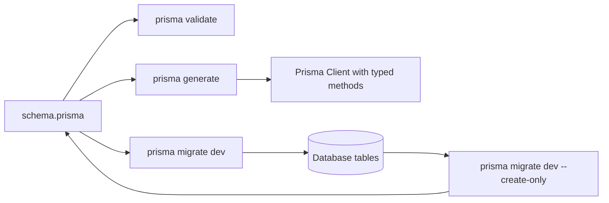

# The Prisma Schema DSL and How It Maps to Your Database

### English

Prisma describes your data model in a single file, `schema.prisma`, written in the **Prisma Schema Language** (PSL). This file is the source of truth: from it, Prisma generates a real SQL migration and a type-safe client. The flow is like keeping a detailed blueprint of a building — the blueprint is what you edit, and tools derive the actual structure from it.

At the top you declare the **datasource**, which says which database engine you connect to (PostgreSQL, MySQL, SQLite, SQL Server, MongoDB) and where the connection string lives. You normally keep the URL in an environment variable rather than hard-coding it, so the same schema works in development and production. You also declare the **generator**, usually `prisma-client-js`, which tells Prisma which client to build.

Then you define **models**, one per table. A model contains fields, and each field has a name, a type, and optional attributes. A `String` field with `@id` becomes the primary key; `Int @default(autoincrement())` becomes a serial primary key. `DateTime @default(now())` becomes a column with a database-side default. Optionality matters: `String?` makes the column nullable, while a plain `String` does not.

Relations are declared on both sides. `posts Post[]` on a `User` model means one user has many posts, and `author User @relation(fields: [authorId], references: [id])` on `Post` means each post belongs to one user. The `@relation` attribute is where the foreign key column is specified. Prisma validates that both ends agree, so a mismatch is caught at validation time rather than at 3 a.m. in production.

Finally, **native database features** are expressed through attributes that map to SQL constructs the ORM cannot infer: `@@unique([email, tenantId])` for a composite unique index, `@@index([createdAt])` for a lookup index, `@default(uuid())` for a UUID primary key, and `Unsupported("tsvector")` when you need a column type Prisma has no native type for.

### 中文

Prisma 用一個檔案 `schema.prisma` 描述你嘅資料模型，呢個檔案用 **Prisma Schema Language**（PSL）寫。呢個檔案就係 single source of truth：Prisma 會由佢生成真正嘅 SQL migration，同埋一套型別安全嘅 client。整個流程好似你手上有一份詳細嘅大廈藍圖 —— 你改嘅永遠係藍圖，而各種工具再由藍圖推導出實際結構。

檔案最頂部會宣告 **datasource**，講明你連緊邊個資料庫引擎（PostgreSQL、MySQL、SQLite、SQL Server、MongoDB），同埋連接字串喺邊度搵。正常做法係將 URL 放喺環境變數而唔係硬寫死，令同一份 schema 喺開發同生產環境都用到。你亦會宣告 **generator**，通常係 `prisma-client-js`，話畀 Prisma 要建邊一種 client。

之後就係定義 **model**，一個 model 對應一張表。Model 入面有欄位，每個欄位有名稱、類型同可選嘅屬性。標住 `@id` 嘅 `String` 欄位會變成主鍵；`Int @default(autoincrement())` 會變成流水號主鍵；`DateTime @default(now())` 會變成由資料庫自行填入嘅預設值欄位。可空性好緊要：`String?` 代表該欄位可以為 null，單純嘅 `String` 就唔可以。

關係（relation）要喺兩邊同時宣告。`User` model 上嘅 `posts Post[]` 意思係一個用戶有好多篇文章，而 `Post` 上嘅 `author User @relation(fields: [authorId], references: [id])` 意思係每篇文章屬於一個用戶。外鍵欄位就係喺 `@relation` 入面指定。Prisma 會檢查兩邊係咪一致，所以唔一致嘅情況喺驗證階段就會爆，唔會拖到production 凌晨三點先出事。

最後，一啲 **native database feature**（原生資料庫功能）靠 attribute 表達，因為 ORM 猜唔到佢哋：`@@unique([email, tenantId])` 代表複合唯一索引，`@@index([createdAt])` 代表查詢索引，`@default(uuid())` 代表 UUID 主鍵，而 `Unsupported("tsvector")` 就係當你需要 Prisma 原生冇對應類型嘅欄位類型時使用。

## Key Takeaway
`schema.prisma` is a validated, declarative blueprint of your tables and relations, and every other Prisma artefact — the client, the migrations, the types — is generated from it.

## Related Concepts
- Database normalisation
- Foreign keys and referential integrity
- Prisma Client API
- Schema introspection and db pull

## Diagram

