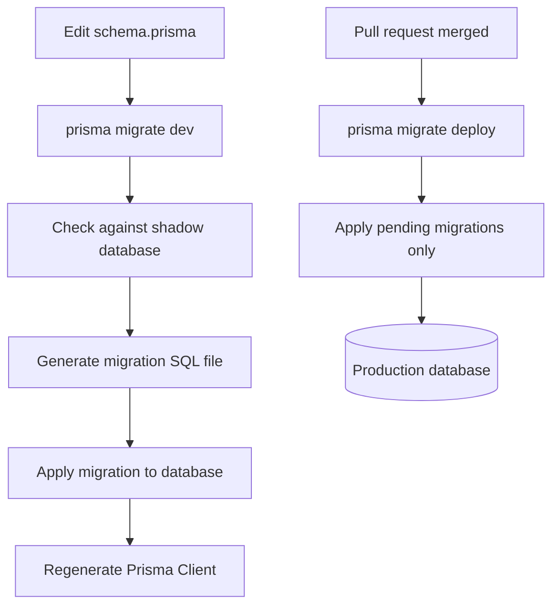

# Migrations, Drift and the dev / deploy Workflow

### English

A **migration** is a versioned, immutable description of a change to your database structure — a folder with a SQL file and a `migration_lock.toml`. The SQL is what actually runs against the database; it is generated from your `schema.prisma`, but you can edit it by hand before it is applied, which matters for things Prisma cannot express such as a complex partial index or a data backfill.

Prisma gives you three commands for three different situations. `prisma migrate dev` is the **development** command: it compares your schema against the migrations history and the database, generates a new migration file if they differ, applies it, and then regenerates the client. It also protects you with a shadow database — a throwaway copy used to detect that your migration would destroy data, so it can warn you before anything bad happens. `prisma migrate deploy` is the **production** command: it applies any pending migrations that have not been run yet, and never prompts, never generates, and never resets. That is exactly what you want in CI or in a release pipeline.

`prisma migrate reset` drops the database, re-applies every migration from scratch, and re-seeds it — handy for resetting a local development database, and dangerous in production.

**Drift** is when the real database structure no longer matches your migration history. It happens when someone changes the database directly (a manual `ALTER TABLE`, a DBA script, a hand-edited production table) without creating a migration. Prisma then sees a mismatch and complains that the database schema is not in sync. `prisma migrate dev` will try to fix this by generating a migration that represents the difference; `prisma db pull` instead does the opposite — it introspects the live database and overwrites your `schema.prisma` so it reflects reality. The right choice depends on which side you trust: if the manual change was correct and should be kept, use `db pull` and then commit the updated schema; if it was an accident, reset the database in development.

In production, the safe habit is to review generated SQL before merging, never to run `migrate dev` against a production database, and to always deploy with `migrate deploy`.

### 中文

**Migration**（遷移）係一個有版本、唔可以修改嘅資料庫結構變更描述 —— 一個資料夾，入面有 SQL 檔案同一個 `migration_lock.toml`。真正對資料庫執行嘅係嗰個 SQL：佢由你嘅 `schema.prisma` 生成，但喺真正執行之前你仲可以手動改佢 —— 呢個好重要，因為 Prisma 表達唔到嘅嘢（例如複雜嘅 partial index 或者資料回填 backfill）就要靠人手寫。

Prisma 為三種唔同情境提供三條命令。`prisma migrate dev` 係**開發**用嘅命令：佢會將你嘅 schema 同 migrations 歷史同一資料庫比較，如果有差異就生成新嘅 migration 檔案、執行佢，再重新生成 client。佢仲有一個 shadow database（影子資料庫）做保護 —— 一個用完即棄嘅臨時副本，用嚟偵測你個 migration 會唔會清空資料，於是喺出事之前先提醒你。`prisma migrate deploy` 係**生產**用嘅命令：佢只會執行仲未行過嘅 pending migrations，唔會問問題、唔會生成新嘢、亦唔會 reset。呢個正正就係 CI 或發佈流程想要嘅行為。

`prisma migrate reset` 會 drop 個資料庫、重新由頭行一次所有 migrations，再重新 seed 資料 —— 適合重設本地開發資料庫，但喺 production 極度危險。

**Drift**（漂移）指真正嘅資料庫結構同你嘅 migration 歷史唔一致。通常係因為有人直接改咗資料庫（手動 `ALTER TABLE`、DBA script、production 上人手改表）但冇建立 migration。Prisma 見到唔一致就會報錯話 schema 唔同步。`prisma migrate dev` 會試住生成一個代表呢個差異嘅 migration 嚟修正；`prisma db pull` 就反過來 —— 佢會 introspect（反射）實際資料庫，然後覆寫你嘅 `schema.prisma` 令佢同現實一致。邊個做法啱，要視乎你信邊一邊：如果嗰次人手改動係故意而且應該保留，就用 `db pull` 再 commit 咗更新過嘅 schema；如果係意外，就喺開發環境 reset 個資料庫。

喺 production 嘅安全習慣係：合併前必睇一次生成嘅 SQL、絕對唔好對 production 跑 `migrate dev`、同埋一律用 `migrate deploy` 發佈。

## Key Takeaway
`migrate dev` is a safe, prompt-friendly development loop with drift detection, `migrate deploy` is the non-interactive production command, and drift always comes from changing the database outside of a migration.

## Related Concepts
- Schema migration versioning
- Shadow database
- Continuous delivery pipelines
- Database introspection

## Diagram

