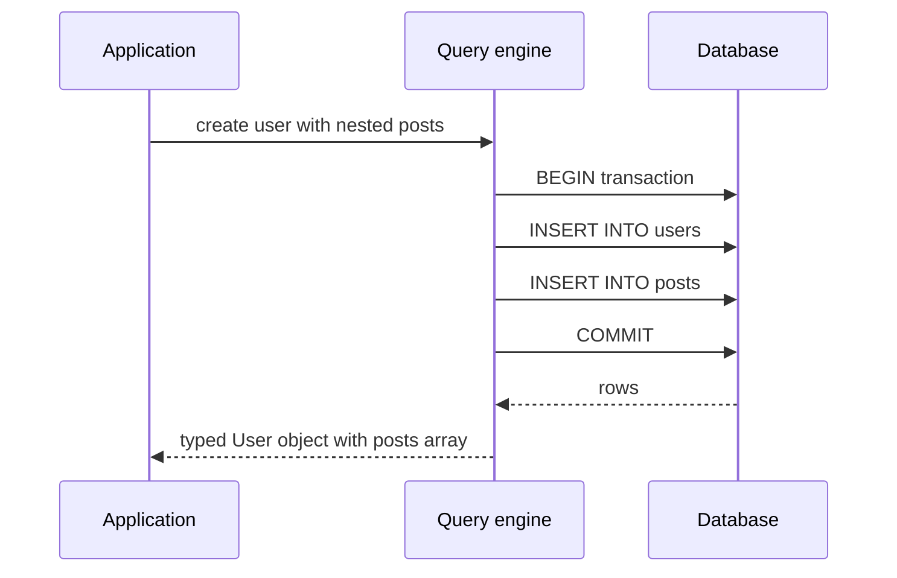

# Transactions, Relations and the Prisma Query Engine

### English

Prisma models relations as a **type-safe object graph**. If `User` has `posts Post[]` and `Post` has `author User`, then `prisma.user.findUnique()` returns a user whose `posts` is an array of posts, and each post can itself carry its `author`. Reading relations is a single operation in your code — whether it costs one database query or several is Prisma's problem, not yours. This is a big deal compared with hand-written SQL, where joining tables by hand is where most bugs live.

The default Prisma Client uses a **query engine**, a separate process that translates your calls into SQL and returns raw rows; the TypeScript client then shapes those rows into your model objects. Because the shaping happens in your application process, Prisma can offer a fully type-safe API without the database understanding TypeScript. The newer **Rust-free architecture** replaces the query engine with a TypeScript-based compiler that talks to the database through a driver (or through an extension like Prisma Accelerate or a serverless adapter), which makes cold starts much faster and enables edge runtimes. The trade-off is that the TypeScript compiler does less aggressive query optimisation, and some features that need engine-level support — such as full-text search with `previewFeatures` — behave differently.

**Transactions** guarantee that a set of writes either all succeed or none do. Prisma offers two forms. The **interactive transaction** is a callback: you open it, run several queries, and commit at the end, with `tx` as the client. Because the callback form requires a single round trip to open and commit, it can hold a connection for a long time, so keep the work inside it short. The **array transaction** form runs a list of operations in one atomic batch without a callback, which is more efficient for bulk work.

Nested writes are also transactional by default: `prisma.user.create({ data: { posts: { create: [...] } } })` inserts the user and all their posts in one transaction, and rolls everything back if one insert fails.

Relations can be loaded in two styles. **Eager loading** uses `include` (or `select` for specific fields) to fetch related records in the same call, which is usually one round trip with a join or a second `IN` query. **Lazy loading** is not available by default in Prisma (unlike some other ORMs), so you must ask explicitly for the relation you need — this is a deliberate design choice that keeps query counts predictable.

### 中文

Prisma 將關係建模成一張 **type-safe 物件圖**。如果 `User` 有 `posts Post[]`，而 `Post` 有 `author User`，咁 `prisma.user.findUnique()` 返回嘅 user 入面，`posts` 係一組 post，每個 post 又可以帶住自己嘅 `author`。喺你嘅程式碼入面，讀取關聯就係一個操作 —— 至於底層究竟係一條定幾條 SQL，係 Prisma 嘅事，唔關你事。呢點非常關鍵，因為喺手寫 SQL 嘅世界入面，join 表格正正係大部分 bug 嘅溫床。

預設嘅 Prisma Client 用緊一個 **query engine**（查詢引擎），係一個獨立行程，負責將你嘅呼叫翻譯成 SQL 再拎返原始 row；然後 TypeScript client 先將啲 row 整理成你嘅 model 物件。因為整形係喺你嘅應用程式行程內完成，Prisma 先可以喺資料庫唔識 TypeScript 嘅情況下提供完全 type-safe 嘅 API。較新嘅 **Rust-free architecture** 就用一個 TypeScript compiler 取代 query engine，直接經 driver（或者經 Prisma Accelerate、serverless adapter 之類嘅 extension）同資料庫溝通，令 cold start 快好多，亦支援喺 edge runtime 行。代價係 TypeScript compiler 嘅 SQL 最佳化冇咁進取，而且一啲需要引擎層支援嘅功能（例如 full-text search）行為會唔同。

**Transaction**（交易）保證一組寫入操作係全部成功，抑或全部唔發生。Prisma 有兩種形式。**Interactive transaction** 係一個 callback：你開啟交易、跑幾條 query，最後 commit，期間個 client 叫 `tx`。因為 callback 形式需要一次來回去開同埋 commit，會長時間霸住一個連線，所以入面嘅嘢要盡量短。**Array transaction** 形式就係將一批操作原子式咁執行，冇 callback，通常做 bulk 嘢會更有效率。

Nested write 預設亦係 transactional：`prisma.user.create({ data: { posts: { create: [...] } } })` 會一次過插入 user 同所有 post，只要其中一個 insert 失敗就全部 rollback。

關聯有兩種載入方式。**Eager loading** 用 `include`（或者用 `select` 指定欄位）喺同一次呼叫取回關聯記錄，通常係一條 join 或者一條 `IN` query 搞掂。**Lazy loading** 喺 Prisma 預設係唔支援嘅（部分其他 ORM 有），所以你必須明確講要邊個關聯 —— 呢個係刻意嘅設計決定，令 query 數量維持可預測。

## Key Takeaway
Prisma gives you a type-safe object graph with transactional nested writes, and the query engine versus Rust-free architecture is a tradeoff between aggressive SQL optimisation and fast cold starts.

## Related Concepts
- ACID and isolation levels
- N+1 query problem
- Connection pooling and transactions
- Prisma extensions

## Diagram

