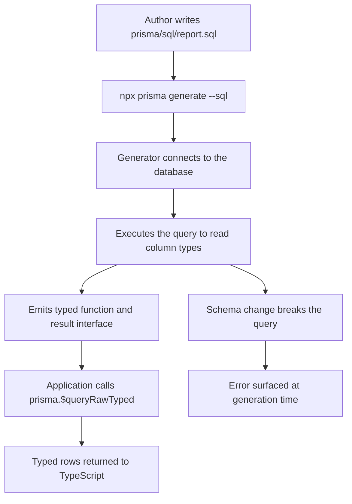

# TypedSQL and Raw Queries: Escaping the ORM Without Losing Type Safety

### English

An ORM is a promise that you will rarely need to write SQL. Prisma keeps that promise for the vast majority of queries — but some queries genuinely cannot be expressed well in a query builder: a reporting query with a window function, a recursive CTE, a `FULL OUTER JOIN` with legacy syntax, a Postgres-specific `tsvector` search, or a hand-tuned query that a human DBA already knows works well. Prisma offers two escape hatches: `$queryRaw` and `$executeRaw`, and a newer one that is much more interesting, **TypedSQL**.

Start with the raw escape hatches. `$queryRawUnsafe` takes a string and is genuinely unsafe — it is the classic SQL injection vector, because a value interpolated into the string becomes part of the statement. Prisma does provide tagged-template variants that are parameterised and therefore safe:

```ts
const users = await prisma.$queryRaw`
  SELECT id, email FROM "User" WHERE email = ${email} LIMIT 10
`;
```

The `${...}` placeholders become bound parameters, not string concatenation. The same applies to `$executeRaw` for statements that change data but return no rows. The rule of thumb: use the tagged template form, never the `Unsafe` variant with user input; if you must build a fragment dynamically (an optional filter, an `ORDER BY` column), validate it against a whitelist first.

**TypedSQL** closes the gap in the other direction. Instead of returning `any`, it lets you write a `.sql` file, run it against a real database during generation, and get back a TypeScript function with fully typed parameters and a typed result. The workflow is:

```prisma
generator client {
  provider        = "prisma-client"
  output          = "../src/generated/prisma"
  previewFeatures = ["typedSql"]
}
```

You create a folder (by default `prisma/sql`, configurable from Prisma 6.12 via `prisma.config.ts`), and put `.sql` files in it. The file name must be a valid JavaScript identifier and cannot start with `$`:

```sql
-- prisma/sql/getUsersWithPostCounts.sql
SELECT u.id, u.name, COUNT(p.id) as "postCount"
FROM "User" u
LEFT JOIN "Post" p ON u.id = p."authorId"
GROUP BY u.id, u.name;
```

Then you run `prisma generate --sql` (add `--watch` to keep regenerating). The generator executes the query against the database, reads the resulting column types, and emits a typed function:

```ts
import { getUsersWithPostCounts } from './generated/prisma/sql';

const rows = await prisma.$queryRawTyped(getUsersWithPostCounts());
// rows: { id: string; name: string; postCount: bigint }[]
```

Parameters work the same way as the raw API, using placeholders inside the SQL file:

```ts
const users = await prisma.$queryRawTyped(getUsersByAge(18, 30));
```

The important caveat: because the generator has to *run* the query to learn the result types, your database must be reachable and the schema must be migrated before you generate. The docs are explicit that pending migrations should be applied first. In CI, that means a job order of migrate → generate → build. TypedSQL also does not support all drivers uniformly: it works with most driver adapters, but for SQLite you should use `@prisma/adapter-libsql` rather than `@prisma/adapter-better-sqlite3`.

Why does this matter? Because the usual objection to "just write raw SQL" is that you lose type safety and lose the ability to refactor. With TypedSQL, the SQL lives in a file, the types are derived from the actual database, and a schema change that breaks the query is caught at generation time rather than at 3 a.m. in production.

### 中文

ORM 基本上係一個承諾：你好少需要自己寫 SQL。Prisma 喺絕大部分 query 上守得住呢個承諾 —— 但有一啲 query 本身就唔適合用 query builder 表达：帶 window function 嘅報表查詢、recursive CTE、要用 legacy 語法嘅 `FULL OUTER JOIN`、Postgres 專屬嘅 `tsvector` 搜尋，或者 DBA 親手調校過、一早知好使嘅 query。Prisma 提供兩個出口：`$queryRaw` 同 `$executeRaw`；但更加有趣嘅係一個較新嘅嘢 —— **TypedSQL**。

先由 raw 出口講起。`$queryRawUnsafe` 收一個字串，係真係唔安全 —— 呢個就係經典嘅 SQL injection 漏洞來源，因為值一旦被拼入字串，就成為 statement 嘅一部分。不過 Prisma 有提供用 tagged template 寫法嘅版本，佢哋會做參數化（parameterised），所以安全：

```ts
const users = await prisma.$queryRaw`
  SELECT id, email FROM "User" WHERE email = ${email} LIMIT 10
`;
```

`${...}` 會變成 bound parameter，而唔係字串拼接。`$executeRaw` 適用於會改資料但唔回傳結果嘅 statement，寫法一樣。實用原則：永遠用 tagged template 嗰個版本，絕對唔好用 `Unsafe` 版本去接使用者輸入；如果真係要動態砌 fragment（例如可選 filter、或者 `ORDER BY` 嘅欄位），就要先對白名單做驗證。

**TypedSQL** 就係補上另一邊嘅缺口。佢唔係回傳 `any`，而係俾你寫一個 `.sql` 檔，喺 generation 階段對住真實資料庫執行一次，然後得到一個參數同結果都有完整型別嘅 TypeScript function。流程係：

```prisma
generator client {
  provider        = "prisma-client"
  output          = "../src/generated/prisma"
  previewFeatures = ["typedSql"]
}
```

你會開一個資料夾（預設 `prisma/sql`，由 Prisma 6.12 起可以喺 `prisma.config.ts` 改），將 `.sql` 檔放入去。檔名必須係合法嘅 JavaScript 識別字，而且唔可以以 `$` 開頭：

```sql
-- prisma/sql/getUsersWithPostCounts.sql
SELECT u.id, u.name, COUNT(p.id) as "postCount"
FROM "User" u
LEFT JOIN "Post" p ON u.id = p."authorId"
GROUP BY u.id, u.name;
```

跟住執行 `prisma generate --sql`（加 `--watch` 就可以持續重新生成）。Generator 會對住資料庫執行呢條 query，讀返結果嘅欄位型別，然後產生一個有型別嘅 function：

```ts
import { getUsersWithPostCounts } from './generated/prisma/sql';

const rows = await prisma.$queryRawTyped(getUsersWithPostCounts());
// rows: { id: string; name: string; postCount: bigint }[]
```

參數同 raw API 一樣，就係喺 SQL 檔入面用 placeholder：

```ts
const users = await prisma.$queryRawTyped(getUsersByAge(18, 30));
```

要留意嘅地方：由於 generator 必須**執行**條 query 先讀到結果型別，所以資料庫要連得到，而且 schema 要先 migrate 過。官方文件明確講要先 apply 晒 pending migration。喺 CI 入面，job 順序就係 migrate → generate → build。另外 TypedSQL 唔係所有 driver 都一視同仁：大部分 driver adapter 都支援，但如果你係用 SQLite，就應該用 `@prisma/adapter-libsql` 而唔係 `@prisma/adapter-better-sqlite3`。

點解咁重要？因為大家反對「直接寫 raw SQL」嘅常見理由，就係會失去型別安全同埋失去重構能力。有咗 TypedSQL，SQL 仍然擺喺檔案入面，型別由真實資料庫推導出嚟，而且如果 schema 改動令條 query 壞咗，問題會喺 generation 階段就浮面，而唔係凌晨三點先喺 production 爆。

## Key Takeaway
TypedSQL lets you keep hand-written SQL for the queries an ORM cannot express, while deriving parameter and result types from the live database at generation time so raw queries stay as safe as builder queries.

## Related Concepts
- Parameterised queries and SQL injection
- Prisma config file and preview features
- Window functions and recursive CTEs
- Prisma Migrate in CI pipelines

## Diagram

