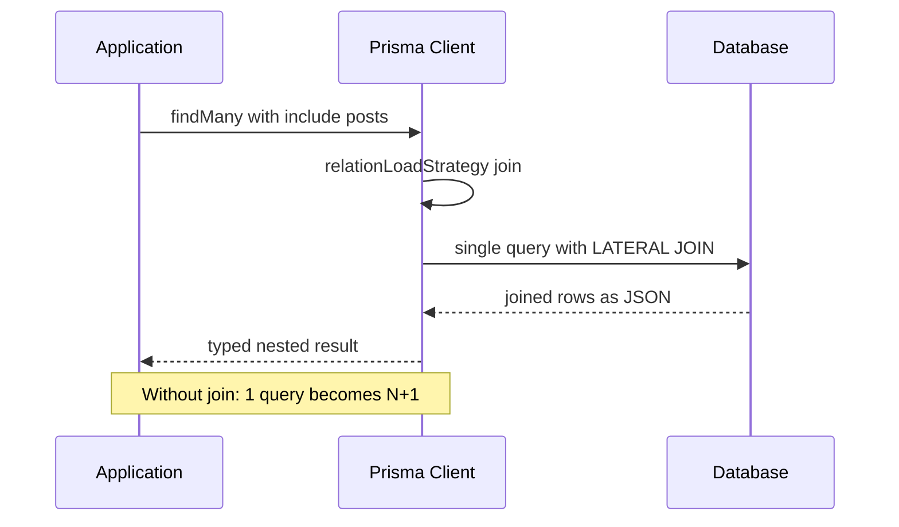

# Query Performance: The N+1 Problem, Join Strategies and Bulk Writes

### English

Prisma makes correct queries easy, which means the performance problems you hit are usually *shape* problems rather than *syntax* problems: too many round trips, too much data, or a missing index. Three techniques fix most of them.

The first is the **N+1 problem**. Imagine you load 100 users and then, for each user, fetch their posts one at a time:

```ts
const users = await prisma.user.findMany();
for (const user of users) {
  user.posts = await prisma.post.findMany({ where: { authorId: user.id } });
}
```

That is 101 database round trips for what should be one. The pattern is so common that Prisma Client ships an automatic mitigation: a built-in **dataloader** that batches identical `findUnique()` calls issued in the same tick of the event loop. If your per-item fetch uses the fluent API — `prisma.user.findUnique({ where: { id } }).posts()` — the dataloader groups those calls and collapses them into a single `findMany`. But the dataloader does *not* currently batch `findMany()` calls, so if you call `findMany` inside a loop, you still pay the N+1 cost.

The clean fix is the **join strategy**. Prisma offers a per-query option, `relationLoadStrategy`, which controls how nested relation data is fetched:

```ts
const users = await prisma.user.findMany({
  relationLoadStrategy: 'join',   // default when the feature flag is on
  include: { posts: true },
});
```

With `join`, Prisma uses a database-level `LATERAL JOIN` on PostgreSQL (and correlated subqueries on MySQL) and fetches everything in a **single** query; the database does the JSON aggregation. With `query`, Prisma sends one query per table and merges the results in the application. The `join` strategy is available on PostgreSQL, CockroachDB and MySQL, and requires the `relationJoins` preview feature flag in the generator block; without the flag the option is rejected as an unknown argument. The trade-off is that `join` is efficient but less flexible — the `where` filter must target scalar fields of the same model using `equal` comparisons, with no boolean operators and no relation filters. When you need those, fall back to `query`, or fetch the relations in a second explicit query.

The second technique is **bulk writes**. Prisma offers `createMany`, `createManyAndReturn`, `updateMany`, `updateManyAndReturn` and `deleteMany`. Inserting 50,000 rows as 50,000 separate `create` calls is roughly a hundred times slower than inserting them in batches of 1,000:

```ts
for (let i = 0; i < rows.length; i += 1000) {
  await prisma.$transaction(
    rows.slice(i, i + 1000).map(row => prisma.product.create({ data: row }))
  );
}
```

Note that `createMany` is a single statement rather than many, so you do not need a transaction for it unless you want atomicity across several statements. For truly large imports, `$executeRaw` with PostgreSQL's `COPY` is faster still, at the cost of leaving Prisma's type safety.

The third technique is **projection and pagination discipline**. Always ask for the columns you need (`select` instead of fetching whole rows, especially to avoid pulling large `text` or `bytea` columns), and always paginate list endpoints. Two pagination styles are available: `skip`/`take` (offset pagination, where the database still has to walk past the skipped rows) and `cursor` pagination, which uses a unique column as a bookmark:

```ts
const page = await prisma.product.findMany({
  take: 20,
  skip: 1,
  cursor: { id: lastSeenId },
  orderBy: { id: 'asc' },
});
```

Cursor pagination is the one to use for infinite scroll and for large tables, because its cost does not grow with the depth of the page.

Finally, none of this substitutes for indexes. Prisma can generate the SQL for you — `prisma db pull` introspects the live database, and raw `CREATE INDEX` statements can live in a migration file created with `prisma migrate dev --create-only`. Query plans (`EXPLAIN`) show whether the database is actually using the index.

### 中文

Prisma 令「寫啱 query」變得好容易，所以通常撞到嘅效能問題，其實係**形狀**問題而唔係**語法**問題：round trip 太多、攞咗太多資料、或者欠咗 index。以下三招可以解決大部分情況。

第一招係 **N+1 問題**。假設你載入咗 100 個 user，然後逐個 user 逐一去攞佢哋嘅 post：

```ts
const users = await prisma.user.findMany();
for (const user of users) {
  user.posts = await prisma.post.findMany({ where: { authorId: user.id } });
}
```

本來一句就夠，變成咗 101 次資料庫 round trip。呢個 pattern 太常見，所以 Prisma Client 內建咗一個緩衝：內置嘅 **dataloader** 會將同一個 event loop tick 之內發出嘅、相同嘅 `findUnique()` 呼叫合併 batching。如果你好似上面咁逐個 fetch，通常要改成用 fluent API —— `prisma.user.findUnique({ where: { id } }).posts()` —— dataloader 就會將佢哋歸組，壓縮成一句 `findMany`。但要留意 dataloader 目前**唔會** batch `findMany()`，所以如果係喺 loop 入面叫 `findMany`，N+1 嘅成本照收。

乾淨嘅解法係 **join 策略**。Prisma 提供 per-query 選項 `relationLoadStrategy`，控制嵌套關聯資料點樣攞：

```ts
const users = await prisma.user.findMany({
  relationLoadStrategy: 'join',   // 開咗 feature flag 之後嘅預設值
  include: { posts: true },
});
```

用 `join` 嘅話，Prisma 喺 PostgreSQL 用 database-level 嘅 `LATERAL JOIN`（MySQL 就用 correlated subquery），用**一句** query 攞晒所有嘢，由資料庫負責做 JSON aggregation。用 `query` 就係 Prisma 每個表發一句，再喺應用層合併。`join` 策略支援 PostgreSQL、CockroachDB 同 MySQL，需要喺 generator block 開 `relationJoins` preview feature flag；唔開嘅話，呢個選項會被當成 unknown argument 拒絕。取捨係咁：`join` 效率高但彈性低 —— `where` filter 必須針對同一個 model 嘅 scalar 欄位、用 `equal` 比較，唔可以有 boolean operator 或者關聯 filter。有需要呢啲嘢，就退回 `query`，或者直接發第二句明確嘅 query 去攞關聯資料。

第二招係 **bulk write**。Prisma 提供 `createMany`、`createManyAndReturn`、`updateMany`、`updateManyAndReturn` 同 `deleteMany`。將 50,000 行資料拆成 50,000 次獨立 `create`，大約慢過用 1,000 一批慢一百倍：

```ts
for (let i = 0; i < rows.length; i += 1000) {
  await prisma.$transaction(
    rows.slice(i, i + 1000).map(row => prisma.product.create({ data: row }))
  );
}
```

留意 `createMany` 本身係一句 statement 而唔係好多句，所以除非你想要多個 statement 之間嘅原子性，否則唔需要 transaction。真正好大量嘅匯入，用 `$executeRaw` 配合 PostgreSQL 嘅 `COPY` 仲要快，但代價係離開咗 Prisma 嘅型別安全。

第三招係 **projection 同分頁紀律**。永遠只攞你真正需要嘅欄位（用 `select`，唔好成行攞晒，尤其要避免抽走好大嘅 `text` 或者 `bytea`），同埋列表 endpoint 永遠要分頁。分頁有兩種風格：`skip`/`take`（offset 分頁，資料庫仍然要行過被跳過嘅嗰啲 row），同 `cursor` 分頁 —— 用一個唯一欄位做書籤：

```ts
const page = await prisma.product.findMany({
  take: 20,
  skip: 1,
  cursor: { id: lastSeenId },
  orderBy: { id: 'asc' },
});
```

無限 scroll 同埋大表嘅情況，就應該用 cursor 分頁，因為佢嘅成本唔會隨頁數深度增長。

最後，以上全部都取代唔到 index。Prisma 可以幫你生成 SQL —— `prisma db pull` 會由真實資料庫做 introspection；而原生嘅 `CREATE INDEX` 可以放喺一個用 `prisma migrate dev --create-only` 開出嚟嘅 migration 檔入面。查詢計劃（`EXPLAIN`）會話畀你知資料庫究竟有冇用到你嗰個 index。

## Key Takeaway
Most Prisma performance problems are about the number of round trips and the amount of data returned, and Prisma gives you explicit levers — relationLoadStrategy, bulk operations and cursor pagination — for each of them.

## Related Concepts
- N+1 query problem and dataloader batching
- Database indexes and query plans
- Connection pooling and query timeouts
- Prisma Accelerate caching layer

## Diagram

