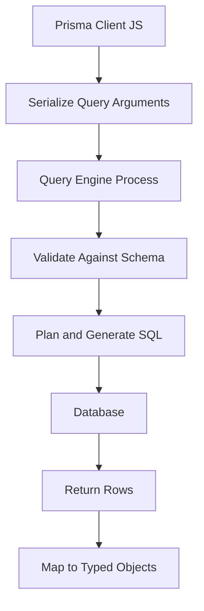

# The Query Engine Under the Hood: How Prisma Turns Method Calls into SQL

## English

When you write prisma.user.findMany({ where: { email: { endsWith: '@example.com' } } }), you never see a SQL string. Something has to translate that JavaScript object into a real query, send it over a wire protocol, and hand back typed objects. Historically that 'something' was the Prisma Query Engine: a separate binary (written in Rust) that ships alongside your app and runs as a sidecar process. Prisma Client is mostly a thin JavaScript layer that serialises your query arguments into a compact request format, passes them to the engine, and the engine does the heavy lifting: validating the query against the schema, planning it, generating the SQL for your specific database (PostgreSQL, MySQL, SQLite, SQL Server), executing it, and returning rows that the client then maps into typed JavaScript objects. This architecture explains a few practical behaviours: why the first query after boot feels slower (the engine process has to start), why deployment bundles historically included engine binaries for each target platform, and why some operations behave differently across databases (the engine is the component that knows each dialect's quirks).

The trade-off is process overhead. An extra binary means extra memory, extra cold-start latency in serverless environments, and a deployment artefact that must match your operating system and CPU architecture. This is why newer versions of Prisma moved toward a Rust-free client: instead of a separate engine process, the query compilation happens in JavaScript (or via driver adapters that talk directly to the database driver you already use). The mental model to keep is that Prisma is not magic — there is always a compiler translating your typed query into SQL, and where that compiler runs (separate process vs in-process) determines your latency profile, bundle size and platform compatibility.

A concrete example: in a traditional Node.js server, the engine process starts once and stays warm, so the overhead is mostly paid at boot. In a serverless function that spins up per request, the engine cold start can dominate the latency of a simple lookup — which is exactly the problem Prisma Accelerate and the driver-adapter approach were built to address. Understanding this layer helps you reason about mysterious performance characteristics: a query that is fast locally may be slow in a Lambda because you are paying for engine startup, not because your SQL is bad.

It also explains error messages. When Prisma reports a validation error before any SQL runs (for example, an unknown field in a where clause), that error came from the query compiler checking your arguments against the schema's abstract syntax tree — no database round trip happened at all. When it reports a database error code, the SQL did reach your database and failed there. Distinguishing 'client-side validation' errors from 'server-side execution' errors tells you immediately whether the problem is in your code or in your data and constraints.

Finally, knowing there is a compiler between you and SQL makes debugging tractable. You can enable query logging to see the exact SQL Prisma emits, which is invaluable when an index is missing or a query plan is bad. You can then take that SQL, run EXPLAIN on it in your database, and tune indexes or rewrite the query — all without abandoning the typed API for everyday code.

## 中文

當你寫 prisma.user.findMany({ where: { email: { endsWith: '@example.com' } } }) 時，你永遠不會見到 SQL 字串。總要有東西把這個 JavaScript 物件翻譯成真正的查詢、透過某種線路協定送出，再把有型別的物件交回來。歷史上，這個「東西」就是 Prisma Query Engine：一個以 Rust 撰寫的獨立二進位檔，隨你的應用程式一起出貨，並以 sidecar 程式的形式執行。Prisma Client 大致上只是一層薄薄的 JavaScript，負責把你的查詢引數序列化成緊湊的請求格式、交給引擎；引擎則做粗重的工作：對照 schema 驗證查詢、規劃查詢、為你特定的資料庫（PostgreSQL、MySQL、SQLite、SQL Server）產生 SQL、執行它，然後回傳資料列，由 client 再對映成有型別的 JavaScript 物件。這個架構解釋了幾種實際行為：為何開機後的第一個查詢感覺較慢（引擎程式必須啟動）、為何部署打包歷來要包含各目標平臺的引擎二進位檔，以及為何某些操作在不同資料庫上表現不同（引擎正是那個熟悉各方言怪癖的元件）。

取捨在於程式開銷。多一個二進位檔就代表多一份記憶體、在無伺服器環境多一段冷啟動延遲，以及一個必須符合你作業系統與 CPU 架構的部署產物。這就是為何較新版本的 Prisma 走向無 Rust 的 client：不再用獨立的引擎程式，而是把查詢編譯放在 JavaScript 裡做（或透過 driver adapter 直接跟你原本已在用的資料庫驅動對話）。要保留的心智模型是：Prisma 不是魔法——永遠有一個編譯器把你的有型別查詢翻成 SQL，而這個編譯器在哪裡跑（獨立程式還是在同一程式內）就決定了你的延遲特性、打包大小與平臺相容性。

具體例子：在傳統的 Node.js 伺服器裡，引擎程式啟動一次就一直保持溫熱，所以開銷大多在開機時付掉。在每個請求都重新啟動的無伺服器函式裡，引擎冷啟動可能主宰一個簡單查詢的延遲——這正是 Prisma Accelerate 與 driver adapter 方案要解決的問題。理解這一層有助你推理神秘的效能特徵：一個在本機很快的查詢在 Lambda 上可能很慢，因為你付的是引擎啟動的成本，而不是你的 SQL 寫得差。

它同時解釋了錯誤訊息。當 Prisma 在任何 SQL 執行之前就回報驗證錯誤（例如 where 子句裡有未知欄位），那個錯誤來自查詢編譯器拿你的引數去對照 schema 的抽象語法樹——根本沒有往返資料庫。當它回報資料庫錯誤碼時，SQL 確實送達你的資料庫並在那裡失敗。區分「client 端驗證」錯誤與「伺服器端執行」錯誤，能立刻告訴你問題在你的程式碼，還是在你的資料與約束。

最後，知道你和 SQL 之間有一個編譯器，讓除錯變得可處理。你可以啟用查詢日誌，看到 Prisma 實際發出的 SQL，這在缺少索引或查詢計畫不佳時極其寶貴。你接著可以把那段 SQL 拿去資料庫跑 EXPLAIN，調整索引或改寫查詢——日常程式碼完全不必放棄有型別的 API。

## Key Takeaway

Prisma always compiles your typed query into SQL somewhere — knowing whether that compiler runs in a separate engine process or in-process tells you why cold starts, bundle sizes and error messages look the way they do.

## Related Concepts
- Query Engine
- Driver Adapters

## Diagram

