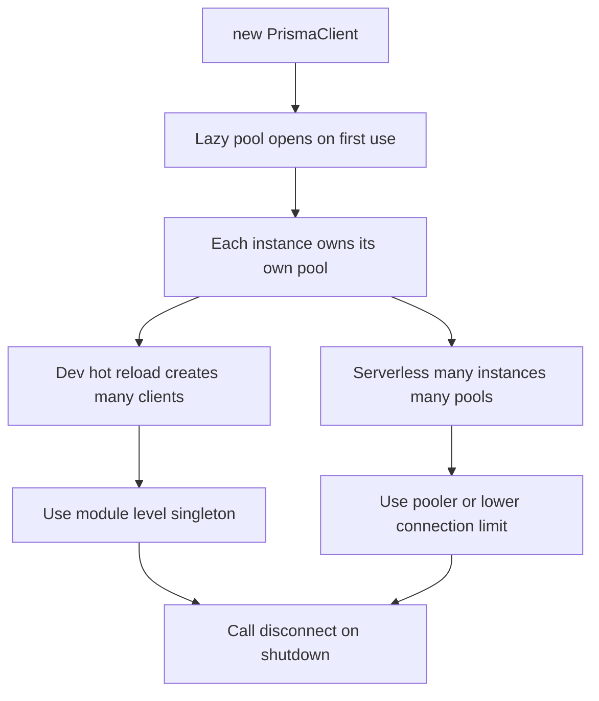

# The Prisma Client Lifecycle: Instantiation, Connection Pooling and Graceful Shutdown

## English

A subtle but important fact: Prisma Client is not a single global connection. When you do new PrismaClient(), you are creating a client instance that lazily opens a connection pool to your database on first use. Each instance manages its own pool, and the pool size is configurable through the connection URL (for PostgreSQL and MySQL, parameters like connection_limit) or through the datasource configuration. This matters enormously in practice because the most common Prisma performance bug is instantiating the client too often. In development with hot reloading, every file save can create a new client, and if the old one is not torn down, you accumulate pools until the database refuses new connections with 'too many clients'. The standard fix is a module-level singleton: create one client, store it on a global object in development so hot reloads reuse it, and export that instance everywhere.

In production the opposite failure mode appears: serverless platforms may run many concurrent function instances, each with its own client and its own pool, multiplying connections against a database with a hard connection limit. A pool of ten connections times a hundred concurrent functions is a thousand connections, which most managed databases will reject. Solutions include a connection pooler in front of the database (such as PgBouncer in transaction mode), reducing connection_limit per instance, or using an acceleration/proxy layer that multiplexes many clients onto few real connections. Understanding that Prisma's pool is per-client-instance, not global, is the key insight that lets you size it correctly.

Graceful shutdown is the other half of the lifecycle. A long-lived server should call $disconnect() when it shuts down so that in-flight queries finish and connections are released cleanly rather than being dropped by the OS. In Node.js you typically hook this into signal handlers for SIGTERM and SIGINT, and into the framework's shutdown hook if it has one. Without it, a rolling deploy can leave the database holding connections for a while, and during rapid restarts you can hit connection limits even though each individual process was well behaved. The client also exposes $connect() if you want to eagerly establish the pool at boot and fail fast when the database is unreachable, rather than discovering it on the first request.

There is also a lifecycle dimension to transactions and interactive sessions. An interactive transaction (the callback form of $transaction) checks out a connection from the pool for its entire duration, so a slow callback holds a connection and can starve other requests. The rule of thumb is to keep interactive transactions short, avoid awaiting unrelated network calls inside them, and prefer the array form of $transaction for a batch of independent writes because it is more efficient. This is not Prisma-specific — it is how any connection pool behaves — but Prisma makes it easy to forget because the API looks synchronous and friendly.

Putting it together: treat the Prisma Client like a database pool, not like a stateless utility. Instantiate once per process, reuse it via a singleton, size the pool deliberately against your database's limits, connect eagerly if you want fail-fast behaviour, and disconnect on shutdown. These are small pieces of boilerplate, but they are the difference between an app that scales smoothly and one that mysteriously exhausts connections under load.

## 中文

一個微妙但重要的事實：Prisma Client 並不是單一的全域性連線。當你執行 new PrismaClient() 時，你建立的是一個 client 例項，它會在首次使用時延遲地開啟通往你資料庫的連線池。每個例項管理自己的連線池，池的大小可透過連線 URL（對 PostgreSQL 與 MySQL 而言，像 connection_limit 這類引數）或 datasource 設定來調整。這在實務上極其重要，因為最常見的 Prisma 效能 bug 就是太頻繁地例項化 client。在開發時用熱過載，每次存檔都可能建立新的 client，若舊的沒有被拆掉，連線池就會累積，直到資料庫以「too many clients」拒絕新連線。標準解法是模組層級的單例：建立一個 client，在開發時把它存到全域性物件上讓熱過載重用，並在各處匯出那個例項。

在生產環境則出現相反的失敗模式：無伺服器平臺可能同時跑許多函式例項，每個都有自己的 client 與自己的連線池，對一個有硬性連線上限的資料庫成倍放大連線數。十條連線的池乘以一百個並行函式就是一千條連線，多數託管資料庫會直接拒絕。解法包括在資料庫前面放連線池器（例如以 transaction 模式執行的 PgBouncer）、降低每個例項的 connection_limit，或使用加速／代理層把許多 client 多工到少數真實連線上。理解 Prisma 的池是「每個 client 例項」而非全域性，正是讓你能正確估算大小的關鍵洞見。

優雅關閉是生命週期的另一半。長駐的伺服器應該在關閉時呼叫 $disconnect()，讓進行中的查詢完成、連線乾淨地釋放，而不是被作業系統硬生生斷掉。在 Node.js 裡，你通常會把它掛到 SIGTERM 與 SIGINT 的訊號處理器，以及框架若有提供的關閉鉤子。沒有它，滾動式部署可能讓資料庫多握著連線一陣子，在快速重啟期間即使每個程式本身行為良好，也可能撞到連線上限。client 也提供 $connect()，若你想在開機時就積極建立連線池、在資料庫不可達時快速失敗，而不是等到第一個請求才發現，就可以用它。

交易與互動式工作階段也有生命週期的一面。互動式交易（$transaction 的回呼形式）會為其整個持續時間從池中借出一條連線，所以緩慢的回呼會佔住連線、餓死其他請求。經驗法則是讓互動式交易保持短小、避免在裡面 await 無關的網路呼叫，並對一批獨立的寫入偏好 $transaction 的陣列形式，因為它更有效率。這不是 Prisma 專有——任何連線池都是這樣運作——但 Prisma 讓人容易忘記，因為 API 看起來同步又友善。

綜合起來：把 Prisma Client 當成資料庫連線池，而不是無狀態的工具。每個程式只例項化一次、透過單例重用、對照資料庫上限刻意設定池大小、想要快速失敗就積極連線，並在關閉時斷線。這些都是小小的樣板程式碼，但正是應用程式能否順暢擴充套件、或在高負載下神秘地耗盡連線的分水嶺。

## Key Takeaway

Prisma Client is a connection pool, not a stateless helper — instantiate it once per process, size the pool against your database's limits, and disconnect on shutdown.

## Related Concepts
- Connection Pooling
- Graceful Shutdown

## Diagram

