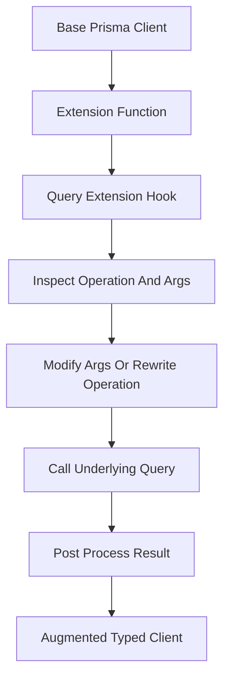

# Extensions and Middleware: Customising Client Behaviour Without Forking the ORM

## English

Real applications rarely use an ORM exactly as shipped. You want soft deletes (rows marked deleted instead of removed), audit timestamps on every write, field-level encryption, or per-request tenant filtering. Prisma's answer to this is the client extensions mechanism (generally available in Prisma 5, replacing the older $use middleware API). An extension is a function that receives the client and returns a new client with additional capabilities, and it can hook into the query lifecycle. The most powerful form is a query extension: you intercept operations on a model, inspect the arguments, optionally modify them, call the underlying query, and post-process the result. This is how you implement a 'default filter' — for example, automatically adding deletedAt: null to every findMany on a soft-deletable model.

A concrete example makes the mechanics clear. You define an extension with a $allModels block containing a $allOperations hook. Inside, you check the operation name; if it is a read like findMany or findFirst, you merge a where clause into args; if it is a delete, you rewrite it into an update that sets the deleted flag. You then call query(args) to run the real operation. The returned client is a new object, so you can layer extensions — one for soft deletes, one for auditing, one for tenant scoping — and compose them. Because the extension is typed, the augmented client still gives you autocomplete and compile-time checks, which is the whole point: customisation without losing type safety.

Result extensions are the simpler, friendlier cousin. Instead of intercepting the query, they add computed fields to the returned objects. You might add a fullName getter that concatenates firstName and lastName, or a hasActiveSubscription boolean derived from a related record. These are computed in JavaScript after the row is fetched, so they cost nothing in SQL but also cannot be used in where clauses — you cannot filter by a computed field at the database level, only in memory. Knowing this boundary prevents a common confusion where developers expect a result extension to behave like a real column.

Extensions also solve the multi-tenant problem elegantly. A tenant-scoping extension can read a tenant ID from a per-request context (using a mechanism like AsyncLocalStorage) and inject it into every query's where clause, so a developer who forgets to filter by tenant still gets safe behaviour by default. This is defence in depth: the database row-level security might be your ultimate guarantee, but the extension makes the common path correct without every developer remembering. The trade-off is that magic filters can surprise people reading the code, so document them and keep them visible in the client's construction.

Finally, be aware of where extensions sit in the pipeline. They run in the client layer, before the query reaches the engine, so they can rewrite arguments and post-process results but they cannot change SQL generation or add database-side features. For things that must happen inside the database — triggers, row-level security, generated columns — you still use migrations and native SQL. Extensions are for cross-cutting application concerns expressed in TypeScript, and used with that boundary in mind they remove an enormous amount of repetitive boilerplate from a codebase.

## 中文

真實的應用程式很少完全照出廠設定使用 ORM。你想要軟刪除（把資料列標記為已刪除而非真的移除）、每次寫入都加上稽核時間戳、欄位層級加密，或依請求的租戶過濾。Prisma 對此的答案是 client extension 機制（在 Prisma 5 正式可用，取代較舊的 $use middleware API）。extension 是一個函式，接收 client 並回傳一個具備額外能力的新 client，它可以掛進查詢生命週期。最強大的形式是 query extension：你攔截某個模型上的操作、檢視參數、視情況修改它們、呼叫底層查詢，再後處理結果。這就是實作「預設過濾」的方式——例如自動在每個可軟刪除模型的 findMany 上加上 deletedAt: null。

一個具體例子能讓機制清楚。你定義一個 extension，內含 $allModels 區塊與 $allOperations 鉤子。在裡面檢查操作名稱；若是像 findMany 或 findFirst 的讀取，就把 where 子句合併進 args；若是 delete，就改寫成設定刪除旗標的 update。然後你呼叫 query(args) 執行真正的操作。回傳的 client 是新物件，所以你可以層層疊加 extension——一個管軟刪除、一個管稽核、一個管租戶範圍——並組合它們。因為 extension 是有型別的，增強後的 client 仍給你自動完成與編譯期檢查，這正是重點：客製化而不失型別安全。

result extension 是較簡單、較友善的表親。它不攔截查詢，而是為回傳的物件加上計算欄位。你可能加一個 fullName getter 串接 firstName 與 lastName，或一個由關聯紀錄推導出的 hasActiveSubscription 布林值。這些是在資料列取回後於 JavaScript 中計算，所以在 SQL 上零成本，但也不能用在 where 子句——你無法在資料庫層用計算欄位過濾，只能在記憶體中。知道這條界線能避免一種常見困惑：開發者以為 result extension 的行為像真實欄位。

extension 也優雅地解決多租戶問題。一個租戶範圍 extension 可以從每請求的上下文中讀取租戶 ID（使用像 AsyncLocalStorage 的機制），並注入每個查詢的 where 子句，這樣即使開發者忘了依租戶過濾，預設仍得到安全的行為。這是縱深防禦：資料庫的列級安全可能是你最終的保證，但 extension 讓常見路徑不必每個開發者都記得就正確。取捨是魔法般的過濾會讓讀程式碼的人驚訝，所以要記錄它們，並讓它們在 client 的建構處保持可見。

最後，要清楚 extension 在管線中的位置。它們跑在 client 層、在查詢到達引擎之前，所以能改寫參數與後處理結果，但不能改變 SQL 產生或加入資料庫端功能。對於必須在資料庫內發生的事——觸發器、列級安全、生成欄位——你仍然使用遷移與原生 SQL。extension 是為以 TypeScript 表達的橫切應用關注點而設，帶著這條界線使用，它們能從程式碼庫移除大量重複的樣板。

## Key Takeaway

Prisma client extensions let you layer soft deletes, auditing and tenant scoping onto typed queries — but they live in the client layer, so database-side features still belong in migrations and native SQL.

## Related Concepts
- Client Extensions
- Multi-Tenancy

## Diagram

