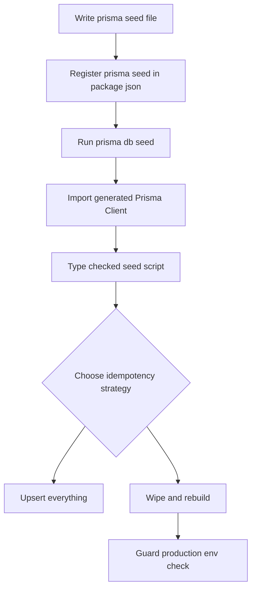

# Seeding and Test Data: Realistic Fixtures Without Hand-Written SQL

## English

Every application needs data before it is useful: a few admin users, a catalogue of products, or a hundred fake orders so you can see whether your pagination works. Prisma calls this 'seeding' — running a script that populates the database with initial data after a migration. The convention is a `prisma/seed.ts` (or `.js`) file, and you register it in `package.json` under a `prisma.seed` key so that `prisma db seed` knows what to run. Because the seed script imports your generated Prisma Client, it is fully type-checked: if you rename a column in the schema, the seed script fails to compile rather than silently writing to a field that no longer exists. That is a real advantage over a pile of `.sql` fixture files, which tend to rot quietly.

The classic pitfall with seeding is idempotency — running the seed twice should not create duplicate rows or crash on a unique constraint. There are two common strategies. The first is 'upsert everything': use `prisma.user.upsert({ where: { email }, update: {}, create: { ... } })` so each record is created if missing and left alone if present. The second is 'wipe and rebuild': delete all rows in dependency order (children before parents, because of foreign keys) and then insert fresh. The wipe strategy is fine for local development and test databases but catastrophic against production, so many teams guard it with an environment check that throws if `NODE_ENV === 'production'`.

For tests, you usually want a different flavour of seeding: a minimal, deterministic baseline that each test can rely on, plus per-test fixtures created inside the test itself and rolled back afterwards. A useful pattern is a helper that wraps each test in a transaction and aborts it at the end, so the database returns to its baseline state. Prisma's interactive transactions (`prisma.$transaction(async (tx) => { ... })`) make this possible, though you must pass the `tx` client into your application code rather than the global client, or the rollback will not cover those queries.

Realistic fake data matters more than people expect. A seed with users named 'Test 1', 'Test 2' will not reveal that your UI breaks on a 40-character name or an emoji. Libraries like Faker generate plausible names, addresses, and dates, and seeding a few hundred rows lets you spot layout and performance problems early. Keep the generator seeded with a fixed value so runs are reproducible — otherwise a flaky test caused by an unusual random string becomes very hard to debug.

Finally, treat seed data as code: commit it, review it, and keep it in sync with the schema. If your seed script is the only place that exercises a new relation, it doubles as a smoke test for the migration you just wrote.

## 中文

每個應用程式在真正有用之前都需要資料：幾個管理員帳戶、一個產品目錄，或者一百筆假訂單，讓你能看出分頁是否正常運作。Prisma 把這件事稱為「種子資料」（seeding）——即是執行一段腳本，在遷移之後把初始資料填入資料庫。慣例是使用 `prisma/seed.ts`（或 `.js`）檔案，並在 `package.json` 的 `prisma.seed` 鍵中註冊，這樣 `prisma db seed` 才知道要執行什麼。由於種子腳本會匯入你產生的 Prisma Client，它會受到完整的型別檢查：如果你在 schema 中改了欄位名稱，種子腳本會編譯失敗，而不是悄悄寫入一個已不存在的欄位。相比於一堆 `.sql` fixture 檔案（那些檔案往往會靜靜地腐爛），這是實實在在的好處。

種子資料最經典的陷阱是「冪等性」（idempotency）——執行兩次不應該產生重複的資料列，也不應該因為唯一約束而崩潰。有兩種常見策略。第一種是「全部 upsert」：使用 `prisma.user.upsert({ where: { email }, update: {}, create: { ... } })`，讓每筆記錄在不存在時建立、存在時保持不變。第二種是「清空再重建」：按依賴順序刪除所有資料列（因為外鍵關係，先刪子表再刪父表），然後重新插入。清空策略對本機開發和測試資料庫來說沒問題，但對生產環境是災難性的，所以很多團隊會加一個環境檢查，若 `NODE_ENV === 'production'` 就拋出錯誤。

在測試方面，你通常需要另一種種子資料：一個最小化、確定性的基準，讓每個測試都能依賴，再加上在測試內部建立、測試結束後回滾的個別 fixture。一個實用的模式是把每個測試包在一個交易中，並在結束時中止它，讓資料庫回到基準狀態。Prisma 的互動式交易（`prisma.$transaction(async (tx) => { ... })`）讓這成為可能，但你必須把 `tx` client 傳入應用程式碼，而不是使用全域 client，否則回滾不會涵蓋那些查詢。

真實感的假資料比人們想像中重要。如果種子資料裡的使用者叫「Test 1」、「Test 2」，就無法揭露你的介面在遇到 40 字元的名字或 emoji 時會壞掉。Faker 之類的程式庫能產生合理的姓名、地址和日期，而種入幾百筆資料可以讓你及早發現版面與效能問題。把產生器設定固定的種子值，讓每次執行都可重現——否則一個由異常隨機字串引起的間歇性測試失敗會非常難除錯。

最後，把種子資料當作程式碼看待：提交它、審查它，並讓它與 schema 保持同步。如果你的種子腳本是唯一觸及某個新關聯的地方，它同時也是你剛寫的遷移的煙霧測試。

## Key Takeaway

Seed scripts are type-checked application code: make them idempotent, keep them out of production, and use them as a smoke test for your schema.

## Related Concepts
- Idempotent upsert patterns
- Test fixtures and transaction rollback

## Diagram

