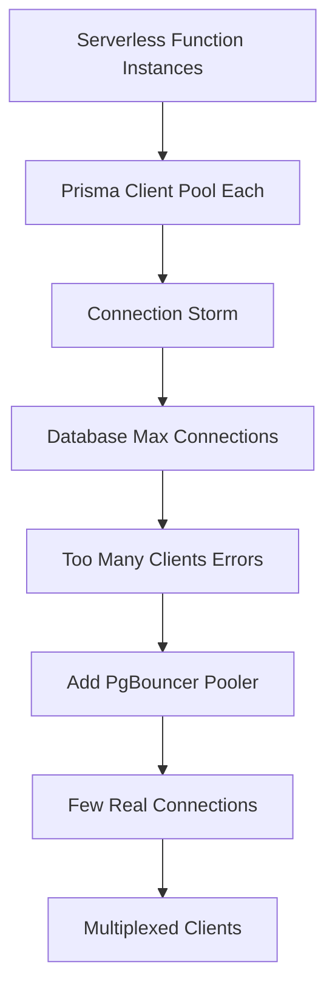

# Connection Pooling, Serverless and PgBouncer: Why Your Database Runs Out of Connections

## English

A database connection is not free. On the PostgreSQL side, every connection is a separate backend process with its own memory, so a server with modest RAM might comfortably handle a few hundred concurrent connections and then start refusing or thrashing. On the Node.js side, Prisma Client maintains a connection pool — a small set of reusable connections — so that a thousand concurrent HTTP requests do not each open their own socket. The pool size is configurable via the `connection_limit` parameter on the database URL, and the default is derived from the number of CPU cores, so it is usually smaller than people assume. If all pooled connections are busy, further queries queue and wait, which is why an unexpectedly slow query can make the whole application appear to hang.

The trouble really begins with serverless and edge functions. Each function instance is its own process with its own Prisma Client and its own pool. If you have two hundred concurrent function instances and each opens a pool of five connections, you have asked the database for a thousand connections — a classic 'connection storm'. The database may hit its `max_connections` limit, and you will see errors about too many clients. This is not a Prisma bug; it is a structural mismatch between short-lived, horizontally scaled compute and a long-lived, connection-hungry database.

The standard remedy is an external connection pooler sitting between your functions and the database. PgBouncer is the most common choice for PostgreSQL; cloud providers offer managed equivalents. A pooler keeps a modest number of real database connections open and multiplexes many client connections onto them. Crucially, PgBouncer has modes: 'session' mode holds a server connection for the whole client session, while 'transaction' mode only holds it for the duration of a transaction. Transaction mode gives the best multiplexing but breaks features that rely on session state — prepared statements, session-level `SET` commands, and advisory locks. Prisma's documentation notes that transaction mode requires care, and newer Prisma versions support configuration to work with it; always check the current docs rather than assuming.

A subtler point is that a pooler changes the meaning of your pool size. If your function's Prisma pool is five and the pooler exposes a hundred server connections to a thousand functions, the effective concurrency is governed by the pooler, not by each function. Setting `connection_limit=1` per function instance is often recommended in serverless setups, because the platform already provides concurrency by spinning up many instances; a large per-instance pool just multiplies the pressure.

Finally, measure rather than guess. Watch the database's active connection count, the pooler's wait queue, and your query latency percentiles together. If latency rises while the pooler queue grows, you need more server connections or faster queries. If latency rises with an idle pool, the problem is elsewhere — perhaps a missing index or a lock. Understanding which layer is saturated is the whole game.

## 中文

資料庫連線不是免費的。在 PostgreSQL 那邊，每個連線都是一個獨立的後端行程，有自己的記憶體，所以一臺記憶體不算多的伺服器可能舒舒服服地處理幾百個並行連線，然後就開始拒絕或劇烈震盪。在 Node.js 那邊，Prisma Client 維護一個連線池——一小組可重複使用的連線——這樣一千個並行 HTTP 請求就不會各自開一個 socket。連線池大小可透過資料庫 URL 上的 `connection_limit` 引數設定，預設值是根據 CPU 核心數推算出來的，所以通常比人們想像的小。如果池中所有連線都在忙，後續查詢就會排隊等待，這就是為什麼一個意外緩慢的查詢可以讓整個應用程式看起來像卡住了。

真正的麻煩從 serverless 和邊緣函式開始。每個函式例項都是獨立的行程，有自己的 Prisma Client 和自己的連線池。如果你有兩百個並行函式例項，每個開五條連線的池，你就等於向資料庫要求一千條連線——典型的「連線風暴」。資料庫可能觸及 `max_connections` 上限，你會看到「too many clients」之類的錯誤。這不是 Prisma 的 bug，而是短命、水平擴充套件的運算資源與長命、渴求連線的資料庫之間結構性的錯配。

標準的補救方法是在函式和資料庫之間放一個外部連線池器。PgBouncer 是 PostgreSQL 最常見的選擇；雲端供應商也提供託管版本。池器維持少量真正的資料庫連線，並把許多客戶端連線多工到這些連線上。關鍵是，PgBouncer 有不同模式：「session」模式在整個客戶端工作階段期間保留一條伺服器連線，而「transaction」模式只在交易期間保留。transaction 模式的多工效果最好，但會破壞依賴工作階段狀態的功能——預備語句（prepared statements）、工作階段層級的 `SET` 指令，以及 advisory lock。Prisma 的檔案指出 transaction 模式需要小心處理，較新的 Prisma 版本支援相應設定來配合它；請務必查閱當前檔案，而不是憑假設。

一個更微妙的點是，池器改變了「池大小」的意義。如果你的函式 Prisma 池是五，而池器對一千個函式提供一百條伺服器連線，實際並行度是由池器決定，而不是每個函式。在 serverless 設定中，經常建議每個函式例項設 `connection_limit=1`，因為平臺本身已透過啟動大量例項提供並行；每個例項一個大池只會倍增收壓力。

最後，要量度而不是猜測。同時觀察資料庫的活躍連線數、池器的等待佇列，以及查詢延遲的百分位數。如果延遲上升而池器佇列也在增長，你需要更多伺服器連線或更快的查詢。如果延遲上升但池閒置，問題在別處——也許是缺少索引或鎖。搞清楚哪一層飽和，就是全部的關鍵。

## Key Takeaway

Connection limits are a shared resource: serverless functions multiply pools, so pool at the database edge and size each instance's pool for the platform, not for a single server.

## Related Concepts
- PgBouncer transaction mode
- Serverless connection storms

## Diagram

