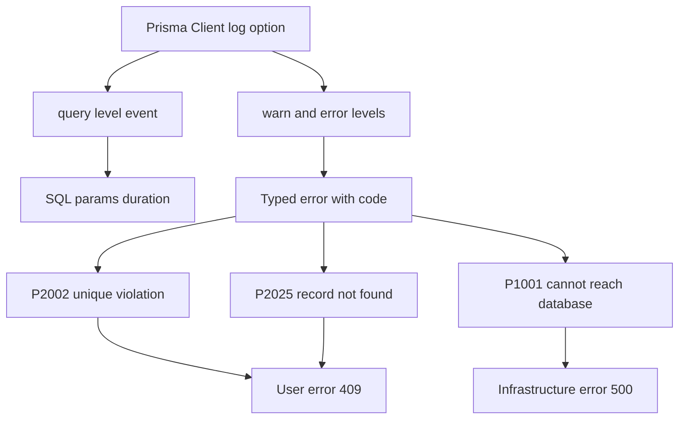

# Prisma in Production: Logging, Error Codes and Knowing What Went Wrong

## English

In development, a failing query usually shows up as a stack trace in your terminal. In production, you need structured information: which query failed, how long it took, and what the database actually said. Prisma Client accepts a `log` option at construction time, where you can request levels such as `query`, `info`, `warn`, and `error`. The `query` level emits an event per query with the SQL, parameters, and duration — invaluable for spotting a slow endpoint, but far too noisy to enable globally in production. A common pattern is to enable `warn` and `error` always, and turn on `query` logging only behind a debug flag or for a sampled fraction of traffic.

Errors from Prisma are not plain strings; they are typed error classes with a `code` field. Two codes come up constantly in production. `P2002` is a unique constraint violation — someone tried to register an email that already exists — and should usually become a friendly 409 response, not a 500. `P2025` means 'record not found' for an operation that required one, such as updating or deleting by a unique identifier that does not exist. Catching these by code rather than by matching error message text is essential, because messages can change between versions and locales. There are also `P2003` for foreign key violations and `P1001` for 'cannot reach database server', which is an infrastructure problem, not a user error.

Distinguishing user errors from infrastructure errors is the single most useful discipline here. A unique constraint violation means the request was invalid; a connection timeout means the system is unhealthy. If you map both to a generic 500, your dashboards cannot tell you whether users are making mistakes or your database is down. A small error-handling layer that inspects `error.code`, logs infrastructure failures at error level with context, and returns appropriate HTTP status codes will save hours during incidents.

Beyond errors, Prisma exposes metrics through its client: you can inspect the connection pool and query engine via the metrics feature, which can be enabled and scraped by a monitoring system. Even without that, timing your own queries in application code — wrapping a call and recording its duration in a histogram — gives you latency percentiles per endpoint. Percentiles matter more than averages: an average of 50ms can hide a p99 of four seconds, and it is the p99 that users complain about.

One more production concern is logging sensitive data. Query logs include parameter values, which may contain passwords, tokens, or personal information. If you ship logs to a third-party service, redact or hash those values before they leave your process. Prisma lets you customise the log emission, so you can filter or transform entries rather than dumping raw parameters. Treat query logs the same way you treat any other personal data: minimise, redact, and set a retention period.

## 中文

在開發時，失敗的查詢通常以終端機裡的堆疊追蹤出現。在生產環境，你需要結構化的資訊：哪個查詢失敗、花了多久，以及資料庫實際說了什麼。Prisma Client 在建構時接受 `log` 選項，你可以要求 `query`、`info`、`warn`、`error` 等級。`query` 等級會為每個查詢發出事件，包含 SQL、參數和耗時——對找出慢端點極有價值，但在生產環境全域開啟就太吵了。常見做法是永遠開啟 `warn` 和 `error`，只在除錯旗標後面或對抽樣的一小部分流量開啟 `query` 記錄。

Prisma 的錯誤不是純字串，而是帶有 `code` 欄位的型別化錯誤類別。生產環境中經常出現兩個代碼。`P2002` 是唯一約束違反——有人嘗試註冊一個已存在的電郵——通常應該變成友善的 409 回應，而不是 500。`P2025` 表示某個需要記錄的操作「找不到記錄」，例如用不存在的唯一識別碼更新或刪除。依代碼而非比對錯誤訊息文字來捕捉這些錯誤至關重要，因為訊息可能隨版本和語系改變。另外還有 `P2003` 代表外鍵違反，以及 `P1001` 代表「無法連線到資料庫伺服器」，後者是基礎設施問題，不是使用者錯誤。

區分使用者錯誤與基礎設施錯誤，是這裡最有用的紀律。唯一約束違反意味著請求本身無效；連線逾時意味著系統不健康。如果你把兩者都對應到一個籠統的 500，你的儀表板就無法告訴你究竟是使用者在犯錯，還是你的資料庫掛了。一個小小的錯誤處理層，檢查 `error.code`、以 error 等級記錄基礎設施失敗並附上上下文、回傳合適的 HTTP 狀態碼，能在事故期間省下好幾個小時。

除了錯誤，Prisma 也透過 client 提供指標：你可以啟用 metrics 功能來檢視連線池和查詢引擎，讓監控系統抓取。即使不用它，在應用程式碼中為自己的查詢計時——包裝呼叫並把耗時記錄到直方圖——也能給你每個端點的延遲百分位數。百分位數比平均值重要：平均值 50 毫秒可以掩蓋 p99 的四秒，而使用者抱怨的正是 p99。

另一個生產顧慮是記錄敏感資料。查詢日誌包含參數值，可能含有密碼、權杖或個人資料。如果你把日誌送到第三方服務，請在離開你的行程之前遮蔽或雜湊那些值。Prisma 讓你自訂日誌的發出方式，所以你可以過濾或轉換條目，而不是直接倒出原始參數。把查詢日誌當作任何其他個人資料對待：最小化、遮蔽，並設定保留期限。

## Key Takeaway

Catch Prisma errors by their typed codes, separate user mistakes from infrastructure failures, and never ship raw query parameters to a log aggregator.

## Related Concepts
- Prisma error codes P2002 and P2025
- Structured logging and latency percentiles

## Diagram

