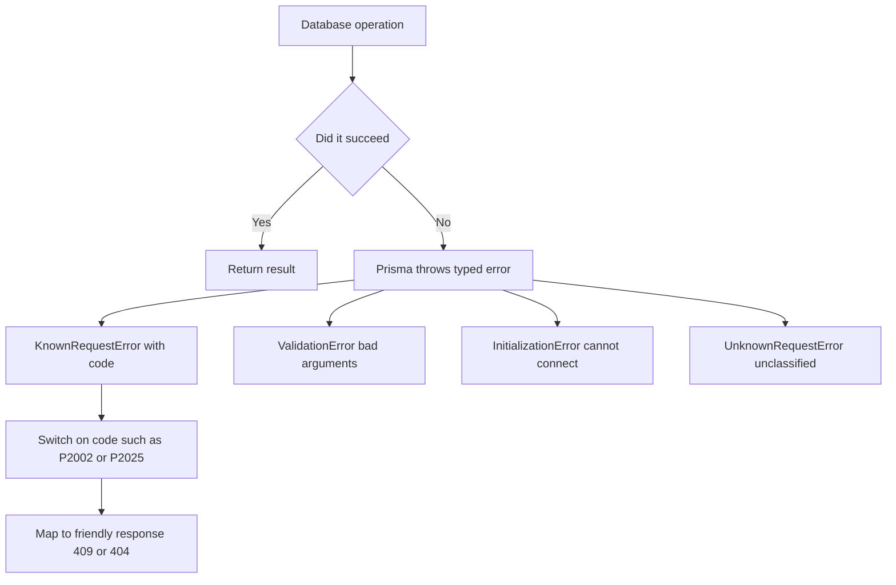

# Error Handling and the Prisma Error Taxonomy

## English

Every database operation can fail for reasons that fall into two broad families: problems with your request (you asked for a row that does not exist, or you violated a unique constraint) and problems with the world (the database is unreachable, a connection timed out, the server crashed mid-transaction). Prisma Client distinguishes these by throwing typed error classes rather than raw driver errors, so your code can branch on the kind of failure instead of string-matching messages. The two you will meet most often are PrismaClientKnownRequestError, which carries a short machine-readable `code` such as P2002 (unique constraint violation) or P2025 (record required but not found), and PrismaClientValidationError, which means you passed arguments the query engine could not accept — a typo in a field name, a missing required input, a wrong type. There are also PrismaClientInitializationError (the client could not connect or start at all) and PrismaClientUnknownRequestError for anything the engine cannot classify.

The `code` field is the stable contract. Error messages are human-facing and may change between versions or be localised; the codes are documented and stable, so production code should switch on `error.code`, never on the message text. A typical pattern wraps a create in a try/catch and maps P2002 to a friendly 409 Conflict response, while a findUniqueOrThrow that raises P2025 maps to 404 Not Found. Because these are ordinary JavaScript classes, `instanceof` checks work and you can narrow the type in TypeScript, gaining autocomplete on the `meta` object — for example `meta.target` often names the columns involved in a constraint violation, which is handy for telling the user which field was duplicated.

It helps to think of errors in layers. The validation layer fires before any SQL leaves your process: the query engine checks argument shapes against the schema, so a bad call fails fast and cheaply. The database layer fires when the server itself rejects the statement — constraint violations, foreign key failures, serialization conflicts under a strict isolation level. The transport layer fires when the network or pool is the problem: connection refused, pool exhausted, socket hang-up. Each layer deserves a different response: validation errors are programmer bugs (log loudly, return 400), constraint violations are often expected business outcomes (return 409/422), and transport errors are infrastructure concerns (retry with backoff, alert on-call).

Transactions deserve special care. If you use the interactive transaction API and the callback throws, Prisma rolls back and re-throws your error, so you can catch it outside the transaction block. But beware of retry logic: a transaction that failed because of a deadlock or serialization failure (in databases that report such codes) is safe to retry, whereas one that failed because of a unique constraint is not — retrying will just fail again. Classify before you retry. Also remember that once a transaction has been aborted by the database, further statements inside it will error until it is rolled back, so never swallow an error inside the callback and keep going.

Finally, make errors observable. Attach a request ID to your logs, log the Prisma error `code` and `meta` but redact user data, and emit metrics keyed by code so you can see, say, a spike in P2002 after a deploy that changed a uniqueness rule. A small central helper that converts Prisma errors into your application's error type keeps controllers clean and ensures every endpoint handles the common cases consistently.

## 中文

每一個資料庫操作都可能因為兩大類原因而失敗：一類是「你的請求有問題」（例如你想要一筆不存在的資料列，或者違反了唯一性約束），另一類是「世界出了問題」（例如資料庫連不上、連線逾時、伺服器在交易中途崩潰）。Prisma Client 透過拋出有型別的錯誤類別（而非原始驅動錯誤）來區分這些情況，讓你的程式碼可以按失敗的種類分支，而不必用字串比對訊息。你最常遇到的兩個是 PrismaClientKnownRequestError（帶有一個簡短的機器可讀 `code`，例如 P2002 代表唯一性約束違反，P2025 代表需要存在的記錄找不到），以及 PrismaClientValidationError（表示你傳入了查詢引擎無法接受的參數——欄位名打錯、缺少必填輸入、型別錯誤）。另外還有 PrismaClientInitializationError（用戶端根本無法連線或啟動）以及 PrismaClientUnknownRequestError，用於引擎無法分類的任何情況。

`code` 欄位才是穩定的契約。錯誤訊息是給人看的，可能隨版本改變或被本地化；錯誤碼則有文件記載且穩定，所以正式環境的程式碼應該對 `error.code` 做分支，絕不要對訊息文字做分支。典型做法是把 create 包在 try/catch 裡，把 P2002 對應到友善的 409 Conflict 回應，而把 findUniqueOrThrow 拋出的 P2025 對應到 404 Not Found。因為這些都是普通的 JavaScript 類別，`instanceof` 檢查可行，你也可以在 TypeScript 中收窄型別，從而對 `meta` 物件獲得自動完成——例如 `meta.target` 往往會指出約束違反涉及的欄位，方便你告訴使用者哪個欄位重複了。

把錯誤分層來理解會有幫助。驗證層在任何 SQL 離開你的進程之前就觸發：查詢引擎會依 schema 檢查參數形狀，所以壞掉的呼叫會快速且便宜地失敗。資料庫層在伺服器本身拒絕語句時觸發——約束違反、外鍵失敗、嚴格隔離層級下的序列化衝突。傳輸層則在網路或連線池出問題時觸發：連線被拒、連線池耗盡、socket 中斷。每一層都值得不同的回應方式：驗證錯誤是程式設計師的 bug（大聲記錄、回傳 400），約束違反往往是預期中的業務結果（回傳 409/422），而傳輸錯誤是基礎設施問題（以退避策略重試、通知值班人員）。

交易需要特別小心。如果你使用互動式交易 API，而回呼拋出錯誤，Prisma 會回滾並重新拋出你的錯誤，所以你可以在交易區塊外捕捉它。但要小心重試邏輯：因為死鎖或序列化失敗（在會回報這類錯誤碼的資料庫中）而失敗的交易可以安全重試，而因為唯一性約束失敗的交易則不行——重試只會再失敗一次。先分類，再重試。另外要記住，一旦交易被資料庫中止，在它被回滾之前，交易內的後續語句都會報錯，所以千萬不要在回呼內吞掉錯誤然後繼續執行。

最後，讓錯誤可被觀察。在日誌中附上請求 ID，記錄 Prisma 錯誤的 `code` 與 `meta` 但要遮蔽使用者資料，並發出以錯誤碼為索引的指標，這樣你就能看到例如某次部署改變了唯一性規則後 P2002 暴增。一個小小的中央輔助函式，把 Prisma 錯誤轉換成你應用程式的錯誤型別，能讓控制器保持乾淨，並確保每個端點都以一致的方式處理常見情況。

## Key Takeaway

Branch on Prisma's stable error codes (P2002, P2025) rather than message strings, and classify failures by layer before deciding whether to retry.

## Related Concepts
- PrismaClientKnownRequestError
- Transaction isolation and rollback

## Diagram

