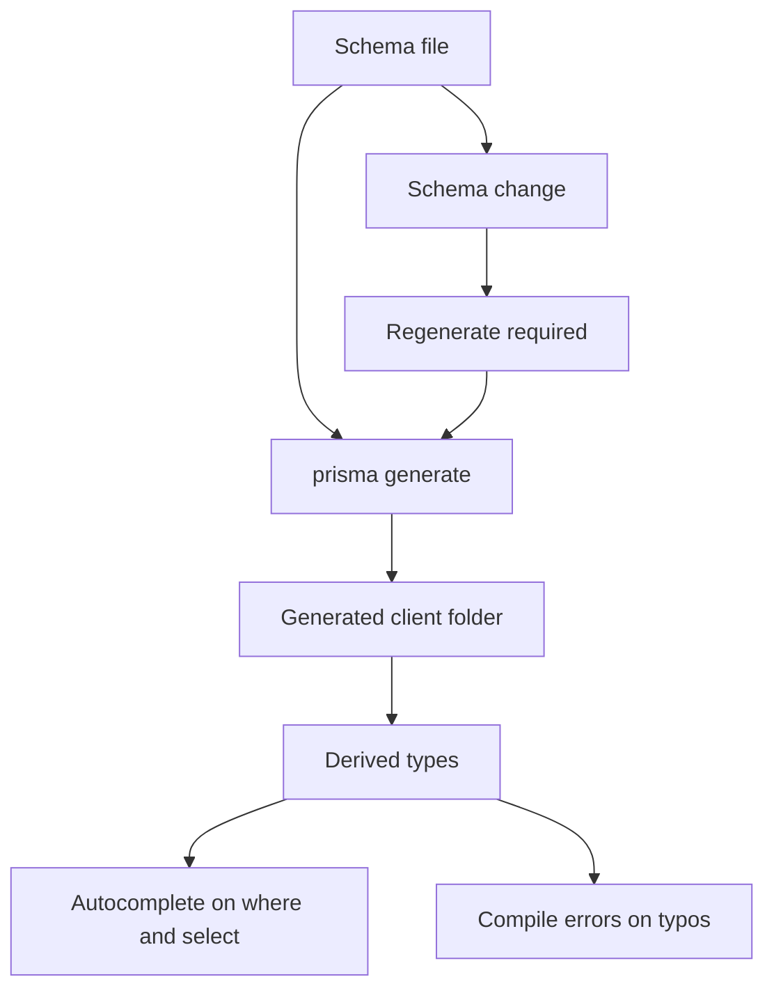

# The Prisma Client Generation Step and the Generated Types

## English

A subtle but important fact about Prisma Client: it is not a hand-written library you import from npm and use directly. What you install is a generator that, when you run `prisma generate`, reads your schema and writes a bespoke client into a folder you control (in Prisma ORM 7 and later the `output` path is required; earlier versions defaulted to `node_modules/.prisma/client`) that is tailor-made for your models. That is why `prisma generate` must run after every schema change and before your code type-checks — the generated types literally do not know about a field until the generator has seen it. This is the mechanical reason Prisma can offer autocomplete on `where` clauses and catch `select: { emial: true }` as a compile error: the types are not generic, they are derived from your specific schema.

Understanding the generation step explains a whole class of confusing errors. If you pull a teammate's branch that added a `User.avatarUrl` field and your editor complains that `avatarUrl` does not exist, the schema and your generated client are out of sync — run `prisma generate`. If CI fails with type errors that pass locally, check that the build pipeline runs `generate` after `prisma migrate deploy` (or at least after installing dependencies, since some setups generate on install via a postinstall hook). The generated client is a build artifact, a bit like compiled output: you generally should not commit it, and you should treat it as something that must be regenerated whenever its input — the schema — changes.

The generated types are worth peeking at once. Open the generated `index.d.ts` and you will find types like `UserWhereInput`, `UserCreateInput`, `UserSelect`, `UserInclude`, and a `UserGetPayload<T>` helper that computes the exact return shape from your `select` and `include` arguments. This is why a query that selects only `id` and `email` returns a type with only those two properties — the payload type is computed at compile time from the literal argument you wrote. It also explains why dynamic, string-built queries lose type safety: if the argument is not a literal the compiler can see, it falls back to a broad type.

Generation also has practical knobs. The `generator` block in your schema declares the provider (`prisma-client` is the default in Prisma ORM 7 and later; `prisma-client-js` is the older one) and, in Prisma 7+, a required `output` path, which matters for monorepos and for bundlers that struggle with the default location. Newer versions of Prisma also offer a generator that emits plain TypeScript/JavaScript without the native engine, which changes what gets generated and how it is bundled. Knowing that the generator is configurable helps when you hit issues like a serverless bundler failing to include the generated client — the fix is usually telling the bundler to treat the generated output as external or to include it in the trace.

One more consequence: because the client is generated per schema, two services with different schemas get different clients even if they share a database. That is a feature — each service only sees the models and fields it declared — but it means a schema change in one service does not automatically update another. Treat the schema as the source of truth and the generated client as a projection of it, and regenerate deliberately rather than assuming the client is always current.

## 中文

關於 Prisma Client 有一個微妙但重要的事實：它不是一個你從 npm 匯入後直接使用的手寫函式庫。你安裝的其實是一個產生器，當你執行 `prisma generate` 時，它會讀取你的 schema，並把一個專為你的模型量身打造的用戶端寫入你指定位置的資料夾（Prisma ORM 7 起 `output` 為必填；較早版本預設是 `node_modules/.prisma/client`）。這就是為什麼每次 schema 變更後、以及程式碼型別檢查之前，都必須執行 `prisma generate`——在產生器看過某個欄位之前，產生的型別根本不知道它存在。這也是 Prisma 能在 `where` 子句上提供自動完成、並把 `select: { emial: true }` 抓成編譯錯誤的機械原因：那些型別不是泛型的，而是從你的特定 schema 衍生出來的。

理解產生步驟能解釋一整類令人困惑的錯誤。如果你拉下隊友新增了 `User.avatarUrl` 欄位的分支，而你的編輯器抱怨 `avatarUrl` 不存在，那就是 schema 與你產生的用戶端不同步——執行 `prisma generate` 即可。如果 CI 因型別錯誤而失敗、但本機卻通過，檢查建置流程是否在 `prisma migrate deploy` 之後（或至少在安裝依賴之後，因為有些設定會透過 postinstall 鉤子在安裝時產生）執行了 `generate`。產生的用戶端是建置產物，有點像編譯輸出：你通常不應該提交它，並應把它視為「每當其輸入——也就是 schema——改變時就必須重新產生」的東西。

產生的型別值得瞄一眼。打開產生的 `index.d.ts`，你會找到像 `UserWhereInput`、`UserCreateInput`、`UserSelect`、`UserInclude` 這樣的型別，以及一個 `UserGetPayload<T>` 輔助型別，它會從你的 `select` 與 `include` 參數計算出確切的回傳形狀。這就是為什麼只選取 `id` 與 `email` 的查詢會回傳只含這兩個屬性的型別——payload 型別是在編譯期從你寫的字面參數計算出來的。這也解釋了為什麼動態、以字串建構的查詢會失去型別安全：如果參數不是編譯器看得見的字面值，它就會退回寬泛的型別。

產生步驟也有一些實用的旋鈕。schema 中的 `generator` 區塊宣告 provider（Prisma ORM 7 起預設是 `prisma-client`，`prisma-client-js` 為舊版），並在 Prisma 7+ 必須設定 `output` 路徑，這對 monorepo 以及對預設位置水土不服的打包工具很重要。較新版本的 Prisma 也提供一種產生器，輸出不含原生引擎的純 TypeScript/JavaScript，這會改變產生出來的內容以及打包方式。知道產生器可設定，能在你遇到例如 serverless 打包工具無法納入產生的用戶端這類問題時幫上忙——解法通常是告訴打包工具把產生的輸出視為外部依賴，或納入追蹤範圍。

還有一個後果：因為用戶端是依 schema 產生的，兩個 schema 不同的服務即使共用同一個資料庫，也會得到不同的用戶端。這是特性——每個服務只看見它自己宣告的模型與欄位——但也意味著一個服務的 schema 變更不會自動更新另一個。把 schema 當作唯一真相來源、把產生的用戶端當作它的投影，並刻意重新產生，而不是假設用戶端永遠是最新的。

## Key Takeaway

Prisma Client is generated from your schema, so regenerate it after every schema change and treat it as a build artifact rather than a static dependency.

## Related Concepts
- prisma generate
- TypeScript declaration files

## Diagram

