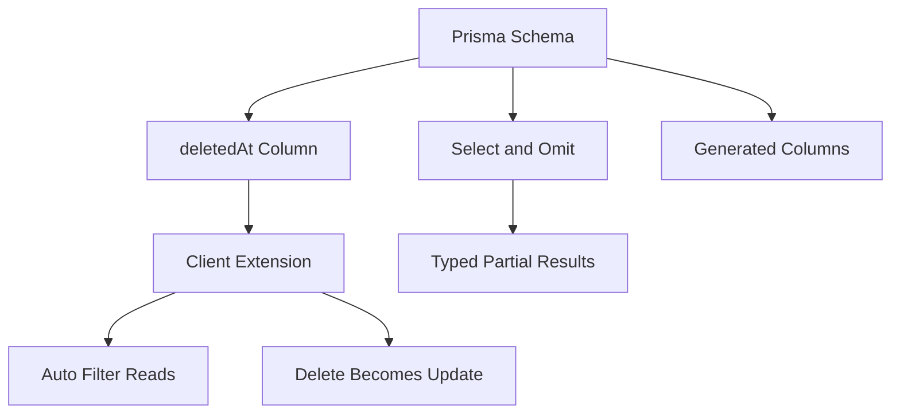

# Soft Deletes, Partial Selects and Other Schema-Level Patterns

## English

Some of the most useful things you can do with Prisma happen entirely in the schema, before any query is written. A classic example is the soft delete: instead of physically removing a row, you add a `deletedAt DateTime?` column and treat non-null as deleted. The schema gives you the storage, but the discipline of filtering `deletedAt: null` everywhere is yours. Prisma does not have built-in soft deletes in the core client, but the extensions mechanism lets you wrap the client so that `findMany`, `findFirst` and similar reads automatically add the filter, and `delete` becomes an `update` setting `deletedAt`. This keeps call sites clean while the behaviour lives in one place — a good example of using the schema as the foundation and extensions as the policy layer on top.

Partial selects are another pattern worth internalising. By default, `findMany` returns every scalar field, which can be wasteful if a table has large text or JSON columns. Prisma lets you pass `select` to fetch only what you need, or `omit` (in recent versions) to fetch everything except specified fields. The generated types then reflect exactly what comes back, so a typo in a `select` key is a compile error and accessing a field you did not select is also a compile error. This is a meaningful safety improvement over building column lists as strings, and it nudges you toward fetching narrowly at the boundary (an API handler) while still allowing rich includes when you genuinely need nested data.

Computed and derived values are a third pattern. Prisma's schema does not support arbitrary computed columns in the client, but you can model them in a few ways. Database-generated (computed) columns are not supported by Prisma's schema, so you would have to expose them as unmanaged or `Unsupported` columns and read them with raw queries. Alternatively, you can compute values in application code after fetching, or expose them through a client extension that adds a method like `fullName()` derived from `firstName` and `lastName`. The trade-off is between pushing logic into the database (consistent everywhere, but harder to change and tied to database features) and keeping it in the application (flexible, testable, but must be applied consistently).

Enums and constrained strings are a fourth. Declaring a field as an enum in the schema gives you a TypeScript union type in the client and, on databases that support them, a real enum column that rejects invalid values at the storage layer. This is a small but powerful way to make illegal states unrepresentable: a `status` field that can only be `PENDING`, `ACTIVE` or `ARCHIVED` cannot accidentally hold `'active'` in lowercase. Where the database lacks native enums, Prisma can map to a string column with a check constraint or similar, but the client-side type safety is the same.

A fifth pattern is the use of composite unique constraints and indexes declared in the schema. A `@@unique([userId, postId])` on a join table prevents duplicate likes at the database level, not just in application logic, and gives you a stable error code (P2002) to handle. A `@@index` on a frequently filtered column is a one-line performance fix. These are the kinds of decisions that are easy to make in the schema and painful to retrofit later, which is exactly why treating the schema as the design surface — not just a description of tables — pays off.

## 中文

用 Prisma 能做的一些最有用的事情，完全發生在 schema 裡，而且是在寫任何查詢之前。經典例子是軟刪除：你不是實際移除一列，而是加一個 `deletedAt DateTime?` 欄位，並把非空值視為已刪除。schema 給你儲存空間，但到處都記得過濾 `deletedAt: null` 的紀律則靠你自己。Prisma 的核心用戶端沒有內建軟刪除，但擴充機制讓你包裝用戶端，使 `findMany`、`findFirst` 之類的讀取自動加上過濾條件，並讓 `delete` 變成設定 `deletedAt` 的 `update`。這讓呼叫端保持乾淨，而行為只存在於一處——這是把 schema 當基礎、把擴充當其上策略層的好例子。

部分選取是另一個值得內化的模式。預設情況下，`findMany` 會回傳每一個純量欄位，如果資料表有大型文字或 JSON 欄位，這可能很浪費。Prisma 讓你傳入 `select` 只取需要的東西，或（在較新版本中）用 `omit` 取除了指定欄位之外的所有東西。產生的型別接著會精確反映回傳的內容，所以 `select` 鍵打錯是編譯錯誤，存取你沒選取的欄位也是編譯錯誤。相較於把欄位清單當字串拼，這是實質的安全提升，也促使你在邊界（API 處理函式）窄取，同時在你確實需要巢狀資料時仍允許豐富的 include。

計算與衍生值是第三個模式。Prisma 的 schema 不支援用戶端中任意的計算欄位，但你可以用幾種方式建模。資料庫層級的生成欄位（computed column）並不為 Prisma 的 schema 所支援，你只能把它們當作 unmanaged 或 `Unsupported` 欄位處理，並用 raw query 讀取。或者，你可以在取得資料後於應用程式碼中計算，或透過用戶端擴充暴露一個由 `firstName` 與 `lastName` 衍生的 `fullName()` 方法。取捨在於把邏輯推入資料庫（到處一致，但較難更改且綁定資料庫特性）與留在應用程式（有彈性、可測試，但必須一致地套用）之間。

列舉與受約束的字串是第四個。在 schema 中把欄位宣告為列舉，會在用戶端給你一個 TypeScript 聯合型別，並在支援它們的資料庫上給你一個真正的列舉欄位，在儲存層就拒絕無效值。這是讓非法狀態無法表示的一個小而強大的方法：一個只能是 `PENDING`、`ACTIVE` 或 `ARCHIVED` 的 `status` 欄位，不可能意外地存著小寫的 `'active'`。在資料庫缺乏原生列舉的地方，Prisma 可以映射到帶有檢查約束之類的字串欄位，但用戶端型別安全是一樣的。

第五個模式是在 schema 中宣告的複合唯一約束與索引。在連接表上使用 `@@unique([userId, postId])` 能在資料庫層級防止重複按讚，而不只是在應用邏輯中，並給你一個穩定的錯誤碼（P2002）來處理。在經常過濾的欄位上使用 `@@index` 是一行的效能修正。這些都是在 schema 中容易做、日後補救卻很痛苦的決策，這正是為什麼把 schema 當作設計介面——而不只是資料表的描述——是值得的。

## Key Takeaway

Many high-value patterns — soft deletes, partial selects, enums, composite uniques — are best expressed in the schema itself, where the database enforces them.

## Related Concepts
- Soft delete pattern
- Database indexes and unique constraints

## Diagram

