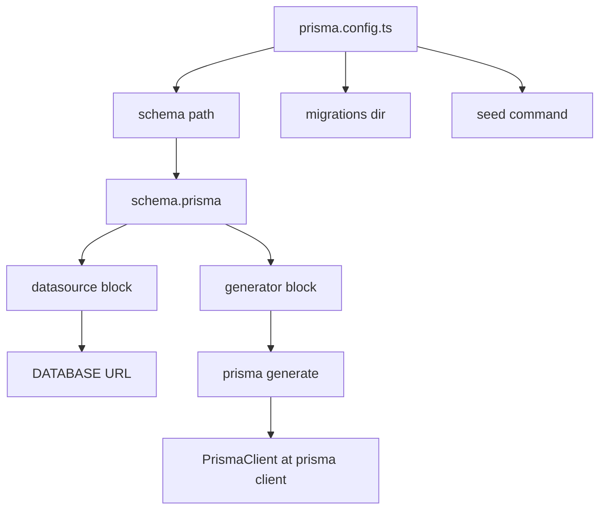

# The Prisma Config File and the Import Paths That Keep Your Project Sane

## English

A Prisma project is not just a schema file. There is a small configuration layer that tells the Prisma CLI where your schema lives, which database URL to use, and how the generated client should be produced. In older versions this lived in the schema's `datasource` and `generator` blocks plus an `.env` file. Newer versions introduced a dedicated config file, typically `prisma.config.ts` at the project root, which can centralise things like the schema path, migration directory, and seed command in TypeScript rather than scattering them across `.env` and `package.json` scripts. The important mental model is that the CLI needs to know three things: where the schema is, where the migrations folder is, and how to reach the database.

The second half of that story is the generator block. Inside your schema you write something like `generator client { provider = "prisma-client-js" }`, and running `prisma generate` reads the schema and emits a TypeScript client into `node_modules/.prisma/client` by default, with the public entry point re-exported through `@prisma/client`. That is why your imports look like `import { PrismaClient } from '@prisma/client'` even though the real generated code lives elsewhere. Newer generator options let you choose a custom output directory and a different module format, which matters when you are bundling for edge runtimes or using ESM.

Why does this matter to an undergraduate building a first real app? Because most confusing Prisma errors are configuration errors in disguise. If `prisma generate` has not run since you last edited the schema, your TypeScript types will be stale and you will get red squiggles for a field that clearly exists. If `DATABASE_URL` is missing or malformed, the CLI and the client will both fail at connect time. If you point the CLI at the wrong schema path, `prisma migrate dev` will happily create an empty migration because it thinks your schema has no models.

A useful habit is to treat the generated client as a build artifact, not source code. Add it to `.gitignore` if you use a custom output directory, run `prisma generate` as part of your `postinstall` or build script, and never edit files inside the generated folder by hand — they will be overwritten. In CI, the sequence is usually: install dependencies, run `prisma generate`, run migrations against a test database, then run your tests. Getting that order wrong is the single most common cause of "it works on my machine" for Prisma projects.

Finally, keep secrets out of the schema. The `datasource` block references an environment variable, not a literal connection string. In development, a `.env` file is convenient; in production, your platform injects the variable. The config file is the seam where you can swap between those worlds without touching the schema itself, which is exactly the kind of separation of concerns that makes a codebase survive its second year.

## 中文

一個 Prisma 專案不只是 schema 檔那麼簡單。它還有一層小型設定層，負責告訴 Prisma CLI 你的 schema 放在哪裡、要連哪個資料庫 URL，以及產生的 client 應該怎麼生成。在較舊的版本裡，這些東西分散在 schema 的 `datasource` 與 `generator` 區塊，再加上一個 `.env` 檔。較新的版本引入了專門的設定檔，通常叫 `prisma.config.ts`，放在專案根目錄，可以把 schema 路徑、migration 目錄、seed 指令這類東西集中在 TypeScript 裡，而不是散落在 `.env` 和 `package.json` 的 scripts 中。最重要的心智模型是：CLI 需要知道三件事——schema 在哪、migrations 資料夾在哪、怎麼連到資料庫。

故事的另一半是 generator 區塊。你在 schema 裡寫類似 `generator client { provider = "prisma-client-js" }` 的東西，執行 `prisma generate` 時，Prisma 會讀取 schema，並預設把 TypeScript client 產生到 `node_modules/.prisma/client`，再透過 `@prisma/client` 這個公開入口重新匯出。這就是為什麼你的 import 寫的是 `import { PrismaClient } from '@prisma/client'`，即使真正生成的程式碼住在別的地方。較新的 generator 選項讓你自訂輸出目錄與模組格式，這在你要打包給 edge runtime 或使用 ESM 時很重要。

為什麼這對一個正在寫第一個真實應用的本科生很重要？因為大多數令人困惑的 Prisma 錯誤，本質上都是設定錯誤。如果你改完 schema 後沒有重新執行 `prisma generate`，你的 TypeScript 型別就會是舊的，你會看到明明存在的欄位卻被紅色波浪線標記。如果 `DATABASE_URL` 缺失或格式錯誤，CLI 和 client 都會在連線時失敗。如果你把 CLI 指向錯誤的 schema 路徑，`prisma migrate dev` 會很開心地建立一個空的 migration，因為它以為你的 schema 裡沒有任何 model。

一個有用的習慣是把生成的 client 當成建置產物，而不是原始碼。如果你使用自訂輸出目錄，就把它加進 `.gitignore`；把 `prisma generate` 放進 `postinstall` 或 build script 裡執行；永遠不要手動編輯生成資料夾裡的檔案——它們會被覆蓋。在 CI 裡，順序通常是：安裝依賴、執行 `prisma generate`、對測試資料庫跑 migrations、然後跑測試。把這個順序搞錯，是 Prisma 專案「在我機器上可以跑」最常見的原因。

最後，把機密資料留在 schema 之外。`datasource` 區塊引用的是環境變數，不是寫死的連線字串。開發時 `.env` 檔很方便；在生產環境，則由你的平台注入變數。設定檔就是你可以切換這兩種世界的接縫，完全不用動到 schema 本身——這正是讓一個程式庫能活過第二年的那種關注點分離。

## Key Takeaway

The Prisma config and generator layer is the invisible plumbing that decides where your schema, migrations and generated client live, and most mysterious Prisma errors trace back to it.

## Related Concepts
- The Prisma Client Generation Step and the Generated Types
- Prisma Migrate — Version-Controlled Database Schema

## Diagram

