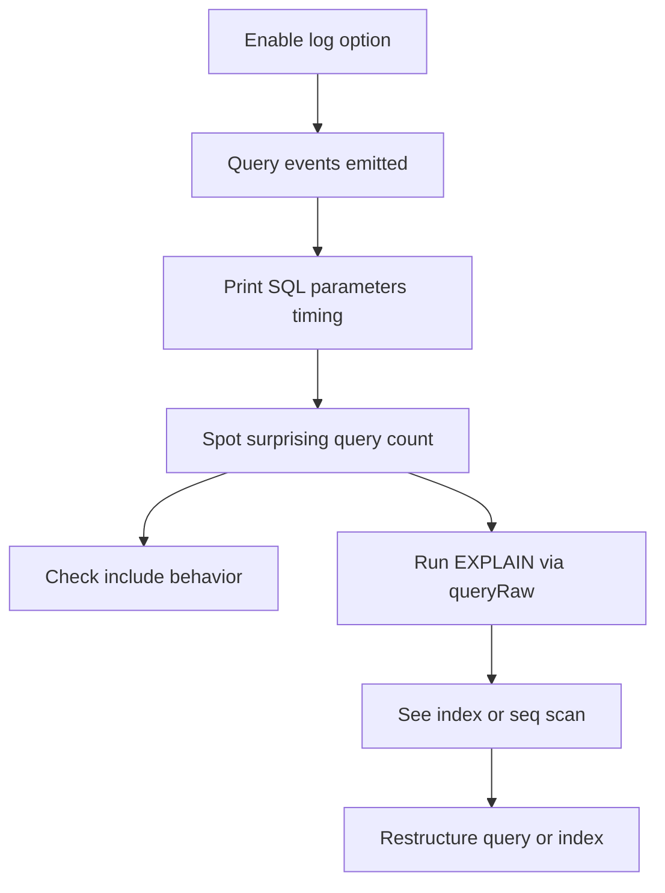

# Reading Prisma's Query Logs and Plan Output to Find Slow Queries

## English

Prisma is happy to stay quiet, but it can also tell you exactly what it is doing. The client accepts a `log` option at construction time, and you can ask for events like `query`, `info`, `warn` and `error`. With `query` logging on, every method call the client makes prints the SQL it actually sent, along with parameters and timing. This is the single most useful debugging tool when you suspect the ORM is generating something surprising — for example, a `findMany` with an `include` that turns into several separate queries instead of one join.

A concrete example: you write `prisma.user.findMany({ include: { posts: true } })` and expect one query. Depending on the relation type and the version, Prisma may issue one query for users and a second query for all their posts, then stitch the results together in memory. That is not a bug — it is often the right strategy — but it means the number of round trips grows with the number of parent rows in some shapes. Turning on query logging makes this visible in your terminal or your log aggregator, and you can then decide whether to restructure the query, paginate, or accept the cost.

Beyond logging, Prisma exposes a way to ask the database for its own query plan. On PostgreSQL and MySQL you can call `prisma.$queryRaw` with an `EXPLAIN` statement, and on PostgreSQL specifically `EXPLAIN ANALYZE` runs the query and reports actual timings. This is how you find out whether an index is being used, whether a sequential scan is happening on a large table, or whether a join is spilling to disk. Prisma does not hide the database from you; it just gives you a pleasant default path and expects you to drop down when performance matters.

A practical workflow for a student project: enable query logging in development only (it is noisy and can leak parameter values into logs), reproduce the slow page, copy the emitted SQL, and run it through `EXPLAIN ANALYZE` in `psql`. If the plan shows a sequential scan on a column you filter by often, add an index in your schema with `@@index` and generate a migration. Then re-run the plan and compare. This loop — observe, explain, index, verify — is the core of practical database performance work, and Prisma gives you all the hooks you need without forcing you to abandon the ORM.

One caution: query logs can contain personal data because parameters are included. In production, prefer structured logging with redaction, or log only slow queries via a threshold. Treat the log stream as sensitive, not as free debugging output.

## 中文

Prisma 平常很安靜，但它也可以清楚告訴你它到底在做什麼。Client 在建構時接受一個 `log` 選項，你可以要求 `query`、`info`、`warn`、`error` 這些事件。開啟 `query` 記錄後，client 每一次方法呼叫都會印出它實際送出的 SQL，連同參數與耗時。當你懷疑 ORM 生成了奇怪的東西時——例如一個帶 `include` 的 `findMany` 變成了好幾個獨立查詢而不是一個 join——這是最有用的除錯工具。

舉個具體例子：你寫 `prisma.user.findMany({ include: { posts: true } })`，期待只有一個查詢。但依關聯型別與版本不同，Prisma 可能先對 users 發一個查詢，再對所有 posts 發第二個查詢，然後在記憶體裡把結果拼起來。這不是 bug——它往往就是正確策略——但它意味著在某些形狀下，來回次數會隨著父資料列數量成長。打開查詢記錄能讓你在終端機或日誌聚合器裡看到這件事，然後你就能決定要重構查詢、分頁，還是接受這個成本。

除了記錄，Prisma 也讓你能向資料庫要它自己的查詢計畫。在 PostgreSQL 與 MySQL 上，你可以用 `prisma.$queryRaw` 執行 `EXPLAIN` 語句；在 PostgreSQL 上尤其可以用 `EXPLAIN ANALYZE`，它會實際執行查詢並回報真實耗時。這正是你查明索引有沒有被用到、大表上有沒有發生循序掃描、或某個 join 有沒有溢出到磁碟的方法。Prisma 並沒有把資料庫藏起來；它只是給你一條舒服的預設路徑，並期待你在效能重要時往下鑽。

給學生專案的實務流程：只在開發環境開啟查詢記錄（它很吵，而且可能把參數值洩漏到日誌裡），重現慢的那個頁面，複製印出的 SQL，然後在 `psql` 裡用 `EXPLAIN ANALYZE` 跑一遍。如果計畫顯示你常拿來過濾的欄位發生了循序掃描，就在 schema 裡用 `@@index` 加索引，並產生一個 migration。再跑一次計畫做比較。這個循環——觀察、解釋、加索引、驗證——就是實務資料庫效能工作的核心，而 Prisma 提供了所有需要的掛鉤，不必逼你放棄 ORM。

一個警告：查詢日誌可能包含個人資料，因為參數會被記錄。在生產環境，偏好使用有遮蔽的結構化日誌，或只透過門檻記錄慢查詢。把日誌流當成敏感資料，而不是免費的除錯輸出。

## Key Takeaway

Turning on Prisma's query logging and pairing it with EXPLAIN ANALYZE turns the ORM from a black box into an observable system you can actually tune.

## Related Concepts
- Query Performance: The N+1 Problem, Join Strategies and Bulk Writes
- The Query Engine Under the Hood: How Prisma Turns Method Calls into SQL

## Diagram

