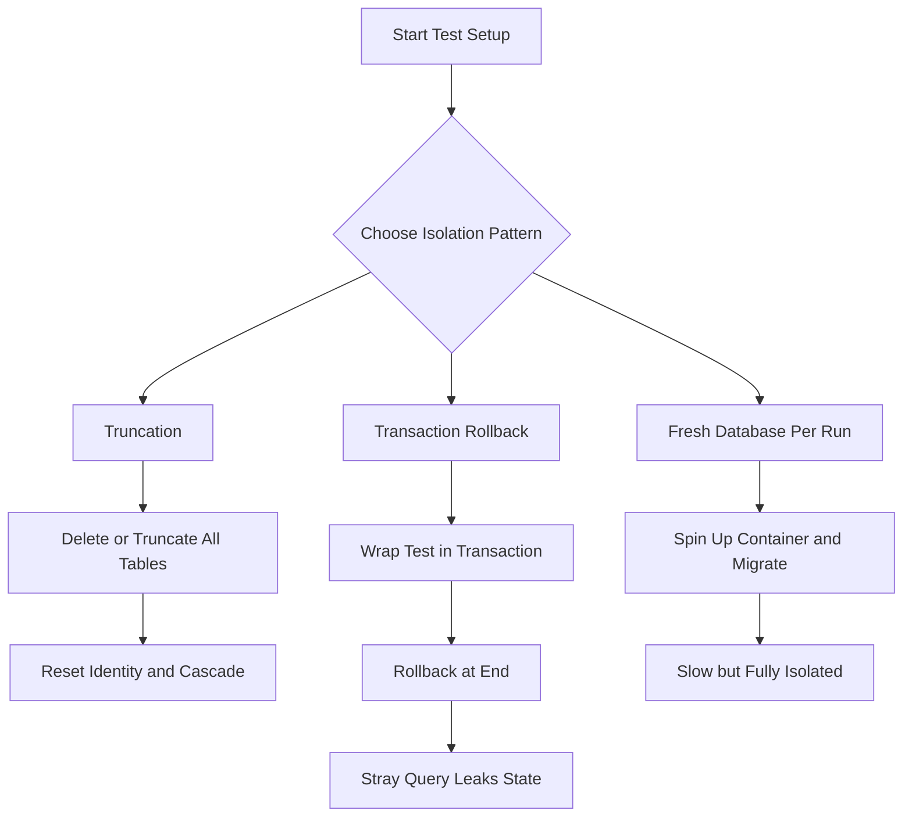

# Testing Against a Real Database: Test Isolation and Cleanup Patterns

## English

When you write tests that touch Prisma, you face a choice that shapes your whole test suite: mock the client, or use a real database. Mocking is tempting because it is fast, but it quickly becomes a lie — you end up testing your mock, not your schema, your constraints, or your SQL. The honest approach is to run tests against a real database, ideally a throwaway one, and the interesting engineering is all about isolation: making sure each test starts from a known state and cannot see another test's leftovers.

The simplest pattern is truncation. Before each test (or each suite), run a `DELETE` or `TRUNCATE` on every table, respecting foreign keys. Prisma can help here: `prisma.$executeRawUnsafe('TRUNCATE TABLE "User", "Post" RESTART IDENTITY CASCADE')` is a common one-liner in a `beforeEach`. `RESTART IDENTITY` resets auto-increment counters so your IDs are predictable, and `CASCADE` handles foreign key dependencies. The downside is that it is PostgreSQL-specific syntax, and it does not help if you want tests to run in parallel against the same database.

A more scalable pattern is the transaction rollback. Each test runs inside a transaction that is rolled back at the end, so nothing is ever committed. Prisma's interactive transactions (`prisma.$transaction(async (tx) => { ... })`) make this expressible, but the catch is that every query in the test must go through `tx`, not the outer `prisma` client, or it will run outside the transaction and leak. This is a real footgun: one stray `prisma.user.create()` and your isolation is gone. Some teams wrap the client in a proxy that forwards every call to `tx` for exactly this reason.

A third pattern is a fresh database per test run. You spin up a container (Docker, Testcontainers, or a local Postgres), run `prisma migrate deploy` against it, run the suite, then tear it down. This is slower per run but perfectly isolated and closest to production. It also lets you test migrations themselves, which is valuable: a migration that works on your dev database may fail on an empty one if it references data that does not exist.

Whichever pattern you choose, keep two rules. First, tests must never point at your development database — a misconfigured `DATABASE_URL` in a test run is how people lose their seed data. Second, the test database should be created by the same migrations that create production, not by `prisma db push`, so that schema drift between test and prod is impossible. The setup cost is real, but the payoff is a suite you can trust when you refactor.

## 中文

當你寫會碰到 Prisma 的測試時，你會面臨一個決定整個測試套件樣貌的選擇：mock 掉 client，還是用真的資料庫。Mock 很誘人，因為它很快，但它很快就會變成一個謊言——你最後測的是你的 mock，而不是你的 schema、你的約束、你的 SQL。誠實的做法是對真的資料庫跑測試，最好是拋棄式的，而有趣的工程全在隔離：確保每個測試都從已知狀態開始，看不到別的測試留下的東西。

最簡單的模式是清空資料表。在每個測試（或每個 suite）之前，對每張表執行 `DELETE` 或 `TRUNCATE`，並處理好外鍵。Prisma 在這裡幫得上忙：`prisma.$executeRawUnsafe('TRUNCATE TABLE "User", "Post" RESTART IDENTITY CASCADE')` 是 `beforeEach` 裡常見的一行。`RESTART IDENTITY` 會重設自動遞增計數器，讓你的 ID 可預測；`CASCADE` 則處理外鍵依賴。缺點是這是 PostgreSQL 專屬語法，而且如果你想讓測試對同一個資料庫平行執行，它幫不上忙。

更具擴展性的模式是交易回滾。每個測試都在一個交易裡執行，結束時回滾，所以什麼都不會被提交。Prisma 的互動式交易（`prisma.$transaction(async (tx) => { ... })`）讓這件事可以表達，但陷阱是測試裡的每個查詢都必須走 `tx`，而不是外層的 `prisma` client，否則它會在交易之外執行並洩漏出去。這是個真實的陷阱：一個不小心的 `prisma.user.create()`，你的隔離就沒了。有些團隊會把 client 包進一個 proxy，把每個呼叫都轉給 `tx`，正是為了這個原因。

第三種模式是每次測試執行都用全新的資料庫。你啟動一個容器（Docker、Testcontainers 或本機 Postgres），對它執行 `prisma migrate deploy`，跑測試套件，然後拆掉。這每次執行都比較慢，但隔離完美，也最接近生產環境。它還讓你連 migration 本身都能測，這很有價值：一個在你的開發資料庫上可行的 migration，在空資料庫上可能失敗，因為它引用了不存在的資料。

不管你選哪種模式，記住兩條規則。第一，測試永遠不能指向你的開發資料庫——測試執行時一個設定錯誤的 `DATABASE_URL`，就是人們弄丟 seed 資料的方式。第二，測試資料庫應該由建立生產環境的同一批 migrations 建立，而不是用 `prisma db push`，這樣測試與生產之間的 schema 漂移就不可能發生。設定成本是真的，但回報是你在重構時可以信任的測試套件。

## Key Takeaway

Real-database tests are only trustworthy if each test is isolated, and the three standard patterns — truncation, transaction rollback, fresh container — each trade speed for isolation differently.

## Related Concepts
- Seeding and Test Data: Realistic Fixtures Without Hand-Written SQL
- Migrations, Drift and the dev / deploy Workflow

## Diagram

