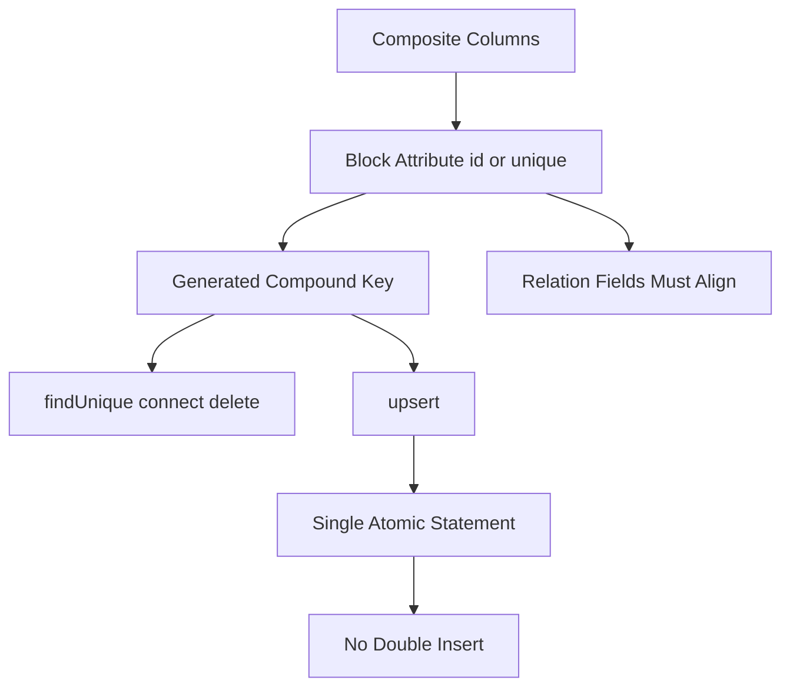

# Composite Keys, Unique Constraints and Upserts: Modelling Identity in Prisma

## English

Relational databases rarely have a single neat primary key on every table. Join tables, tenancy tables and versioned records often identify rows by a combination of columns, and Prisma models this with the `@@id` and `@@unique` block attributes. `@@id([userId, roleId])` declares a composite primary key, while `@@unique([email, tenantId])` says the pair must be unique even though neither column alone is. These block-level attributes matter because they change what Prisma Client can do for you: a compound unique constraint automatically generates a named input object like `email_tenantId` that you can pass to `findUnique`, `connect`, `delete` and — crucially — `upsert`. Without the constraint, `upsert` has no way to decide which row is 'the same row' and you fall back to a `findFirst` followed by a create-or-update race.

A concrete example makes the payoff obvious. Suppose a membership table links users to organisations and stores a role. If you declare `@@id([userId, orgId])`, then `prisma.membership.upsert({ where: { userId_orgId: { userId, orgId } }, update: { role }, create: { userId, orgId, role } })` is a single atomic statement at the database level: the database either inserts or updates, and concurrent callers cannot both insert — provided Prisma's database-upsert criteria are met (the connector is CockroachDB, PostgreSQL or SQLite, there are no nested reads or writes, and `where` matches a single unique field that also appears in `create`). When those conditions are not met, Prisma Client performs the upsert itself as a read followed by a create or update, and concurrent callers can still collide on the unique constraint (error P2002). That is far safer than 'read, check, branch, write', which can double-insert under load. The generated compound key field name is derived from the column names joined by an underscore, unless you give the attribute a name argument such as `@@unique([email, tenantId], name: "emailPerTenant")`.

Composite keys also affect relations. When a child model references a parent with a composite primary key, the foreign key side must repeat all the fields, and Prisma's `@relation(fields: [...], references: [...])` lists must line up in order. This trips people up because a relation to a composite-key parent needs every key column present in the child, which sometimes means denormalising a tenant id into every table in a multi-tenant design. That is not a Prisma quirk — it is how SQL foreign keys work — but Prisma surfaces it in the schema rather than at query time, which is a feature: you find out when you run a migration, not in production.

One more subtlety: a model can have both a surrogate `@id` and additional `@@unique` constraints, and each unique constraint produces its own compound selector. That means the same row can be addressed by `{ id }`, by `{ email }`, or by `{ email_tenantId }`, and Prisma will type-check each one separately. Use the surrogate id for internal references (stable, opaque, cheap to index) and the natural unique key for user-facing lookups and idempotent writes. Mixing the two deliberately is one of the cleanest ways to keep an API idempotent without hand-rolled SQL.

## 中文

關聯式資料庫很少每張表都有一個乾淨的單一主鍵。連接表、租戶表、版本化紀錄往往用幾個欄位的組合來識別一行，而 Prisma 用 `@@id` 和 `@@unique` 這兩個區塊層級屬性來表達這件事。`@@id([userId, roleId])` 宣告複合主鍵，`@@unique([email, tenantId])` 則表示這一對欄位必須唯一，即使單獨看每個欄位都不唯一。這些區塊屬性之所以重要，是因為它們改變了 Prisma Client 能替你做的事：一個複合唯一約束會自動生成一個具名輸入物件，例如 `email_tenantId`，你可以把它傳給 `findUnique`、`connect`、`delete`，以及最關鍵的 `upsert`。沒有這個約束，`upsert` 根本無法判斷哪一行算「同一行」，你只能退回 `findFirst` 再判斷要建立還是更新，而在高併發下這會產生競爭條件。

舉個具體例子，回報就一目了然。假設有一張 membership 表把使用者連到組織，並儲存角色。如果你宣告 `@@id([userId, orgId])`，那麼 `prisma.membership.upsert({ where: { userId_orgId: { userId, orgId } }, update: { role }, create: { userId, orgId, role } })` 在資料庫層面就是單一原子語句：資料庫要麼插入、要麼更新，同時呼叫的兩方不可能都插入成功——前提是符合 Prisma 的資料庫 upsert 條件（連接器為 CockroachDB、PostgreSQL 或 SQLite；沒有巢狀讀寫；`where` 對應到一個也出現在 `create` 的唯一欄位）。若不符合這些條件，Prisma Client 會自行以「先讀、再建立或更新」的方式執行 upsert，並行呼叫者仍可能在唯一約束上撞車（錯誤碼 P2002）。這比「先讀、再檢查、再分支、再寫入」安全得多，因為後者在負載高時可能重複插入。生成的複合鍵欄位名稱，預設是把各欄位名稱用底線連接；你也可以在屬性加名稱參數，例如 `@@unique([email, tenantId], name: "emailPerTenant")`。

複合鍵也會影響關聯。當子模型引用一個有複合主鍵的父模型時，外鍵那一邊必須重複列出所有欄位，而 Prisma 的 `@relation(fields: [...], references: [...])` 兩份清單必須順序一致。這一點常令人絆倒，因為連到複合主鍵父表的關聯需要子表擁有每一個鍵欄位，有時這意味著在多租戶設計中要把 tenant id 反正規化到每一張表。這不是 Prisma 的怪癖，而是 SQL 外鍵本來的運作方式；但 Prisma 把這件事呈現在 schema 裡，而不是等到查詢時才爆，這其實是優點：你在跑遷移時就會發現，而不是在生產環境才發現。

還有一個微妙之處：一個模型可以同時擁有代理 `@id` 和額外的 `@@unique` 約束，而每個唯一約束都會產生自己的複合選擇器。也就是說同一行可以用 `{ id }`、用 `{ email }`、或用 `{ email_tenantId }` 來定位，而 Prisma 會分別對每個做型別檢查。內部引用用代理 id（穩定、不透明、索引便宜），面向使用者的查詢與冪等寫入用自然唯一鍵。刻意混用這兩者，是讓 API 保持冪等而不必手寫 SQL 最乾淨的做法之一。

## Key Takeaway

Composite primary keys and compound unique constraints are what make upsert atomic and idempotent, so model identity deliberately rather than bolting on a surrogate id everywhere.

## Related Concepts
- Compound unique selectors
- Idempotent writes

## Diagram

