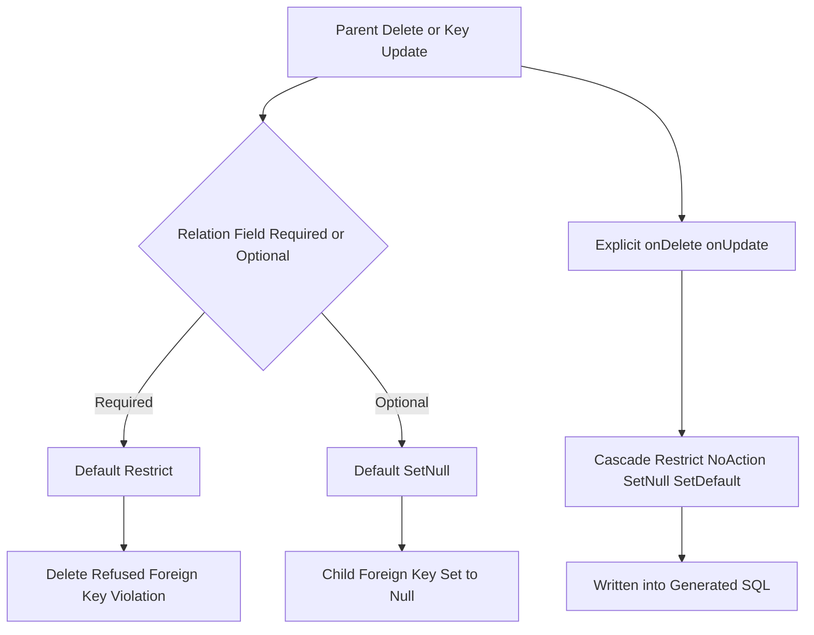

# Referential Actions: What Happens to Children When a Parent Dies

## English

Every relation in a Prisma schema implies a question the schema author must answer: when the parent row is deleted or its key changes, what should happen to the child rows? Prisma exposes this through the `onDelete` and `onUpdate` arguments on `@relation`, with values like `Cascade`, `Restrict`, `NoAction`, `SetNull` and `SetDefault`. These map onto the foreign key actions your database already supports, and Prisma's migrate engine writes them into the generated SQL. The default for a required relation is `Restrict` (the delete is refused), and for an optional relation it is `SetNull` — a default that surprises many people the first time deleting a user silently nulls out their posts instead of failing.

Why does this matter so much? Because referential actions are the difference between a cascading cleanup that works and a delete that either fails loudly or, worse, silently orphans data. Consider a blog with `User` and `Post`. If `Post.author` is required and you leave the default, deleting a user throws a foreign key violation, which is usually what you want — you do not want to lose posts by accident. If you set `onDelete: Cascade`, deleting the user deletes all their posts in one statement, which is correct for genuinely owned data (a comment on a deleted post, an order line on a deleted order) but dangerous for anything with independent value. `SetNull` only works when the relation field is optional, because a required column cannot hold null; Prisma will reject the schema if you try.

There is an important distinction between `Restrict` and `NoAction`. In PostgreSQL they behave similarly in practice, but `Restrict` is checked immediately while `NoAction` defers to the end of the statement or transaction depending on the constraint's deferrability. In MySQL, `Restrict` and `NoAction` are effectively identical. If you are relying on deferred checks, be explicit and verify against your actual database rather than assuming Prisma's naming implies a particular timing. With the default `foreignKeys` relation mode on relational databases, the database ultimately enforces these actions. The exception is `relationMode = "prisma"` (and MongoDB), where Prisma Client emulates referential integrity itself, so the actions run in the client rather than in the database.

A practical pattern is to make destructive cascades explicit and rare. Reserve `Cascade` for true composition: the child cannot exist without the parent, and the parent's deletion genuinely means the child's deletion. Use `Restrict` for everything else, forcing application code to decide. For soft-delete designs, cascade is irrelevant because rows are never physically removed — but then you must remember that a soft-deleted parent still satisfies foreign keys, so 'deleting' a user does not hide their posts unless your queries filter on the parent's deleted flag too.

Finally, `onUpdate` is easy to forget. If a primary key can change (rare, but possible with natural keys like a slug), the default `Cascade` propagates the new key to children. If you use immutable surrogate ids, this never fires and you can stop worrying about it. The general lesson: referential actions are a design decision about ownership and lifecycle, not a checkbox, and they belong in the schema where reviewers can see them.

## 中文

Prisma schema 裡每一個關聯都隱含一個 schema 作者必須回答的問題：當父行被刪除、或它的鍵改變時，子行應該怎樣？Prisma 透過 `@relation` 上的 `onDelete` 與 `onUpdate` 參數把這件事表達出來，可用的值有 `Cascade`、`Restrict`、`NoAction`、`SetNull` 和 `SetDefault`。這些會對應到你資料庫本來就支援的外鍵動作，Prisma 的遷移引擎會把它們寫進生成的 SQL。必要關聯的預設值是 `Restrict`（拒絕刪除），可選關聯的預設值則是 `SetNull`——這個預設常令人第一次踩雷：刪除一個使用者時，他的文章不是報錯，而是悄悄被設成 null。

為什麼這件事如此重要？因為參照動作正是「 cascade 清理能正常運作」與「刪除要麼大聲失敗、要麼更糟地默默留下孤兒資料」之間的分界線。設想一個有 `User` 和 `Post` 的部落格。如果 `Post.author` 是必要的而你保留預設，刪除使用者會擲出外鍵違規，這通常正是你要的——你不想不小心丟掉文章。如果你設 `onDelete: Cascade`，刪除使用者會用單一語句刪掉他所有文章，這對真正被擁有的資料（已刪文章上的留言、已刪訂單上的訂單行）是對的，但對任何有獨立價值的東西都很危險。`SetNull` 只有在關聯欄位是可選時才成立，因為必要欄位不能存 null；你若硬寫，Prisma 會拒絕這個 schema。

`Restrict` 與 `NoAction` 之間有一個重要區別。在 PostgreSQL 裡兩者實務上行為相近，但 `Restrict` 是立即檢查，而 `NoAction` 則視約束的可延遲性，延到語句或交易結束時才檢查。在 MySQL 裡，`Restrict` 與 `NoAction` 實際上完全相同。如果你依賴延遲檢查，請明確指定並對你真正使用的資料庫驗證，而不是假設 Prisma 的命名暗示了某種時機。在關聯式資料庫採用預設的 `foreignKeys` 關聯模式時，這些動作最終由資料庫執行。例外是 `relationMode = "prisma"`（以及 MongoDB），此時 Prisma Client 會自行模擬關聯完整性，動作是在 client 端而非資料庫端執行。

一個實用原則是：讓破壞性的 cascade 明確且罕見。只對真正的組合關係保留 `Cascade`：子項不能脫離父項存在，父項的刪除確實意味著子項的刪除。其餘一律用 `Restrict`，強迫應用程式碼自己做決定。至於軟刪除設計，cascade 根本不相關，因為行永遠不會被實際移除——但你要記得，軟刪除的父項仍然滿足外鍵，所以「刪除」一個使用者並不會藏起他的文章，除非你的查詢同時過濾父項的已刪除旗標。

最後，`onUpdate` 很容易被遺忘。如果主鍵會改變（罕見，但自然鍵如 slug 就可能），預設的 `Cascade` 會把新鍵傳播給子項。如果你用不可變的代理 id，這永遠不會觸發，你就可以不用再想它。整體的教訓是：參照動作是關於擁有權與生命週期的設計決定，不是一個勾選框，而它應該留在 schema 裡讓審查者看得見。

## Key Takeaway

onDelete and onUpdate are lifecycle decisions baked into the schema; choose Cascade only for true composition and Restrict everywhere else so deletes fail loudly instead of silently orphaning data.

## Related Concepts
- Foreign key constraints
- Soft delete patterns

## Diagram

