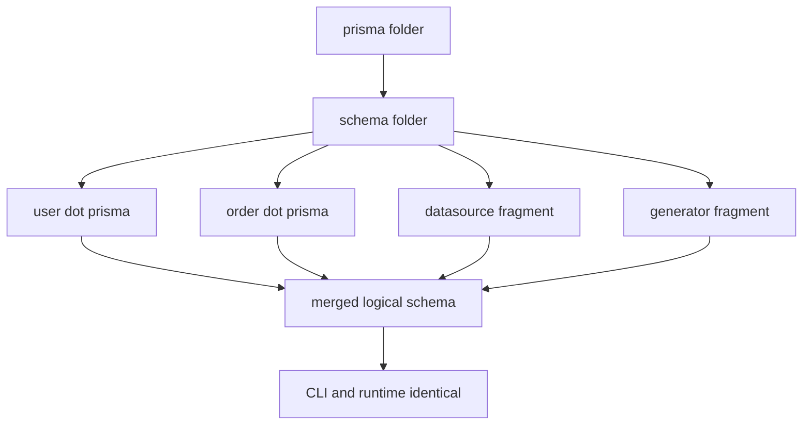

# Multi-File Schemas and the Prisma Folder: Scaling Beyond One File

## English

A single `schema.prisma` works beautifully until it does not. Around a dozen models it becomes a scrolling exercise; at fifty models with enums, generators and datasource blocks interleaved, review diffs turn into noise. Prisma supports splitting the schema across multiple files by placing them in a directory and pointing the CLI at that directory instead of a single file — conventionally a `prisma/schema` folder, with `prisma/schema.prisma` replaced by `prisma/schema/` in commands like `prisma migrate dev --schema prisma/schema` or via the `schema` key in the Prisma config file. The files are merged into one logical schema at build time, so the runtime behaviour is identical to a single file.

The rules for splitting are simple but strict. Exactly one file must declare the `datasource` block and exactly one must declare each `generator` block — you cannot have two `generator client` blocks across files. Blocks like `model`, `enum`, `type` and `view` can live anywhere in the folder and reference each other freely, because Prisma resolves names across the whole merged schema. That means a `User` model in `user.prisma` can have a relation to an `Order` model in `order.prisma` with no import statement at all. There is no module system here; the folder is just a set of fragments.

Why bother? The main benefit is reviewability and ownership. In a monorepo, teams can own their own `.prisma` fragment and the merge conflicts shrink dramatically because two people editing different models no longer touch the same file. It also makes the schema navigable: a `models/` folder with one file per aggregate mirrors how domain-driven designs are usually discussed. The cost is tooling — some editor extensions and older versions of Prisma's language server handled multi-file schemas less gracefully, and jumping to a definition may land you in a different file than you expect. Verify your editor plugin supports it before committing to the layout.

A practical layout that ages well: `prisma/schema/datasource.prisma` for the datasource, `prisma/schema/generator.prisma` for generators, and then one file per bounded context such as `identity.prisma`, `billing.prisma`, `content.prisma`. Keep enums near the models that use them rather than in a global `enums.prisma`, because a global enum file becomes a dumping ground. If you use Prisma's config file, set the schema path once there and every CLI command picks it up, which avoids repeating `--schema` on every invocation.

One caveat: formatting and validation operate on the merged result, so `prisma format` will rewrite files, and the order of models in the output may not match your file order. Treat the folder as source of truth and let the formatter do its thing; do not fight it by hand-aligning fields across files. And when you generate a migration, the SQL is produced from the merged schema, so a migration can legitimately touch models that live in three different files — the migration name is your only clue, so name it descriptively.

## 中文

單一 `schema.prisma` 在還行得通的時候非常美好。到大約十幾個模型，它就變成一場捲動練習；到五十個模型、中間還夾著 enum、generator 和 datasource 區塊時，審查的 diff 就變成噪音。Prisma 支援把 schema 拆散到多個檔案：把它們放進一個目錄，然後讓 CLI 指向那個目錄而不是單一檔案——慣例上是一個 `prisma/schema` 資料夾，於是把指令裡的 `prisma/schema.prisma` 換成 `prisma/schema/`，例如 `prisma migrate dev --schema prisma/schema`，或在 Prisma 設定檔的 `schema` 鍵指定。這些檔案在建置時會合併成一個邏輯 schema，所以執行期行為與單一檔案完全相同。

拆分的規則簡單但嚴格。必須恰好有一個檔案宣告 `datasource` 區塊，而每個 `generator` 區塊也必須恰好宣告一次——你不能在兩個檔案各放一個 `generator client`。`model`、`enum`、`type`、`view` 等區塊可以放在資料夾任何位置並自由互相引用，因為 Prisma 會在整個合併後的 schema 裡解析名稱。也就是說 `user.prisma` 裡的 `User` 模型可以關聯到 `order.prisma` 裡的 `Order` 模型，完全不需要 import 語句。這裡沒有模組系統；資料夾就只是一堆片段。

為何要費這個工？主要好處是可審查性與擁有權。在 monorepo 裡，各團隊可以擁有自己的 `.prisma` 片段，合併衝突會大幅減少，因為兩個改不同模型的人不再動同一個檔案。它也讓 schema 更好瀏覽：一個 `models/` 資料夾、每個聚合一個檔案，正好對應領域驅動設計平常討論的方式。代價是工具鏈——有些編輯器擴充和外掛、以及較舊版本的 Prisma 語言伺服器，對多檔案 schema 的處理沒那麼順暢，跳轉到定義可能落在你意料之外的另一個檔案。在你定下這個佈局之前，先確認你的編輯器外掛支援它。

一個經得起時間的實用佈局：`prisma/schema/datasource.prisma` 放 datasource，`prisma/schema/generator.prisma` 放 generator，然後每個限界上下文一個檔案，例如 `identity.prisma`、`billing.prisma`、`content.prisma`。把 enum 放在使用它的模型附近，而不是集中到一個全域 `enums.prisma`，因為全域 enum 檔最後會變成垃圾桶。如果你用 Prisma 設定檔，就在那裡設定一次 schema 路徑，所有 CLI 指令都會沿用，省得每次呼叫都重複 `--schema`。

一個注意事項：格式化與驗證是對合併後的結果運作，所以 `prisma format` 會改寫檔案，而輸出中模型的順序未必與你的檔案順序一致。把資料夾當作唯一真實來源，讓格式化工具做它的事；不要手動跨檔案對齊欄位來跟它搏鬥。還有，當你生成遷移時，SQL 是從合併後的 schema 產生，所以一個遷移可以合理地牽涉到分別住在三個檔案裡的模型——遷移名稱是你唯一的線索，所以請取個有描述性的名字。

## Key Takeaway

Splitting the Prisma schema into a folder of fragments keeps large schemas reviewable and team-owned, as long as exactly one datasource and one of each generator exist and you let the formatter own the merged output.

## Related Concepts
- Monorepo schema ownership
- Bounded contexts

## Diagram

