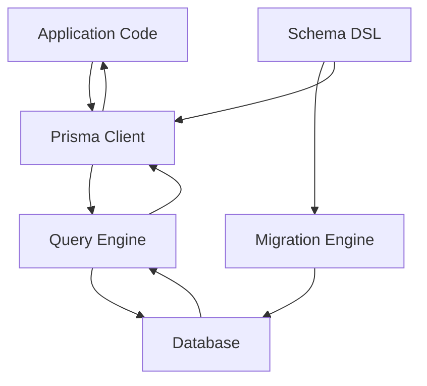

# Prisma's Ecosystem Boundary: What It Is and Is Not

## English

Prisma is often described as an ORM (Object-Relational Mapper), but it is more accurately a database toolkit split into several cooperating pieces: the schema language, the migration engine, the query client, and the underlying query engine. Understanding this boundary matters because newcomers often expect Prisma to do things it deliberately does not do. For example, Prisma does not manage your HTTP layer, your authentication, or your business logic — it only translates typed method calls into SQL and maps rows back into JavaScript objects. If you need a REST or GraphQL API, you build it yourself or reach for a separate framework; Prisma sits underneath and supplies the data access layer.

A useful analogy is a car's gearbox. Prisma is the gearbox: it takes the driver's intent (accelerate, reverse) and translates it into mechanical action. It does not decide where you drive, does not paint the car, and does not replace the engine (the database). The database itself — PostgreSQL, MySQL, SQLite, SQL Server, MongoDB, CockroachDB — remains the source of truth and does the actual storage and querying. Prisma is a client library that speaks to that engine over a driver or an internal query engine process.

This distinction has practical consequences. Because Prisma is not a web framework, you will not find route definitions or middleware for HTTP inside it. Because it is not a general-purpose query builder like Knex, you cannot easily compose arbitrary SQL fragments — Prisma prefers declarative schema definitions and typed queries, and when you need raw SQL you use tagged template literals (`$queryRaw`) or TypedSQL. Because it is not a migration-only tool like Flyway, its migration engine is tightly coupled to the schema DSL rather than accepting standalone SQL scripts as the primary authoring format.

It also helps to know what Prisma replaces. In a typical Node.js stack, Prisma sits where a hand-rolled repository layer, a query builder, or a lighter ORM would sit. It replaces boilerplate row-mapping, hand-written SQL strings, and ad-hoc migration scripts. It does not replace your DBA's judgment about indexes, your architect's decisions about sharding, or your team's conventions for naming. Those remain human responsibilities; Prisma just makes the mechanical parts consistent and type-checked.

Finally, the ecosystem includes optional commercial services and community tools, but the open-source core — schema, migrate, client — works standalone. It is worth knowing the status of the hosted pieces, because their state changes: Prisma Pulse, the managed change-data-capture service, was discontinued in early 2025 while a new iteration was built, and Prisma Accelerate, the hosted connection and query-caching layer, is being retired on 1 December 2026, with the Console no longer offering it for new setups. Neither is something to build a new architecture around. It also helps to know where the version line currently sits: Prisma ORM 8 is a release candidate and is what `prisma@latest` installs, while Prisma ORM 7 remains the supported, stable line at `prisma@prev` and keeps receiving fixes for eighteen months after version 8 reaches general availability. Knowing which parts are core, which are optional, and which major version is current prevents the common mistake of assuming you must adopt the whole platform to use any of it. You can start with the client against an existing database, add migrations later, and never touch the hosted services at all.

## 中文

Prisma 常被形容為 ORM（物件關聯對映，Object-Relational Mapper），但更準確的說法是一個資料庫工具箱，由幾個互相配合的部分組成：schema 語言、遷移引擎、查詢客戶端，以及底層的查詢引擎。理解這條界線很重要，因為新手往往期望 Prisma 去做一些它刻意不做的事情。例如，Prisma 不負責你的 HTTP 層、不處理身分驗證、也不管理業務邏輯——它只把帶型別的 method call 翻譯成 SQL，再把資料列映射回 JavaScript 物件。如果你需要 REST 或 GraphQL API，你要自己建，或者採用另一個框架；Prisma 就坐在下面，提供資料存取層。

一個好用的比喻是汽車的波箱。Prisma 就是波箱：它接收駕駛者的意圖（加速、倒車），再翻譯成機械動作。它不決定你駛去哪裡、不負責車身噴漆，也不取代引擎（資料庫）。資料庫本身——PostgreSQL、MySQL、SQLite、SQL Server、MongoDB、CockroachDB——仍然是真相來源，負責實際的儲存與查詢。Prisma 是一個客戶端程式庫，透過 driver 或內部的查詢引擎程序與那個引擎溝通。

這個區分有實際後果。因為 Prisma 不是網頁框架，你不會在裡面找到 HTTP 的路由定義或 middleware。因為它不是像 Knex 那樣的通用查詢建構器，你不能輕易拼湊任意的 SQL 片段——Prisma 偏好宣告式的 schema 定義與帶型別的查詢，而當你需要原生 SQL 時，你會用 tagged template literal（`$queryRaw`）或 TypedSQL。因為它不是像 Flyway 那樣只管遷移的工具，它的遷移引擎與 schema DSL 緊密耦合，而不是以獨立的 SQL 腳本作為主要撰寫格式。

知道 Prisma 取代了什麼也有幫助。在典型的 Node.js 技術棧中，Prisma 坐的位置就是手寫的 repository 層、查詢建構器，或較輕量的 ORM 所在之處。它取代了樣板化的資料列映射、手寫的 SQL 字串，以及臨時拼湊的遷移腳本。它不取代你的 DBA 對索引的判斷、架構師對分片（sharding）的決定，也不取代團隊的命名慣例。那些仍然是人類的責任；Prisma 只是把機械性的部分變得一致並經過型別檢查。

最後，整個生態還包括可選的商業服務與社群工具，但開源核心——schema、migrate、client——可以獨立運作。託管那部分的狀態會變，值得留意：Prisma Pulse 這個託管的變更資料擷取（CDC）服務，已於 2025 年初停用，同時在重建新版本；Prisma Accelerate 這個託管的連線層與查詢快取，則於 2026 年 12 月 1 日退場，Console 也已不再為新設定提供它。兩者都不是值得你把新架構建在其上的東西。知道目前版本線站在哪裡也有用：Prisma ORM 8 仍是 release candidate，`prisma@latest` 裝到的是它；Prisma ORM 7 則是受支援的穩定線，在 `prisma@prev`，並會在版本 8 正式上市後繼續獲得十八個月的修正。知道哪些是核心、哪些是可選、哪個主要版本是現況，就能避免一個常見誤解：以為要用其中任何一部分，就必須採用整個平台。你可以先從客戶端連接既有資料庫開始，之後才加入遷移，完全不碰託管服務也可以。

## Key Takeaway

Prisma is a database toolkit, not a web framework — it owns the data access layer and nothing above it.

## Related Concepts
- ORM responsibilities
- Database drivers

## Diagram

